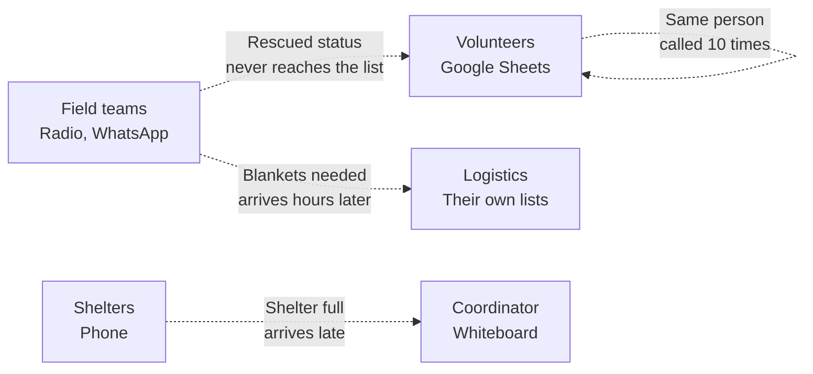
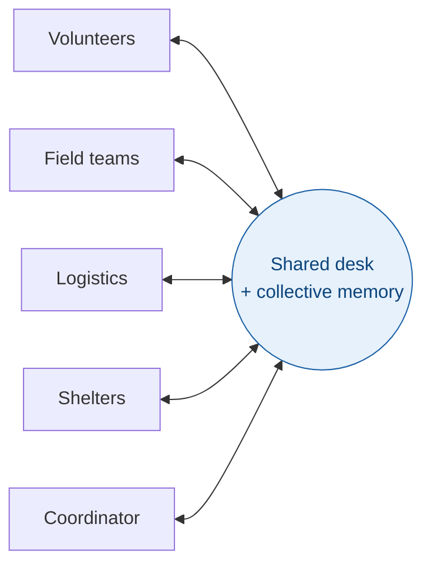
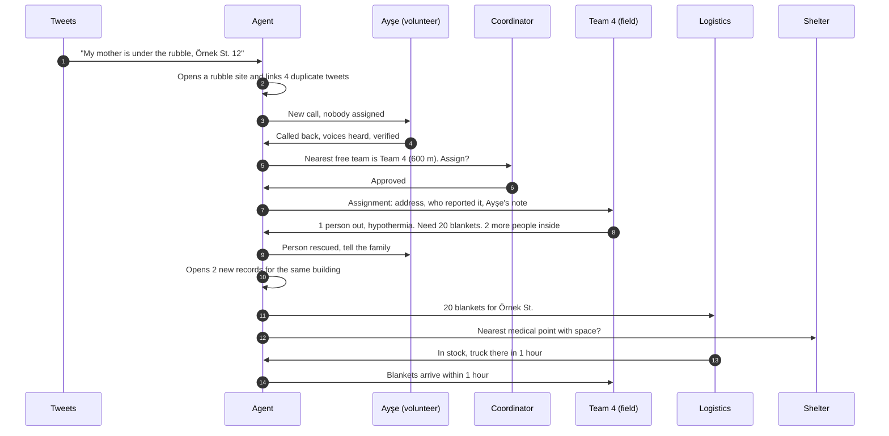
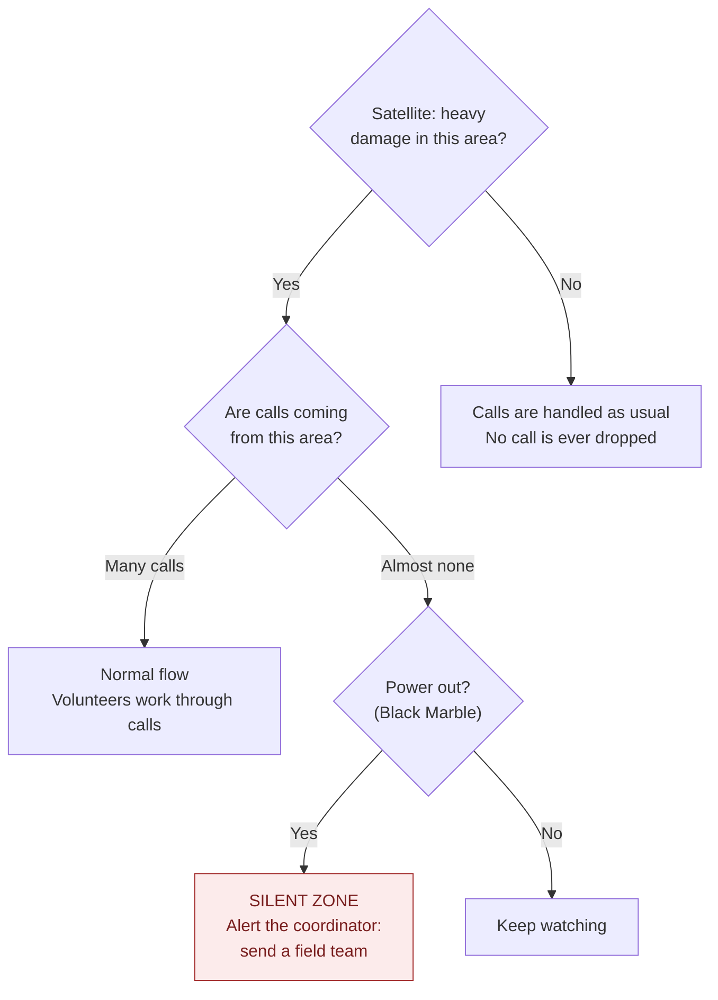
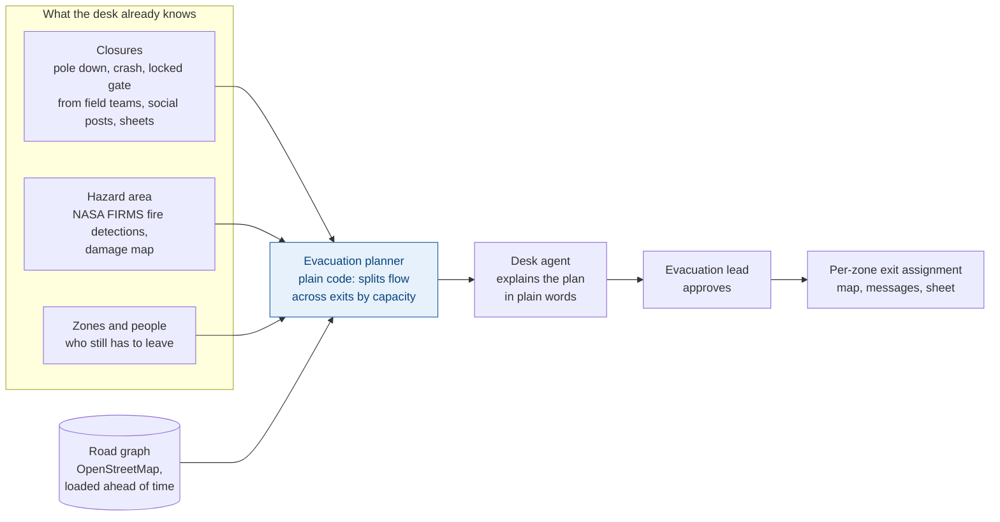
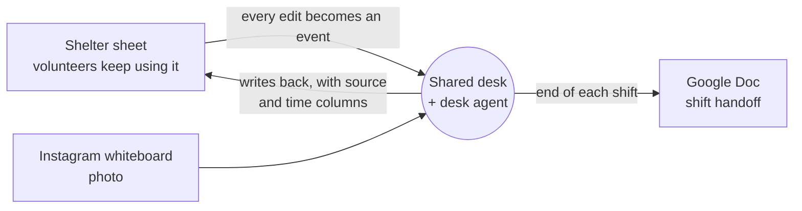

# Multiplayer Disaster Deck

> [!abstract] In one sentence
> A coordination app that brings the groups who work apart after a disaster (volunteers, field teams, logistics, shelters and the coordinator) **onto one desk**: everyone talks to their own agent, and all agents share one collective memory. Agents read X, Instagram, Facebook and the volunteers' Google Sheets, and the desk acts on what they find, all the way to splitting evacuation traffic across every open exit.

Jump to: [[Final system design]] · [[Team contracts]] · [[Data sources]] · [[Hackathon info]] · [[Voice memo 2026-11-14|Voice memo]]

---

## 1. Why this idea

### What multiplayer AI means
When Google Docs replaced Word, the pain it removed was emailing "report_v3_FINAL_final.docx" around. Today's AI version of that pain: **everyone asks their own ChatGPT and drops a screenshot of the answer into a group chat.** Context gets lost, and nobody knows who decided what.

**Multiplayer AI** means several people working **in the same agent session**. Everyone can see what the agent is doing, redirect it, and hand the work off to someone else.

> [!question] Is an idea really multiplayer AI? A two-question test
> 1. **If you remove the other people, does the product lose its point?** The answer should be yes.
> 2. **If you remove the AI, are you left with an ordinary shared app?** The answer should be yes.
>
> This idea passes both. Without people, nobody calls or rescues anyone. Without the AI, you are left with a Google Sheet full of duplicate rows, which is exactly what happened in 2023.

### Türkiye, February 2023
After the 6 February 2023 earthquakes in Türkiye, thousands of people posted on Twitter: "My mother is under the rubble, the address is …". Volunteer developers built models that pulled addresses out of these tweets (afetharita). Hundreds of volunteers tried to track the calls in Google Sheets and Discord. Rescue teams, logistics and shelters each worked **in their own channel**.

Everyone was helping, but independently. People did the same work without knowing about each other. Some areas got too much attention and everyone drove there, so the same roads jammed while other areas got nobody. It was February and freezing, and most people had lost their homes.

### Lahaina, August 2023
The 8 August 2023 wildfire killed 102 people in Lahaina, Maui. The Fire Safety Research Institute report for the Hawaii attorney general (September 2024) found that **more than 60% of them had tried to flee**, and many were found in or around their cars. A crash on Front Street trapped 10 people. The most deaths were on Kuhua Street, a narrow road that was the only way out for a dense neighborhood. The jams came from downed power poles, crashes, dead traffic signals, smoke, parked cars narrowing the streets, and **back roads blocked by locked gates**.

Shelters tracked their capacity **on whiteboards**. Someone took a photo of the board and posted it to Instagram. By the time anyone read the post, the number was about two hours old, so people were turned away from full shelters.

Dan put together a team of 10 people during the response. One representative per shelter updated a shared dashboard by hand. **That is the workflow this app automates**, and we ran it ourselves.

### Same gaps, two disasters
| Gap | Türkiye | Lahaina |
|---|---|---|
| Duplicate work | Ten volunteers call the same person | Groups repeat the same tasks in different places |
| Supplies to the wrong place | Needs reach logistics hours late | Supplies routed to the wrong spots |
| Traffic | Everyone uses the same road out of five | People die stuck in their cars |
| Stale shelter info | Shelter full, arrivals still sent there | Whiteboard photo on Instagram, 2 hours old |
| Who decides priority | Nobody, or whoever shouts loudest | Same |

The data in the demo comes from Türkiye (that is where the public datasets are). Lahaina is the second case that shows the problem is not specific to one disaster.

### Time phases
A disaster response moves through phases, and the app does different work in each one.

| Phase | What is happening | What the agent does |
|---|---|---|
| **Minutes** (0–10 min) | First posts, no teams deployed, shelters not open | Opens sites from the first posts, flags silent zones from satellite data |
| **Hours** (1–5 h) | Posts flood in, teams deploy, shelters open | Merges duplicates, routes reports, tracks shelter capacity. **The demo lives here** |
| **Days** (1–2 days) | Cold, supplies, shelters filling up, shift changes | Supply needs, shelter routing, handoff summaries |
| **Weeks** | Long-term recovery | Out of scope |

---

## 2. The real problem: groups that do not talk to each other

Collecting the information was not the problem. The problem was that **information got lost every time it passed from one group to another.**

### Today


- A field team pulls someone out, but the volunteers' list still shows that person as "under the rubble".
- A team says "we need blankets here", and logistics hears about it hours later.
- A shelter is full, but new arrivals are still being sent there.
- The same tweet is shared hundreds of times, so ten volunteers call the same person. Other people never get a call.
- A road gets blocked by traffic, but nobody else knows it is blocked.


### With the app


Everyone sees the same picture. Nobody passes information between groups by hand. Each person's agent writes to one collective memory, and the Brain sends every fact to the people who need it.

---

## 3. Who uses it

| Role                                             | Device           | What they do                                                      | What the agent gives them                                                      |
| ------------------------------------------------ | ---------------- | ----------------------------------------------------------------- | ------------------------------------------------------------------------------ |
| **Coordinator**                                  | Laptop, map view | Assigns teams to areas, approves priorities                       | "The nearest free team for this site is Team 4. Approve?"                      |
| **Call volunteers**                              | Laptop           | Call people back from tweets and phone calls to verify them       | Merges duplicates and shows calls nobody has picked up                         |
| **Field teams** (AFAD, army, fire brigade, AKUT) | Phone            | Take assignments, report back by voice or short text              | Sends each report to everyone who needs it                                     |
| **Logistics**                                    | Laptop           | Manage stock and vehicles                                         | Groups and ranks needs by area                                                 |
| **Shelter / medical point**                      | Phone            | Report capacity and needs, or just send a photo of the whiteboard | Reads the photo into capacity numbers, changes routing when a shelter fills up |
| **Evacuation lead** (police, county EOC)         | Laptop, map view | Opens and closes roads, issues evacuation orders                  | "Front St north is blocked by a crash. Send zones 3 and 4 out by the other exits. Approve?" |
| **Sheet volunteers**                             | Google Sheets    | Keep updating the shelter sheet they already use                  | Their edits land on the desk, and the desk's updates land in their sheet       |

The desk holds six kinds of records: **rubble sites**, **supply needs**, **teams and their locations**, **shelter capacity**, **road closures**, and **evacuation zones**.

---

## 4. Main flow: the life of one case

> [!info] This is the story version. The technical flows, with every component, are in [[Final system design#8. The main flows]]. What happens when a step goes wrong (a truck breaks down, an address is wrong) is in [[Final system design#6. Help desk: when something goes wrong (v2)|the help desk]].

This is the heart of the product. One case passes through five groups, and none of them passes information to another by hand.



### Step by step
1. **03:10**: A tweet comes in. The agent opens a **rubble site** and links 4 duplicate tweets to it.
2. **03:15**: **Volunteer Ayşe** calls the person who posted it: "Voices heard, verified."
3. **03:16**: The agent asks the **coordinator**: "The nearest free team is Army Team 4, 600 m away. Assign them?" The coordinator approves.
4. **03:17**: The assignment lands on **Team 4**'s phone: the address, who reported it, and Ayşe's note.
5. **05:40**: Team 4 reports by voice. From that one report the agent does four things:
   - Marks the person as "rescued" on Ayşe's list.
   - Opens new records for the 2 people still in the building.
   - Sends a need for 20 blankets to **logistics**.
   - Suggests the nearest **shelter** or medical point with space.
6. **05:50**: **Logistics** replies: "Truck there in 1 hour." The agent passes this on to Team 4.
7. **In the background, NASA**: The agent warns the coordinator about a **silent zone** (see [[#6. NASA data and silent zones]]).
8. **08:00**: Shift change. The agent writes a summary for the incoming coordinator: "23 people rescued overnight, 6 sites still open, 2 supply deliveries late."

> [!tip] This is what multiplayer AI looks like
> Everyone talks to **the same agent**, and the agent is **everyone's shared memory**. The volunteer, the soldier, the logistics officer and the coordinator work on the same case without messaging each other.

### Three multiplayer moments
| Moment | What happens |
|---|---|
| **Watching** | Someone who just joined sees live what the agent is doing and who is working on what |
| **Steering and pushback** | A volunteer says "these two addresses are not the same", and the agent corrects itself. If two instructions conflict, the agent does not quietly merge them. It shows the trade-off and asks the person in charge |
| **Handoff** | When a shift ends, the next person does not get a document. They take over the agent session itself |

---

## 5. What the agent does and does not do

| Does | Does not |
|---|---|
| Merges duplicates, opens and closes records | Assign a team without the coordinator's approval |
| Sends each report to the groups that need it | Drop a call because of satellite data |
| Suggests teams, supplies and shelters | Replace AFAD or official systems |
| Ties every piece of information to a source, a person and a time | Present uncertain information as fact |
| Writes the shift handoff summary | Predict how damage will spread |
| Reads shelter whiteboard photos into capacity numbers | Trust a photo's number without showing when it was taken |
| Reads public posts on X, Instagram and Facebook through official APIs | Scrape platforms, or keep personal details beyond what the case needs |
| Recommends how to split evacuation traffic across exits | Issue an evacuation order on its own |
| Keeps the volunteers' Google Sheet in sync both ways | Overwrite a cell a human just edited |

---

## 6. NASA data and silent zones

Tweets only come from people who have **a phone, battery, internet and followers**. Older people, areas without power and villages without signal stay silent. **A satellite sees everyone.**

NASA produced two datasets for the 2023 earthquakes (details in [[Data sources]]):
- **ARIA Damage Proxy Map:** likely building damage, derived from radar satellite images.
- **Black Marble night lights:** areas that lost power.



The strongest part of this is that it **covers the blind spot of tweet-based tools.** The volunteer tools of 2023 could only see the people who were able to speak up.

> [!warning] Rules for judges who know the science
> - Satellite data only **raises** priority. It never drops a call.
> - Every satellite fact shows its date and source: "Sentinel-1, 10 Feb 2023, NASA JPL ARIA".
> - The damage map is less reliable over vegetation and mountains. Say so on screen.
> - The map shows **likely damage**, not individual buildings.

---

## 7. Evacuation routing

People in Lahaina died in their cars. In Türkiye, everyone drove down the same road out of five. In both cases, people sat in traffic while the information that would have gotten them out already existed somewhere: a power pole down on one road, a gate locked on another, an exit with nobody on it.

### Why navigation apps make it worse
Every driver's navigation app picks the fastest route **for that driver**. When thousands of drivers ask at the same moment, they all get the same answer, so they all end up on the same road. Traffic engineers call this the **user equilibrium** (Wardrop): every choice is the best one for that driver, and the total is a jam. What the evacuation lead wants is the **system optimum**: the traffic split across every open exit in proportion to what each road can carry. Only a planner that sees everyone at once can compute that, and a shared desk is exactly that view.

### How it works


1. Closures come in through the same intake workers as everything else. A Facebook post saying "power pole down on Front St", a field report saying "the gate on the back road is locked", or a sheet row all become **road closure** records with a source and a time.
2. The **planner is plain code**, not an LLM: a capacity-aware flow split over the road graph (networkx on an OpenStreetMap graph of Lahaina, loaded ahead of time). Same inputs, same plan, every time.
3. The LLM does the two jobs it is good at. It turns messy posts into closure records, and it explains the plan: "Front St north is blocked by a crash at 3:42 PM (field team 2). Zones 3 and 4 now go out by the other exits. The back-road gate is locked, keyholder: county public works."
4. The **evacuation lead approves** before anything goes out, the same way the coordinator approves team assignments.

### Rules
- The agent **recommends**. Only a human issues an evacuation order.
- An unconfirmed report of a hazard closes the road for routing until someone confirms it is open. Like the satellite rule, uncertain information only makes the plan more careful.
- Every closure shows its source and age on the map.
- Locked gates get a record of their own, with who holds the key. Lahaina had escape roads nobody could open.

> [!note] Google Maps
> Google Maps gives each driver their own fastest route, and that is the problem described above. We use OpenStreetMap so we control closures. Google could still provide live drive times later.

---

## 8. Social media agents: X, Instagram, Facebook

In Türkiye the calls for help were on Twitter. In Lahaina the shelter whiteboards were on Instagram and the community updates were on Facebook. The desk runs **one intake agent per platform**. Each one turns platform posts into the same proposal format, so the desk agent never cares where a post came from. The same whiteboard photo posted on both Instagram and Facebook becomes one record with two sources.

### What each platform actually allows
| Platform | Real API access | What we demo live | What we replay |
|---|---|---|---|
| **X** | API v2 search, pay per use | Live search on a demo keyword | The 2023 Turkish tweet dataset |
| **Instagram** | Public hashtag search needs Meta App Review (Public Content Access) and is capped at 30 hashtags per 7 days. No App Review in 24 h. The Graph API can read **our own** business account | A demo "shelter" account posts a whiteboard photo. Seconds later the Instagram agent reads it and the shelter's capacity changes on the desk | Synthetic whiteboard posts |
| **Facebook** | Public post search is gone. Meta shut down CrowdTangle in August 2024, and its replacement (Meta Content Library) is only for vetted nonprofit researchers. The Graph API reads Pages **we manage** | A demo community Page posts "power pole down on Front St". The Facebook agent reads it, a road closes, and the evacuation plan changes | Synthetic community posts |

The agents are real and the API calls are real. The only thing that changes in a real deployment is **whose accounts they read**: platform partnerships or Meta Content Library access instead of our demo accounts. We say this in the pitch.

> [!warning] Demo accounts
> Every demo post is labeled **"HACKATHON DEMO, NOT A REAL EMERGENCY"**. Nothing we post can be mistaken for a real call for help. We delete the accounts after the event. No scraping, only official APIs.

---

## 9. Google Sheets and Docs sync

Dan's Lahaina shelter dashboard was a Google Sheet with one representative per shelter updating it by hand. Volunteers already know Sheets, so the desk meets them there instead of asking them to switch tools mid-disaster.



- **Sheet to desk:** an Apps Script trigger sends every edit to the desk as an event (polling the Sheets API every few seconds works as a fallback). A volunteer typing "Shelter B: 41/60" is the same as any other report.
- **Desk to sheet:** when the desk learns something new, for example from a whiteboard photo on Instagram, it writes the number back into the shelter's row and fills the **source** and **updated** columns. Volunteers who never open the app still see the latest numbers.
- **Conflicts:** if a human edited a cell in the last few minutes, the desk does not overwrite it. It leaves a comment on the cell with the newer number and its source, and lets the human decide.
- **Docs:** the shift handoff summary goes into a Google Doc, so the next coordinator can read it anywhere.

This is the Lahaina dashboard with the 10 people taken out of the copying loop.

---

## 10. What the app looks like

### Desk view (coordinator and volunteers)
```
┌─────────────────────────────────────────────────────────────────┐
│ Disaster deck · Antakya · night shift        AY  MK  ZD + agent │
├──────────────────────┬──────────────────────────────────────────┤
│ INCOMING             │ SHARED LIST                              │
│                      │                                          │
│ Tweet (translated):  │ Site 57 · Örnek St. 12       [2 sources] │
│ "My mother is under  │   1 person, voices heard · Ayşe calling  │
│ the rubble, St. 12"  │                                          │
│  → New site 57       │ Site 52 · Çınar St.   [unassigned 2 h]   │
│                      │   3 people · no phone number             │
│ Team 4 (voice): "1   │                                          │
│ person out..."       │ Need · 20 blankets · Logistics: 1 h      │
│  → Site 41 closed    │                                          │
│                      │ Shelter A 90% · Shelter B 40%            │
│ NASA: district Y     │                                          │
│  → Silent zone       │                                          │
├──────────────────────┴──────────────────────────────────────────┤
│ SHARED AGENT SESSION (everyone sees it)                         │
│ Mehmet: There are two buildings on St. 12, may not be the same  │
│ Agent:  You may be right, splitting the record. Zeynep, take it?│
│ Zeynep: On it                                                   │
│ ⇄ Ayşe leaves at 04:00. Summary: 14 closed, 3 urgent unassigned │
└─────────────────────────────────────────────────────────────────┘
```

### Field team view (phone)
```
┌───────────────────────────┐
│ Team 4 · Assignment       │
│ Örnek St. 12, No 4        │
│ 1 person, voices heard    │
│ Reported by Ayşe, 03:15   │
│                           │
│ [ On our way ] [ Arrived ]│
│                           │
│ ( Hold to report          │
│   by voice )              │
└───────────────────────────┘
```

---

## 11. What we show at the hackathon

| Where | What |
|---|---|
| **Pitch** | The full vision: five groups, one desk, one agent, silent zones. Opens with Türkiye and Lahaina, the same gaps in both |
| **Live demo, scene 1: Türkiye** | Play the "life of one case" story from start to finish on four devices, one role per team member: volunteer, coordinator, field phone, logistics |
| **Live demo, scene 2: Lahaina** | A demo shelter account posts a whiteboard photo to **Instagram**, and the shelter's capacity changes on the desk and in the **Google Sheet**. A demo community Page posts "power pole down on Front St" to **Facebook**, the road closes, and the **evacuation plan** sends two zones out by other exits. The evacuation lead approves |
| **Data** | Tweets are real, from the 2023 dataset, replayed as if they were arriving live. NASA layers and the Lahaina road graph are real. Field and logistics reports, whiteboard photos and demo social posts are synthetic, and we say so |

> [!example] The strongest demo moment: side by side
> Split the screen. **Left, today:** every group in its own channel, four different and conflicting versions of the same case. **Right, the app:** one desk, one case, and every change has an owner.

The interface is in English and the tweets stay in Turkish. The agent shows each tweet with an English translation, which also makes a strong impression on the judges.

Track fit and deadlines: [[Hackathon info]].

---

## 12. System design

The one and only system design is **[[Final system design]]**: components, data model, lifecycles, dispatcher rules, the main flows, how it runs, the settled decisions and the build plan. Who builds what: [[Team contracts]] and the four role notes in `Roles/`.

---

## 13. Parked for phase 2

Real problems from the memo that we do not build this weekend. They go on a "what's next" slide. Evacuation routing, social media agents and Sheets sync moved into the core (sections 7–9).

- **Disinformation** filtering of false posts.
- **Power restoration priority**: who gets power back first.
