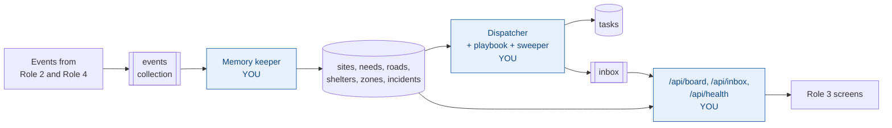

# Role 1: Backend and Brain

**Owner:** _write your name here_

Read first: [[Team contracts]] · Design: [[Final system design]] · What changed in version 2: [[Design review 2026-11-14]]

> [!abstract] Your mission
> Build the **collective memory** and the **Brain**: the database, the event queue, the memory keeper (the only writer of records), the dispatcher (who must know, who acts), and the **help desk playbook** (what happens when a task goes wrong). If your part works, every agent and every screen has something real to read.

---

## Your slice of the system



## You own
`lib/` (incl. `lib/types.ts`, `lib/db.ts`, `lib/rules/`) · `app/api/events` · `app/api/board` · `app/api/inbox` · `app/api/health` · `workers/brain.ts` · `workers/memory-keeper.ts` · `workers/dispatcher.ts` · `workers/sweeper.ts`

## What you need
- **MongoDB Atlas** free cluster. You create it and share `MONGODB_URI` privately with the team.
- **Node** + the official `mongodb` driver. Optionally `zod` to validate event payloads.
- **OpenAI key** only for one small optional call: "are these two reports the same site?"
- Seed users, shelters and regions from Role 4 (`data/seed.json`).
- You pick `AGENT_KEY` (any random string) and share it privately with Role 2 and Role 4.

---

## One loop, three modules

Do **not** run the memory keeper and the dispatcher as two separate loops. Two loops race each other. `workers/brain.ts` is the only entry point:

```ts
while (true) {
  const event = await takeNextEvent();          // lane 0 first, then oldest. Stamps lockedAt
  if (event) {
    const changes = await memoryKeeper.apply(event);   // writes records, returns what changed
    await dispatcher.react(changes);                    // writes tasks and inbox
  }
  if (fiveSecondsPassed()) await sweeper.tick();
  if (!event) await sleep(300);
}
```

---

## Tasks, in order

### 1. Foundations (18:30 → 19:00): others are waiting on this
- [ ] Create the Atlas cluster, share `MONGODB_URI`.
- [ ] Push `lib/types.ts` exactly as in [[Team contracts#3. Data shapes|Team contracts §3]]. **All of it, including the v2 fields and the incident types.** You fill them in later; the others can code against them now.
- [ ] Push `lib/db.ts` with `postEvent()`, `getUserContext()`, `getBoard()`, `searchMemory()` (stubs that return empty data are fine at first).
- [ ] `postEvent()` sets `lane` (0 when `source` is `person` or `system`, otherwise 1), and returns the old id when the `dedupeKey` already exists.
- [ ] Create the four indexes from [[Team contracts#4. Functions and API|Team contracts §4]].
- [ ] `POST /api/events`. **`actor` comes from the login on the server**, or from the agent name when the request carries `x-agent-key`. Never from the body.

**Done when:** Role 2 can call `postEvent()` and see a `pending` event in Atlas, and posting the same `dedupeKey` twice gives one event.

### 2. Memory keeper (19:00 → 21:30): CP1
- [ ] Take: `findOneAndUpdate({ status: "pending" }, { $set: { status: "working", lockedAt: now }, $inc: { attempts: 1 } }, { sort: { lane: 1, ts: 1 } })`. Atomic, so only one event at a time.
- [ ] Handle `report` → create or update a **site**. Set `tier` (a trapped person is 0), `confidence`, `observedAt`.
- [ ] **Merge rule, in this order:** same text → a copy, it adds a source but **not** support. Same kind within ~100 m (haversine in code), or the same normalized address → the same record. Otherwise a new record. The LLM tie-break is optional, only when the rules cannot decide.
- [ ] Every record change appends a `history` entry: who, when, source, reason.
- [ ] `apply()` **returns** the list of changes for the dispatcher.
- [ ] `GET /api/board`, sorted by tier and priority.

**Done when (CP1):** a replayed tweet shows up on the board as a site. Four copies of the same tweet show up as **one** site with 4 sources.

### 3. Dispatcher (21:30 → 00:00): CP2
- [ ] `dispatcher.react(changes)`, called from the loop. No second loop, no `changedAt` scan.
- [ ] Rule: site with `callStatus: "not_called"` → `call` task.
- [ ] `lib/rules/assign.ts`: right role, has what the task needs, seen in the last 3 minutes, fewer than 3 open tasks, **not in `tried`**. Then nearest, then fewest open tasks. Nobody → `escalated` + an inbox item for the coordinators.
- [ ] Tasks carry `open: true` until they are blocked, done or cancelled. The unique index makes a second open task for the same record and type fail. Catch that error and move on.
- [ ] Write the task, push an `InboxItem` (with its `kind`) to that person.
- [ ] Handle `answer` events: accepted, declined, done → update the task and the record. Accept an `answer` **only from the task's assignee**. Store `eta` from `etaMinutes`.
- [ ] **Timeout** (in `sweeper.tick()`): no answer in N minutes (N = 2 for the demo) → `timed_out` → add to `tried` → next person. After 3 people → `escalated`.
- [ ] `GET /api/inbox` for the logged-in person. It also stamps `lastSeen`.
- [ ] `GET /api/health`: pending count, age of the oldest pending event, failed count, time of the last loop turn.

**Done when (CP2):** the volunteer gets "call Ayşe", answers "called, voices heard" (by chat or by the button), the site turns `verified`.

### 4. Needs, priority, approvals, closures (00:00 → 04:00): CP3
- [ ] `need` events → one need per item and region, with `lines`. **Same site, same item: keep the larger number. Another site: a new line.** `quantity` is the sum of the lines.
- [ ] `lib/rules/priority.ts`: tier, then `10 × support (max 50) + minutes waiting (max 60) + 30 if silent zone + 20 if warmth need and cold zone`. Recompute when a record changes and in the sweeper.
- [ ] `deliver` task to a supplier with enough stock (`profile.stock`), nearest first.
- [ ] Notify the field team's inbox when the need changes status.
- [ ] **Risk rule:** `rescue` (send a field team), evacuation and big supply moves are `risk: "high"` → `waiting_approval` → an inbox item of kind `approval` for **every** coordinator. The first `approval` event wins. Accept `approval` **only from a coordinator**.
- [ ] `closure` events → road record → notify every open task whose region touches that road.
- [ ] `capacity` events → shelter record → notify volunteers in that region when a shelter is above 90%.
- [ ] When two sources disagree on one field: higher trust wins, then newer `observedAt`. Keep the loser in the history.

**Done when (CP3):** the blanket flow and a coordinator approval both work end to end.

### 5. Help desk and sweeper (04:00 → 06:00): CP4
Design: [[Final system design#6. Help desk: when something goes wrong (v2)|Final system design §6]].
- [ ] Memory keeper: `incident` event → write or update an `Incident`. Set severity: `critical` for injury, unsafe, or when the blocked need is life-threatening; `high` when a task is blocked; `low` when the person can continue.
- [ ] `lib/rules/incidents.ts`, the playbook. Start with **one row**: `vehicle_breakdown`.
  - Task → `blocked`, `blockedBy`, `open: false` (so the replacement can be created). Need → `open` again.
  - Replacement `deliver` task with `replaces`: relay from the truck's position, or a fresh delivery from another supplier, whichever is nearer to the site.
  - `assist` task for the nearest person with a vehicle or the `mechanic` skill.
  - Notices to everyone whose task touches the same need, with the new ETA.
  - Incident card (`kind: "incident"`) to every coordinator: what happened, what the desk did.
  - Write each step into `incident.actions`.
- [ ] `incident` with `resolved: true` → incident `resolved`, the person is free again.
- [ ] Sweeper: task `accepted` and `eta` passed → inbox item of kind `checkin`. Second miss → post an `incident` of kind `unreachable` with `actor: "sweeper"`.
- [ ] Sweeper: event `working` for more than 30 s → back to `pending`. `attempts` ≥ 3 → `failed`.
- [ ] Then, if there is time, more rows: `short_supply`, `road_blocked`, `cannot_find`, `unsafe`.

**Done when (CP4):** the supplier presses Problem, a second supplier gets the pick-up, the field team gets a new ETA, and the coordinator sees the incident card. **If CP3 is late, this block is the first thing to drop.**

### 6. Hardening (06:00 → 08:00)
- [ ] `alert` events (silent zones and cold nights from Role 4) → zone record → priority boost + high-risk task for the coordinators.
- [ ] A `reset` script that wipes and reseeds the database, so the demo can be rerun.
- [ ] Load test with the full replay file, run twice in a row. No duplicate tasks, no lost events, no `failed` events.
- [ ] Stretch: `claim` (declared work becomes an accepted task), `correction` (`retract` and `edit` first), needs that start as `proposed`.

---

## Rules you enforce
- **One writer per collection.** The memory keeper writes records. The dispatcher writes tasks and inboxes. The API writes users and messages. Everyone else posts events.
- **High-risk tasks never reach a field team without an approval event from a coordinator.**
- **Satellite data only raises priority.** No rule may close or drop a site because of NASA data.
- **The server sets `actor`.** A client can never say who it is.
- **A social post alone never approves, closes or cancels anything.**

## If you get stuck
- Merge rule too strict or too loose: tune the distance, and show the merge reason on the board so it is easy to debug.
- The board stops moving: look at `/api/health` first. A growing `pending` count means the loop died. A `failed` count means one event keeps throwing.
- Atlas or index questions: the mentors and the help desk are in Halle Library.

## Your part in the demo
You explain the Brain: "one writer, so nothing is lost or written twice; one dispatcher, so the right person always gets the work; and when a truck breaks down, the same rules re-plan it". You also run the reset script between demo runs.

## Track
**MongoDB Atlas (MLH):** you own it. Make sure the Devpost text says how Atlas is used: the queue, the collective memory, the incidents and the inboxes.
