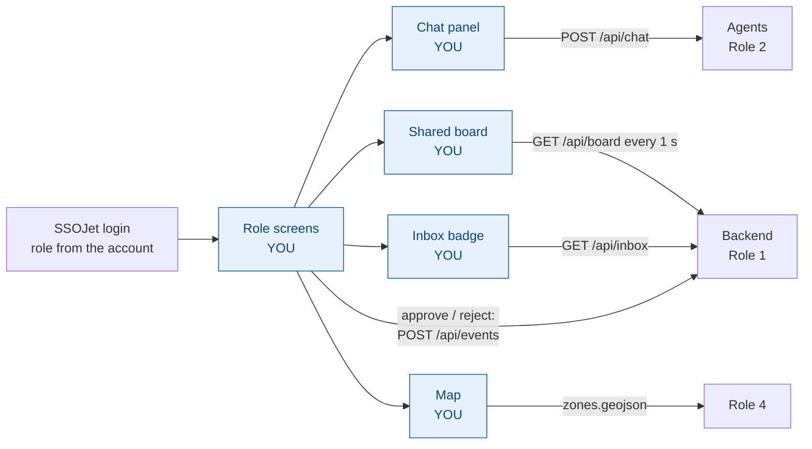

# Role 3: Frontend

**Owner:** _write your name here_

Read first: [[Team contracts]] · Design: [[Final system design]] · What changed in version 2: [[Design review 2026-11-14]]

> [!abstract] Your mission
> Build everything people see: the **repo skeleton**, **login with roles**, one **screen per role** with a chat to that person's agent, the **shared board**, and the **map**. The judges only ever see your work, so it has to be clear in two minutes.

---

## Your slice of the system

## You own
`app/` pages · `components/` · `public/` (except `public/data/`) · the repo skeleton

## What you need
- **Next.js** (App Router) + **Tailwind**.
- **SSOJet** free plan + its Next.js quickstart. Each demo account maps to one role.
- **Leaflet** (`react-leaflet`) with OpenStreetMap tiles. Free, no key.
- Browser **MediaRecorder** for voice messages (send as `audioBase64`). **A phone only gives the microphone to an HTTPS page.** `http://192.168.x.x:3000` will not record. Use a tunnel (`cloudflared tunnel --url http://localhost:3000` or `ngrok`) or a deploy, and test hold-to-talk on a real phone by CP2.
- `public/data/zones.geojson` from Role 4.

**Start without waiting:** build every screen against a local `fixtures/board.json` with a few fake sites, needs and tasks. Swap to the real API at CP1.

---

## Tasks, in order

### 1. Repo skeleton (18:00 → 18:30): everyone is waiting on this
- [ ] `create-next-app` with TypeScript and Tailwind in `DarshalShetty/HackTheNest26`.
- [ ] Empty folders: `lib/`, `agents/`, `workers/`, `data/`, `scripts/`, `public/data/`.
- [ ] `.gitignore` with `.env.local` **in the first commit**.
- [ ] Push, tell the team.

### 2. Login, role screens, chat (18:30 → 22:00)
- [ ] SSOJet login. After login, read the role and open that role's screen.
- [ ] Fallback if SSOJet fights you: a role picker for the demo (it works only with `DEMO_MODE=1`), and add SSOJet back later. Do not lose more than 1 hour on it. **Know the cost: with a role picker we are out of the SSOJet track.** Ask the mentors in Halle Library before giving up.
- [ ] One layout per role: chat on one side, "your tasks" on the other.
- [ ] Chat panel → `POST /api/chat`. Shows the agent's reply. Text box + hold-to-talk button.
- [ ] **Task card with four buttons: Accept, Decline, Done, Problem.** Each one posts an event straight to `POST /api/events` (`answer`, or `incident` for Problem). The demo must not depend on the model answering.
- [ ] Inbox badge: unread count from `GET /api/inbox`.

### 3. Shared board (22:00 → 01:00): CP1 and CP2
- [ ] `GET /api/board` every second.
- [ ] Columns: **Sites** (call status, sources count, owner, age), **Needs**, **Shelters** (bar: used / total), **Roads**.
- [ ] Everything arrives **sorted by tier and priority**. That order is the shared priority list: show the tier as a colour and the score as a small number. A need with status `proposed` is grey, with "1 of 3 people asked".
- [ ] One line at the bottom from `GET /api/health`: "queue: 3 waiting, oldest 2 s". Red when the oldest is over 30 s.
- [ ] Every task shows its owner and how long it has waited. Red when unassigned for too long.
- [ ] Click a record → its history: who changed it, when, from which source, why. **This is how judges see the Brain working.**
- [ ] English translation under every tweet.

**Done when (CP1):** replayed tweets appear on the board within a few seconds, duplicates as one site with a source count.

### 4. Field team phone view + coordinator approvals (01:00 → 04:00): CP3
- [ ] Phone-sized screen for field teams: current task, "on our way" / "arrived" buttons, big hold-to-talk button.
- [ ] Coordinator screen: a list of tasks waiting for approval with **Approve** / **Reject** → `POST /api/events` with type `approval`. Each card shows the confidence and the sources of the record it is about. A card waiting too long turns red.
- [ ] **Problem button** on the phone view, big and red. Four choices: Vehicle, Road blocked, Can't find it, Other → an `incident` event with the task id and, when the browser allows it, the position.
- [ ] **Incidents column** on the board and on the coordinator screen: what happened, what the desk already did (`incident.actions`), and its status. Critical ones first.

### 5. Map (04:00 → 07:00)
- [ ] Sites as pins (color by status), closed roads in red, shelters with capacity.
- [ ] Silent zones from `zones.geojson` as a shaded layer, with "Sentinel-1, 10 Feb 2023, NASA JPL ARIA" in the legend. Cold zones with their minimum temperature and "NASA POWER".
- [ ] Open incidents as a warning pin.
- [ ] Stretch: an **Ask the desk** box on the board. It sends the question to `POST /api/chat` and shows the answer.

### 6. Demo polish (07:00 → 10:00)
- [ ] A "today vs. with the desk" split screen for the pitch opening.
- [ ] Four browser profiles logged in as four roles, ready for the four laptops.

---

## Screen rules
- English everywhere in the UI. Turkish only in the original tweet text.
- Every number has its source and age next to it ("Shelter A 58/60 · Instagram · 4 min ago"). **The age comes from `observedAt`**: when the number was true, not when we received it.
- Phone numbers are masked everywhere except inside the task of the volunteer who has to call.
- No screen needs scrolling to show the main thing.

## Your part in the demo
You drive the shared board / coordinator laptop and do the approval live.

## Track
**SSOJet:** you own it. Judges look at how naturally login fits the product, "not how many providers you wired up": roles decide what each person sees and who can approve, and an agency can join with its own sign-in ([[Final system design#9. Who can do what|Final system design §9]]).
