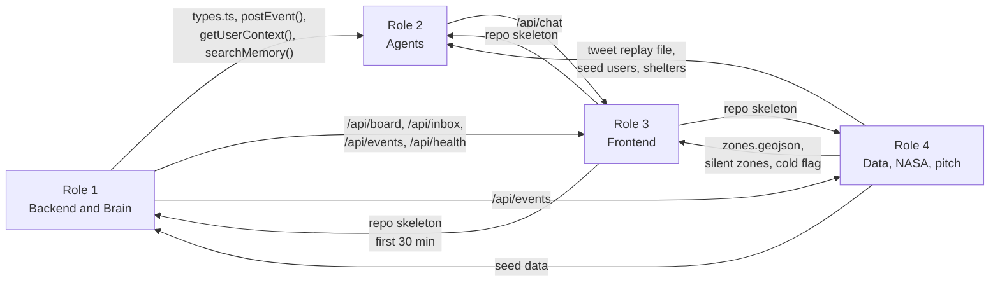
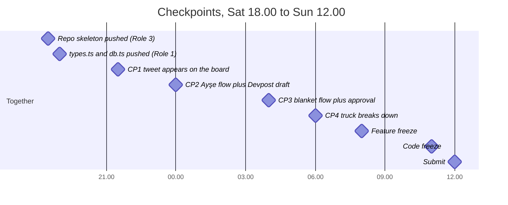

# Team contracts

Design: [[Final system design]] · Roles: [[Role 1 - Backend and Brain]] · [[Role 2 - Agents]] · [[Role 3 - Frontend]] · [[Role 4 - Data, NASA and pitch]]

> [!abstract] Why this note exists
> Four people build in parallel without touching each other's code. That only works if everyone agrees on **three things** up front: the data shapes, the API, and who owns which folder. This note is that agreement. **Read it before writing any code.** Only Role 1 changes `lib/types.ts`, and only after telling the others.

> [!note] Version 2, 14 Nov 18:45
> Changed after the design review ([[Design review 2026-11-14]]), before any code was pushed. What is new: the help desk (`incident`), priority fields, trust, `deskId`, `observedAt`, queue fields, and the rule that the server sets `actor`. Fields marked `// v2` are new. **Put all the fields in `types.ts` now, even for parts you build later**: adding a field at 03:00 breaks three people.

---

## 1. Who gives what to whom



---

## 2. Folder ownership

Touch only your folders. If you need a change in someone else's folder, ask them.

| Folder or file | Owner |
|---|---|
| `app/` pages, `components/`, `public/` (except `public/data/`) | **Role 3** |
| `app/api/events`, `app/api/board`, `app/api/inbox`, `app/api/health` | **Role 1** |
| `lib/` (incl. `lib/types.ts`, `lib/db.ts`, `lib/rules/`) | **Role 1** |
| `workers/brain.ts`, `workers/memory-keeper.ts`, `workers/dispatcher.ts`, `workers/sweeper.ts` | **Role 1** |
| `app/api/chat`, `agents/` | **Role 2** |
| `workers/x-agent.ts`, `workers/news-agent.ts` | **Role 2** |
| `data/`, `scripts/`, `public/data/` | **Role 4** |
| `workers/satellite-watcher.ts`, `workers/scenario-player.ts` | **Role 4** |
| `docs/` (pitch, Devpost text) | **Role 4** |
| `package.json` | Anyone: pull first, add your line, push right away |

`lib/rules/` holds the plain-code rules: `priority.ts`, `assign.ts`, `incidents.ts` (the help desk playbook).

### Who writes which collection

| Collection | The only writer |
|---|---|
| `events` | Anyone, but only by `postEvent()`. The memory keeper changes the status |
| `sites`, `needs`, `roads`, `shelters`, `zones`, `incidents` | Memory keeper |
| `tasks`, `inbox` | Dispatcher (with the playbook and the sweeper) |
| `users`, `messages` | The API: login, heartbeat, chat |

---

## 3. Data shapes

```ts
// Owned by Role 1. Ask before changing.          Version 2, 14 Nov.
export type Role = "volunteer" | "field" | "supplier" | "shelter" | "coordinator"
                 | "public";                                              // v2: a citizen
export type Trust = "official" | "vetted" | "public";                     // v2
export type Confidence = "unconfirmed" | "corroborated" | "confirmed";    // v2
export type Source = "x" | "news" | "reddit" | "instagram" | "facebook"
                   | "sheet" | "nasa" | "person" | "system";
export type LatLng = [number, number];   // [lat, lng], the order Leaflet uses
export type Tier = 0 | 1 | 2;            // v2: 0 danger to life, 1 urgent, 2 comfort

export interface User {
  _id: string; name: string; role: Role; region: string;
  status: "available" | "busy" | "offline";
  deskId: string;                        // v2
  trust: Trust;                          // v2
  coords?: LatLng; lastSeen?: Date;      // v2: for "nearest" and "is this person there?"
  profile?: {                            // v2: the person's context file
    skills?: string[];                   //     "first_aid", "mechanic", "arabic"
    vehicle?: "none" | "car" | "van" | "truck";
    stock?: Record<string, number>;      //     suppliers: { blankets: 200 }
    notes?: string;                      //     what the agent should keep in mind
  };
}

export interface Message {               // v2: chat history, loaded by the personal agent
  _id: string; userId: string; from: "user" | "agent";
  text: string; ts: Date; eventIds?: string[];
}

export interface HistoryEntry { ts: Date; by: string; source: Source; reason: string; }

// ---------- Events: the only way anything enters memory ----------
export type EventType = "report" | "need" | "closure" | "capacity"
                      | "answer" | "approval" | "alert"
                      | "incident"       // v2: something went wrong (help desk)
                      | "claim"          // v2: "I am already doing this"
                      | "correction"     // v2: "the desk has this wrong"
                      | "plan";          // v2: evacuation plan, was missing here

export interface Event<P = unknown> {
  _id?: string;
  deskId: string;         // v2: which disaster, "antakya-2023" or "lahaina-2023"
  ts: Date;               // when the desk received it
  observedAt?: Date;      // v2: when it was true (tweet time, photo time). Default: ts
  type: EventType;
  source: Source;
  actor: string;          // user id or agent name. v2: SET BY THE SERVER, never by the client
  dedupeKey?: string;     // v2: e.g. "x:<tweet id>". Unique. The same key twice is ignored
  lane: 0 | 1;            // v2: set by postEvent(). 0 = a person on the desk or the sweeper,
                          //     1 = research agents and satellite
  payload: P;
  status: "pending" | "working" | "done" | "merged" | "rejected"
        | "failed";       // v2
  lockedAt?: Date; attempts?: number;   // v2: so a crashed keeper loses nothing
  result?: { recordIds: string[]; reason: string };
}

export interface ReportPayload {
  kind: "trapped" | "missing" | "rescued" | "site_update";
  text: string; textEn: string;
  address?: string; coords?: LatLng; region?: string;
  peopleCount?: number; phoneMasked?: string; siteId?: string;
}
export interface NeedPayload {
  item: string; quantity: number; lifeThreatening: boolean;
  siteId?: string; region?: string; coords?: LatLng;
}
export interface ClosurePayload {
  road: string; state: "closed" | "open" | "unconfirmed";
  reason: string; coords?: LatLng;
}
export interface CapacityPayload {
  shelter: string; bedsUsed: number; bedsTotal: number; photoUrl?: string;
}
export interface AnswerPayload {
  taskId: string; result: "accepted" | "declined" | "done";
  note?: string; etaMinutes?: number;
}
export interface ApprovalPayload { taskId: string; approved: boolean; }
export interface AlertPayload {
  zoneId: string; kind: "silent_zone" | "cold";                       // v2: cold
  evidence: { damage?: number; dark?: boolean; calls?: number; minTempC?: number };
}

// v2: the help desk
export type IncidentKind = "vehicle_breakdown" | "road_blocked" | "cannot_find"
                         | "short_supply" | "unsafe" | "injury"
                         | "handover" | "unreachable" | "other";
export interface IncidentPayload {
  incidentId?: string;      // set = an update to an open incident
  kind: IncidentKind;
  text: string; textEn: string;
  taskId?: string;          // the task that is in trouble, if any
  canContinue: boolean;     // can this person still finish the task?
  coords?: LatLng;
  canDeliver?: number;      // short_supply: how many they can still bring
  resolved?: boolean;       // update: the problem is over
}

// v2: "I am already taking water to the school"
export interface ClaimPayload {
  what: "call" | "rescue" | "deliver" | "assist";
  text: string; textEn: string;
  recordId?: string; etaMinutes?: number;
}

// v2: "these are two buildings", "that report is false"
export interface CorrectionPayload {
  action: "retract" | "edit" | "split" | "merge";
  recordType: RecordType; recordId: string;
  otherRecordId?: string;               // merge
  eventIds?: string[];                  // split: the sources that move out
  fields?: Record<string, unknown>;     // edit
  reason: string;
}

// v2: evacuation plan (Lahaina scene, only if time allows)
export interface PlanPayload {
  zoneExits: { zoneId: string; exit: string }[]; reason: string;
}

// ---------- Records: written only by the memory keeper ----------
export type RecordType = "site" | "need" | "road" | "shelter" | "zone" | "incident";

export interface Site {
  _id: string; address: string; coords?: LatLng; region: string;
  peopleTrapped: number;
  callStatus: "not_called" | "called" | "verified";
  status: "open" | "team_on_site" | "closed" | "retracted";           // v2: retracted
  sources: { source: Source; eventId: string }[];
  history: HistoryEntry[];
  deskId: string; confidence: Confidence; observedAt: Date;           // v2
  tier: Tier; priority: number; support: number;                      // v2
  hazard?: string;                                                    // v2: set by an unsafe incident
}
export interface Need {
  _id: string; item: string; quantity: number; region: string; siteIds: string[];
  status: "proposed"                                                  // v2: waits for more voices
        | "open" | "assigned" | "on_the_way" | "delivered"
        | "cancelled";                                                // v2
  history: HistoryEntry[];
  deskId: string; confidence: Confidence; lifeThreatening: boolean;   // v2
  lines: { siteId?: string; quantity: number }[];                     // v2: who gets how many
  tier: Tier; priority: number; support: number;                      // v2
}
export interface Road {
  _id: string; road: string; state: "open" | "closed" | "unconfirmed";
  reason: string; coords?: LatLng; history: HistoryEntry[];
  deskId: string; confidence: Confidence; observedAt: Date;           // v2
}
export interface Shelter {
  _id: string; name: string; region: string; coords?: LatLng;
  bedsUsed: number; bedsTotal: number; updated: Date; history: HistoryEntry[];
  deskId: string; observedAt: Date;      // v2: when the number was true, not when we got it
}
export interface Zone {
  _id: string; name: string; silentZone: boolean;
  damage: number; dark: boolean; calls: number;
  deskId: string; cold?: boolean; minTempC?: number;                  // v2
  exitAssigned?: string;                                              // v2: was in the design only
}
export interface Incident {                                           // v2
  _id: string; deskId: string; kind: IncidentKind;
  reportedBy: string;                    // user id, or "sweeper"
  taskId?: string; coords?: LatLng;
  severity: "low" | "high" | "critical";
  canContinue: boolean; text: string; textEn: string;
  status: "open" | "helping" | "escalated" | "resolved";
  actions: { ts: Date; what: string; taskId?: string }[];   // what the Brain did about it
  history: HistoryEntry[];
}

// ---------- Work: written only by the dispatcher ----------
export interface Task {
  _id: string;
  type: "call" | "rescue" | "deliver" | "notify"
      | "assist" | "evacuate";           // v2. "approve" is gone: see the note below
  recordType: RecordType;                // v2: which collection recordId points to
  recordId: string;
  assignee?: string;                     // v2: optional. Empty until someone is picked
  tried: string[];                       // v2: people who said no or did not answer
  risk: "low" | "high";
  tier: Tier; priority: number;          // v2
  status: "created" | "waiting_approval" | "assigned" | "accepted"
        | "blocked"                      // v2: an incident stopped it
        | "done" | "declined" | "timed_out" | "cancelled"
        | "escalated";                   // v2: nobody fits, a coordinator decides
  open: boolean;                         // v2: true while created, waiting_approval, assigned, accepted
                                         //     or escalated. False when blocked, done or cancelled.
                                         //     Unique index, see §4
  title: string; detail: string;
  deadline: Date;                        // answer by
  eta?: Date;                            // v2: promised finish, from the person's answer
  blockedBy?: string;                    // v2: incident id
  replaces?: string;                     // v2: the task this one took over from
  history: HistoryEntry[];
  deskId: string;                        // v2
}
export interface InboxItem {
  _id: string; userId: string; taskId?: string;
  message: string; status: "unread" | "read"; ts: Date;
  kind: "task" | "notice" | "approval" | "incident" | "checkin";      // v2: the UI needs it
  incidentId?: string; priority: number;                              // v2
}
```

MongoDB collections: `users`, `messages`, `events`, `sites`, `needs`, `roads`, `shelters`, `zones`, `incidents`, `tasks`, `inbox`.

> [!note] Three things that are easy to get wrong
> - **Approvals.** There is no task of type `approve`. A high-risk task sits in `waiting_approval`, and each coordinator gets an inbox item of kind `approval` with its `taskId`. The coordinator's screen lists tasks in `waiting_approval`.
> - **Coordinates.** `LatLng` is `[lat, lng]`. MongoDB's own geo index wants `[lng, lat]`. Do not mix them: compute distance in code (haversine) and skip the geo index this weekend.
> - **Phone numbers.** Records carry `phoneMasked` only. The full number of a demo contact lives in the task `detail` of the volunteer who has to call. Every number in the demo is made up.

---

## 4. Functions and API

### Functions in `lib/` (Role 1 writes, everyone may call)
| Function | What it does |
|---|---|
| `postEvent(e)` | Inserts an event with `status: "pending"`, `ts: now` and the `lane` (0 when `source` is `person` or `system`, otherwise 1). If `dedupeKey` already exists it does nothing and returns the old id. Returns the id. **The only way to put anything into memory** |
| `getUserContext(userId)` | Returns `{ user, inbox, tasks, records, incidents, messages }`: the person with their profile, unread inbox, their open tasks **sorted by tier and priority**, the records those tasks touch, their open incidents, and their last 10 messages. Used by personal agents |
| `getBoard(deskId)` | Everything the shared board shows: sites, needs, roads, shelters, zones, incidents, tasks with owners, all sorted by tier and priority |
| `searchMemory(q)` | **v2.** Read only. `{ collection, region?, status?, text?, limit? }` → matching records with source and age. Behind the personal agents' `ask_desk` tool |

### API routes
| Method | Path | Owner | Called by | Body / returns |
|---|---|---|---|---|
| POST | `/api/events` | Role 1 | Role 2, Role 3 (buttons, approvals), Role 4 (scenario player) | `Event` without `_id`, `status`, `ts`, `actor`, `lane` → `{ id }` |
| GET | `/api/board` | Role 1 | Role 3 | `getBoard()` |
| GET | `/api/inbox` | Role 1 | Role 3 | `InboxItem[]` of the logged-in person. Also stamps their `lastSeen` |
| GET | `/api/health` | Role 1 | Role 3 | `{ pending, oldestPendingSeconds, failed, lastLoopAt }` |
| POST | `/api/chat` | Role 2 | Role 3 | `{ text?, audioBase64?, imageBase64?, coords? }` → `{ reply, eventIds }` |
| static | `/data/zones.geojson` | Role 4 | Role 3 | Zones with `silentZone`, `damage`, `dark`, `cold`, `minTempC` |

### Rules the API enforces (v2)
| Rule | Why |
|---|---|
| `actor` comes from the login session on the server | Otherwise anyone can post an event as the coordinator |
| `approval` only from a coordinator. `answer` only from the task's assignee | "High-risk tasks never move without an approval" is only true if this holds |
| Workers and the scenario player send `x-agent-key: <AGENT_KEY>` and may set `actor` to their agent name | They have no login |
| `?user=ID` and `userId` in a body work only when `DEMO_MODE=1` | Lets us demo with a role picker if SSOJet fights us, without shipping an open door |

### Indexes (Role 1 creates them in `lib/db.ts`)
| Collection | Index | Why |
|---|---|---|
| `events` | `{ status: 1, lane: 1, ts: 1 }` | The keeper's take |
| `events` | `{ dedupeKey: 1 }`, unique, sparse | The same post twice is ignored |
| `tasks` | `{ recordId: 1, type: 1 }`, unique, partial on `{ open: true }` | The dispatcher cannot create the same open task twice |
| `inbox` | `{ userId: 1, status: 1, ts: -1 }` | Inbox polling every second |

---

## 5. Keys and accounts

Keys go in `.env.local` only. **Never commit a key.** `.env.local` is in `.gitignore` from the first commit.

| Variable | Who needs it | Where to get it |
|---|---|---|
| `MONGODB_URI` | Everyone | Role 1 creates the Atlas cluster and shares it privately |
| `OPENAI_API_KEY` | Role 1, Role 2 | Hackathon / team account |
| `EXA_API_KEY` | Role 2 | $50 per hacker, code at kickoff / Discord |
| `NASA_API_KEY` | Role 4 | api.nasa.gov, free. POWER, EONET and GIBS need no key |
| SSOJet keys | Role 3 | ssojet.com free plan |
| `AGENT_KEY` | Role 1, 2, 4 | **v2.** Any random string. Role 1 picks it and shares it privately |
| `DEMO_MODE` | Everyone | **v2.** `1` on our laptops |
| `DESK_ID` | Everyone | **v2.** `antakya-2023` |

---

## 6. Git rules
- One repo: `DarshalShetty/HackTheNest26`. Everyone works on `main`, in **small commits**.
- `git pull --rebase` before every push.
- Only touch your folders (§2). Nobody force-pushes.
- If the build breaks, the person whose commit broke it fixes it first.

---

## 7. Checkpoints



| Checkpoint | What must work | Who is on the hook |
|---|---|---|
| **CP1** 21:30 | A replayed tweet becomes a site on the board. Four copies become one site | Role 1 (keeper), Role 2 (X agent), Role 3 (board), Role 4 (replay file) |
| **CP2** 00:00 | Volunteer gets "call Ayşe", answers "called", site turns verified. Works by chat **and** by the buttons. Voice tested on a real phone over HTTPS. Devpost draft is in | All four |
| **CP3** 04:00 | Field team asks for blankets in chat, supplier gets the task, field team hears the ETA. Coordinator approves a field team dispatch. **One real Exa call is in the product** | All four |
| **CP4** 06:00 | **v2.** The supplier presses Problem ("flat tire"). The need reopens, a second supplier gets the pick-up, the field team gets the new ETA, the coordinator sees the incident card | All four. First thing to drop if CP3 is late |

At each checkpoint, stop for 10 minutes and run it together on one screen. Fix what breaks before moving on.
