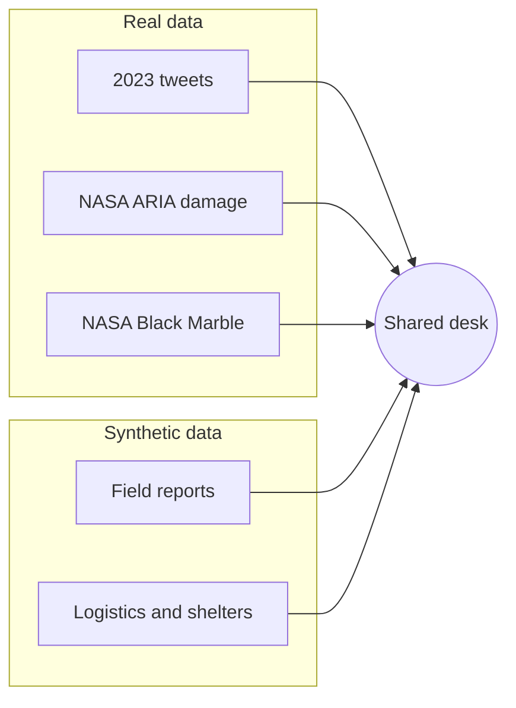

# Data sources

Main note: [[Multiplayer Disaster Desk]]

> [!info] Hackathon rule
> Only public, synthetic or our own data. No real patient data and no medical advice. Tweets are public, but names, addresses and phone numbers are sensitive: **mask phone numbers in the demo and never publish personal addresses on a public map.**

## Which data, for what

| Data | What it gives | What it does in the app | Status |
|---|---|---|---|
| **2023 earthquake tweet dataset** | ~1,000 Turkish tweets, labeled as help call or not, with person, city, address and status tagged | "Live" replay of the tweet stream | Open license, ready |
| **Earthquake NER models** | Ready models that pull person, address, city and status out of a tweet | Optional extra tool for the agent (OpenAI can already do this) | Optional |
| **NASA ARIA Damage Proxy Map** | Likely building damage from the Sentinel-1 radar satellite (10 Feb 2023) | Finding silent zones, raising priority | Hosted map service exists |
| **NASA Black Marble** | Night lights before and after the earthquake (3 Jan and 8 Feb 2023) | Power outage, a sign of "areas that cannot tweet" | Images exist |
| **Exa tweet search** | `category="tweet"` filter | Live tweet search (extra demo) | Not verified, index may be daily |
| **X API** | Tweets from the last 7 days. Pay per use, ~$0.005 per tweet read | Real live stream | Paid, needs a card. Not verified |
| **Field, logistics and shelter reports** | We write them | Demo scenario | Synthetic, we say so in the pitch |

## Links

**Tweet data**
- Dataset: [ctoraman/deprem-tweet-dataset](https://huggingface.co/datasets/ctoraman/deprem-tweet-dataset)
- Model: [deprem-convberturk-ner](https://huggingface.co/ctoraman/deprem-convberturk-ner)
- Paper: [Tweets Under the Rubble (arXiv 2302.13403)](https://ar5iv.labs.arxiv.org/html/2302.13403)
- The story of the 2023 volunteer effort: [Hugging Face blog](https://huggingface.co/blog/using-ml-for-disasters)

**NASA**
- ARIA damage map, map service: [maps.disasters.nasa.gov … aria_dpm/MapServer](https://maps.disasters.nasa.gov/ags04/rest/services/turkey_earthquake_2023/aria_dpm/MapServer)
- ARIA files: `https://aria-share.jpl.nasa.gov/20230206_Turkey_EQ/DPM/`
- NASA JPL write-up: [Satellites assess earthquake damage in Turkey](https://www.jpl.nasa.gov/images/pia25564-satellites-assess-earthquake-damage-in-turkey/)
- NASA Disasters earthquake page: [Türkiye-Syria earthquakes 2023](https://disasters.nasa.gov/what-we-do/disasters/disasters-activations/turkiye-syria-earthquakes-2023)
- Black Marble: [Dark Nights in Antakya](https://science.nasa.gov/earth/earth-observatory/dark-nights-in-antakya-151029)
- Paper on night lights and the earthquake: [Levin 2023, Remote Sensing](https://mdpi.com/2072-4292/15/8/2120)
- Credit line: "NASA JPL/Caltech ARIA Team, Copernicus, ESA"

**Live tweets**
- Exa: [Twitter/X post retrieval](https://docs.exa.ai/examples/live-demo-twitterx-post-retrieval)
- X API pricing (third party): [opentweet.io/x-api-pricing](https://opentweet.io/x-api-pricing)

## Open questions (check before building)
- [ ] Does the ARIA map service let us query the damage value at a single point?
- [ ] What format are the ARIA files in (GeoTIFF, KMZ)?
- [ ] Is Black Marble available as a map layer, or do we need to work from the images?
- [ ] Turning tweet addresses into coordinates (geocoding): safest to do it ahead of time for the demo data.
- [ ] Does Exa's tweet filter return Turkish tweets from 2023?
