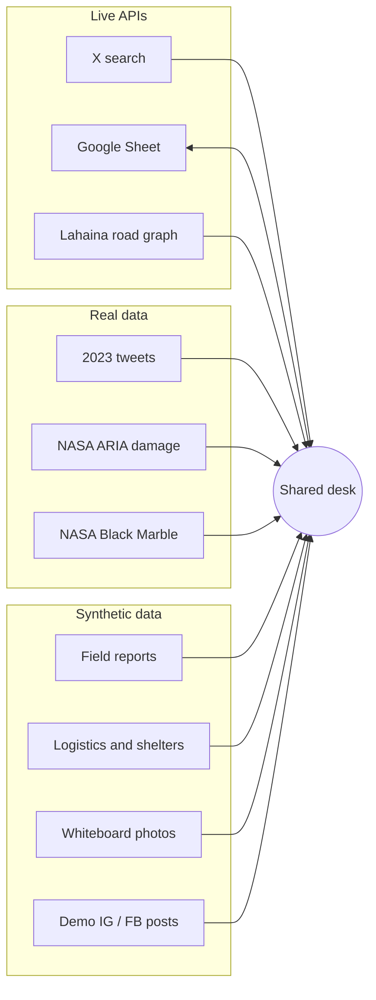

# Data sources

Main note: [[Multiplayer Disaster Desk]]

> [!info] Hackathon rule
> Only public, synthetic or our own data. No real patient data and no medical advice. Tweets are public, but names, addresses and phone numbers are sensitive: **mask phone numbers in the demo and never publish personal addresses on a public map.**

## Which data, for what

| Data                                     | What it gives                                                                                    | What it does in the app                                        | Status                                                  |
| ---------------------------------------- | ------------------------------------------------------------------------------------------------ | -------------------------------------------------------------- | ------------------------------------------------------- |
| **2023 earthquake tweet dataset** | Original study: 1,000 tweet IDs and labels, no full text. Alternative: 43 real archived Antakya posts, 7-10 Feb 2023 | Historical real-text replay | Packaged under `data/replays/`; source audit and instructions in the real-tweet runbook |
| **Earthquake NER models**                | Ready models that pull person, address, city and status out of a tweet                           | Optional extra tool for the agent (OpenAI can already do this) | Optional                                                |
| **NASA ARIA Damage Proxy Map**           | Likely building damage from the Sentinel-1 radar satellite (10 Feb 2023). Pixels of about 30 m   | Finding silent zones, raising priority                         | **Service moved. New address works, checked 14 Nov** (see "Checked on 14 Nov" below) |
| **NASA Black Marble**                    | Night lights before and after the earthquake (3 Jan and 8 Feb 2023). Pixels of about 500 m       | Power outage, a sign of "areas that cannot tweet"              | **Available as a map layer through NASA GIBS, no login, checked 14 Nov** |
| **NASA POWER**                           | Daily temperature for any point on Earth, no key. Weather grid of about 50 km                    | Cold flag: raises the priority of blankets, tents and heaters when the night is below 0 °C | **Checked 14 Nov.** Malatya, 9 Feb 2023: minimum −14.4 °C |
| **NASA EONET**                           | Natural events happening now (wildfires, storms, volcanoes), no key                              | Stretch: "live mode", open a desk from an event of today       | Checked 14 Nov, returns open events                     |
| **Exa tweet search**                     | `category="tweet"` filter                                                                        | Live tweet search (extra demo)                                 | Not verified, index may be daily                        |
| **X API**                                | Tweets from the last 7 days. Pay per use, ~$0.005 per tweet read                                 | Real live stream                                               | Paid, needs a card. Not verified                        |
| **Field, logistics and shelter reports** | We write them                                                                                    | Demo scenario                                                  | Synthetic, we say so in the pitch                       |
| **Shelter whiteboard photos**            | Photos of a handwritten capacity board, like the ones posted to Instagram in Lahaina             | Agent reads them into shelter capacity                         | Synthetic: we write a board and photograph it ourselves |
| **Instagram Graph API** | Media from Instagram business accounts **we own**. Public hashtag search needs Meta App Review and is capped at 30 hashtags per 7 days | Instagram agent reads the demo shelter account | Free. Needs a Meta developer app + a business account linked to a Page |
| **Facebook Graph API (Pages)** | Posts on Pages **we manage**. Public post search is gone since CrowdTangle shut down (Aug 2024) | Facebook agent reads the demo community Page | Free. Needs a Page access token |
| **Google Sheets API + Apps Script** | Read and write a sheet, plus an installable trigger that can call a URL on edit | Two-way shelter sheet sync | Free. Needs a Google Cloud service account |
| **OpenStreetMap road graph (Lahaina)** | Roads, one-way streets, lane counts where tagged | Evacuation planner | Free. Download once with osmnx, keep the file in the repo |
| **NASA FIRMS** | Satellite active-fire detections (VIIRS, MODIS) | Hazard area for the Lahaina scene | Free with a map key. Not yet checked for 8 Aug 2023 over Maui |
| **FSRI Lahaina report** | Where people were trapped, what blocked the roads | Scenario facts: Front St crash, Kuhua St, locked gates | Public report |



## Links

**Tweet data**
- Dataset: [ctoraman/deprem-tweet-dataset](https://huggingface.co/datasets/ctoraman/deprem-tweet-dataset)
- Model: [deprem-convberturk-ner](https://huggingface.co/ctoraman/deprem-convberturk-ner)
- Paper: [Tweets Under the Rubble (arXiv 2302.13403)](https://ar5iv.labs.arxiv.org/html/2302.13403)
- The story of the 2023 volunteer effort: [Hugging Face blog](https://huggingface.co/blog/using-ml-for-disasters)

**NASA**
- ARIA damage map, image service (**works**): `https://gis.earthdata.nasa.gov/portal/rest/services/DISASTERS_202302_EARTHQUAKE_TURKIYE/2302_opera_dpm/ImageServer`
- ~~ARIA damage map, old map service: `maps.disasters.nasa.gov/ags04/…/aria_dpm/MapServer`~~ and ~~ARIA files: `aria-share.jpl.nasa.gov/20230206_Turkey_EQ/DPM/`~~: both return 404 since at least 14 Nov. Do not use.
- NASA JPL write-up: [Satellites assess earthquake damage in Turkey](https://www.jpl.nasa.gov/images/pia25564-satellites-assess-earthquake-damage-in-turkey/)
- NASA Disasters earthquake page: [Türkiye-Syria earthquakes 2023](https://disasters.nasa.gov/what-we-do/disasters/disasters-activations/turkiye-syria-earthquakes-2023)
- Black Marble: [Dark Nights in Antakya](https://science.nasa.gov/earth/earth-observatory/dark-nights-in-antakya-151029)
- Paper on night lights and the earthquake: [Levin 2023, Remote Sensing](https://mdpi.com/2072-4292/15/8/2120)
- Credit line: "NASA JPL/Caltech ARIA Team, Copernicus, ESA"

**Live tweets**
- Exa: [Twitter/X post retrieval](https://docs.exa.ai/examples/live-demo-twitterx-post-retrieval)
- X API pricing (third party): [opentweet.io/x-api-pricing](https://opentweet.io/x-api-pricing)

## Build verification · 14 Nov 2026, 20:04 EST

The sources are cached in `data/nasa/` with URLs, SHA-256 hashes and download timestamps. [NASA evidence and reproducible commands](../nasa-evidence.md)

- [x] Verified the ARIA product as Sentinel-1 on 10 February 2023 at about 30 m. Transparent background leaves normalized damage unknown.
- [x] Verified the gap-filled BRDF-corrected Suomi NPP layer on a 500 m tile matrix. Both selected city cells saturate at the white end of its linked scale, starting at 38.2 nW/(cm² sr). Darkness stays unknown.
- [x] Read −14.38 °C for 9 February 2023 from POWER JSON, with LST as its time standard and 0.5° × 0.625° regional meteorology.
- [x] Compared the Yeni Cami surroundings with DHA's 6 February field report. The overlay agrees with damage in the location. Power conditions remain unresolved.
- [x] Collapsed four synthetic reposts to one original call and labeled all report counts as sample counts.

The two-cell GeoJSON and watcher support two cold alerts. Silent-zone eligibility remains unknown for this cache. Team integration acceptance is recorded in the Role 4 handoff.

## Checked on 14 Nov

Each line below was tested against the live service on 14 Nov between 18:35 and 19:10.

> [!success] The NASA layers are reachable. Three open questions are closed.

**ARIA Damage Proxy Map, 10 Feb 2023**
- Service: `https://gis.earthdata.nasa.gov/portal/rest/services/DISASTERS_202302_EARTHQUAKE_TURKIYE/2302_opera_dpm/ImageServer`
- Covers longitude 35.51 to 38.97, latitude 35.58 to 38.80. **Malatya, Kahramanmaraş, Antakya, Gaziantep and Adıyaman are all inside.**
- Pixel: 0.000278°, about **30 m**. 4 bands, 8-bit: it is a **colour picture of the map, not raw numbers**.
- Get a picture of one city (this one is Malatya, it returned a 600 KB PNG):
  ```
  curl -o malatya_dpm.png "https://gis.earthdata.nasa.gov/portal/rest/services/DISASTERS_202302_EARTHQUAKE_TURKIYE/2302_opera_dpm/ImageServer/exportImage?bbox=38.21,38.25,38.41,38.45&bboxSR=4326&imageSR=4326&size=700,700&format=png&f=image"
  ```
  `bbox` is west, south, east, north. **Ask for boxes of 0.2° or smaller.** A box over the whole region came back blank.
- `identify` returns the pixel's color. The build records colored overlay area separately. A valid unflagged-area denominator still needs to be established before publishing normalized damage per zone.
- A second service in the same folder, `2302_opera_rs_dpm`, has the Earth Observatory of Singapore maps: ALOS-2 on 8 Feb, Sentinel-1 on 9 and 10 Feb. Wider area, same use.
- The same maps as downloadable GeoTIFF + KMZ (about 50 MB each, CC BY): [HDX, EOS-RS Türkiye-Syria earthquake](https://data.humdata.org/dataset/eos-rs-turkiye-syria-earthquake-feb-2023). Only needed if we want the raw values.
- Credit line from the service: "Contains modified Copernicus Sentinel data (2022-2023), processed by ESA and analyzed by the NASA-JPL/Caltech ARIA team in collaboration with Earth Observatory of Singapore - Remote Sensing Lab (EOS-RS)."

**Night lights (Black Marble)**
- Layer `VIIRS_SNPP_GapFilled_BRDF_Corrected_DayNightBand_Radiance` through NASA GIBS, no login. By its name it is the gap-filled, moonlight-corrected Black Marble daily product (VNP46A2). Confirm that on the layer's description in Worldview before you say it to a judge. It returned images for **3 Jan 2023** and **8 Feb 2023**:
  ```
  curl -o lights_0208.png "https://wvs.earthdata.nasa.gov/api/v1/snapshot?REQUEST=GetSnapshot&TIME=2023-02-08&BBOX=35.8,35.8,38.8,38.8&CRS=EPSG:4326&LAYERS=VIIRS_SNPP_GapFilled_BRDF_Corrected_DayNightBand_Radiance&FORMAT=image/png&WIDTH=600&HEIGHT=600"
  ```
  Here `BBOX` is south, west, north, east (the other order from the ARIA service). Change `TIME` for the date.
- The raw layer `VIIRS_SNPP_DayNightBand_At_Sensor_Radiance` also works, but it shows moonlit clouds and snow as bright. Do not use it for "dark or not".
- The images expose rendered brightness. Comparison requires comparable coverage, a usable baseline and an unsaturated scale. The selected city cells saturate and retain unknown darkness.

**Temperature (NASA POWER, no key)**
```
curl "https://power.larc.nasa.gov/api/temporal/daily/point?parameters=T2M,T2M_MIN&community=RE&longitude=38.31&latitude=38.35&start=20230206&end=20230210&format=JSON"
```
Malatya, daily minimum: 6 Feb −3.5 °C · 7 Feb −9.6 · 8 Feb −10.8 · **9 Feb −14.4** · 10 Feb −11.0. Daily mean: −0.6 to −7.6 °C. The grid cell is about 50 km wide, so this is the weather of the area, not of one street.

**Live events (NASA EONET, no key)**
```
curl "https://eonet.gsfc.nasa.gov/api/v3/events?status=open&limit=20"
```

## Open questions (check before building)
- [x] Does the ARIA map service let us query the damage value at a single point? **Yes, as a colour, at the new address.**
- [x] What format are the ARIA files in (GeoTIFF, KMZ)? **The service gives PNG or TIFF pictures. GeoTIFF + KMZ are on HDX.**
- [x] Is Black Marble available as a map layer, or do we need to work from the images? **Yes, through GIBS.**
- [ ] **New:** check one zone by eye against something known before the demo (the NASA track asks for this). Example: a district the news reported as destroyed should be red on the ARIA map and dark on 8 Feb.
- [ ] Turning tweet addresses into coordinates (geocoding): safest to do it ahead of time for the demo data.
- [ ] Does Exa's tweet filter return Turkish tweets from 2023?
- [ ] **First hour:** does the Graph API read our demo Instagram account and Facebook Page while the Meta app is in development mode (no App Review)?
- [ ] X API: who has a card, and what does a live search for one keyword cost for the demo?
- [ ] Do FIRMS detections exist for Lahaina on 8 Aug 2023 at a useful resolution, or do we draw the hazard area by hand from the FSRI report?
- [ ] Lahaina OSM graph: are lane counts tagged on the main exits, or do we set road capacities by hand?
- [ ] Apps Script onEdit can't call outside URLs from a simple trigger. Use an installable trigger, or poll the Sheets API.

**Social and routing links**
- Instagram hashtag search: [Meta docs](https://developers.facebook.com/docs/instagram-platform/instagram-api-with-facebook-login/hashtag-search)
- CrowdTangle shutdown and Meta Content Library: [TechCrunch](https://techcrunch.com/2024/08/15/meta-shut-down-crowdtangle-a-tool-for-tracking-disinformation-heres-how-its-replacement-compares)
- Lahaina FSRI report coverage: [AP via ABC News](https://abcnews.go.com/US/wireStory/hawaii-wildfire-victims-made-blocks-becoming-trapped-flames-113682489), [NPR](https://www.npr.org/2024/09/14/g-s1-23028/report-hawaii-officials-wildfire-warnings)

## Real tweet source audit - 2026-11-15 02:31 EST

The original research and Hugging Face TSV publish IDs/annotations only. A GitHub analysis project links to the Gabriel Preda archive; its reviewed version 24 supplies the packaged 43-post Antakya subset. Texts have contact redactions, preserve original IDs and publication times, and have no invented coordinates. These are real archived posts, including news and commentary, not verified current help calls. The X worker now defaults to this file; synthetic rehearsal is explicit. See [the source audit and replay runbook](../real-tweets.md).
