# Final system design

> [!abstract] In one sentence
> Every person talks only to **their own agent**. Agents never talk to each other: every fact goes into **one collective memory** (MongoDB). The **Brain** keeps that memory clean, ranks the work, and sends each new fact to the people who need it. When something goes wrong on the ground, the person tells their agent and the Brain **re-plans**: that is the help desk.

**This is the only system design.** Older drafts (System design, Agent architecture, System map canvas, the whiteboard's architecture) were removed on 14 Nov so nothing conflicts. Background and story: [[Multiplayer Disaster Desk]]. Data: [[Data sources]]. Whiteboard photo: [[Whiteboard 2026-11-14]].

> [!note] Version 2, 14 Nov 18:45
> The design was reviewed against the three voice memos and the Hacker Packet. Every gap that was found, and the reason for each change, is in [[Design review 2026-11-14]]. Parts marked **(v2)** are new. The core did not change: five boxes, one memory, agents never talk to each other.

---

## 1. The whole thing in five boxes

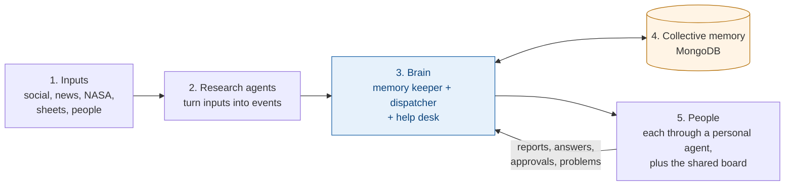

**The loop:** inputs → events → memory → tasks → people → events → memory. People receive work and are also a source of new facts, including the fact "my task went wrong".

**The same thing in the words of voice memo 3:** boxes 1–2 are the *event feed*, boxes 3–4 are the *shared model of the crisis*, box 5 is the *personal agents* that give each person their own priority list.

---

## 2. Every component

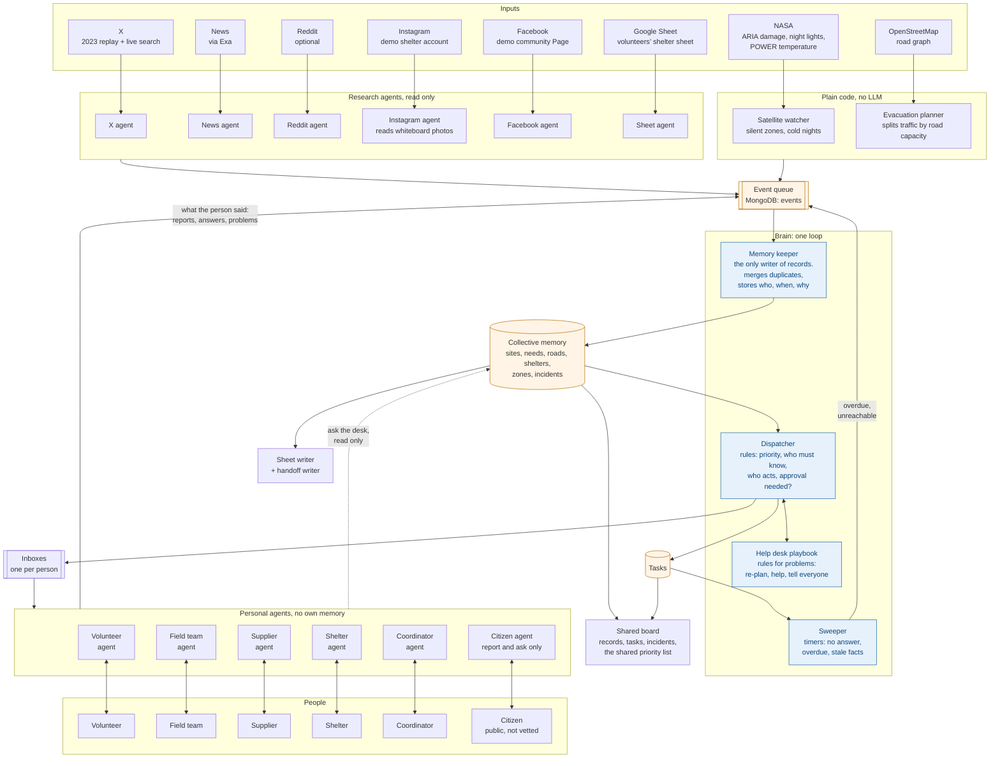

Not drawn, to keep the picture readable: the sheet writer writes back into the Google Sheet, and the evacuation planner reads road closures from the memory.

| Component | Job | LLM? | Writes |
|---|---|---|---|
| **Research agents** | One source each. Turn a post into a structured event (person, place, need, closure, capacity), with an English translation | Yes, one call per item | Nothing. Post events |
| **Personal agents** | Talk to one person. Turn what they say (text, voice, photo) into events. Tell them their inbox in plain words. Answer questions about the crisis (**v2**) | Yes | Nothing. Post events |
| **Satellite watcher** | Heavy damage + few calls + power out → silent-zone alert. Night temperature below 0 °C → cold flag (**v2**) | No, a rule | Nothing. Posts events |
| **Evacuation planner** | Closures + hazard + zones → exit per zone, split by road capacity | No, a flow algorithm | Nothing. Posts a plan for approval |
| **Event queue** | Every new fact waits here. People on the desk first, then outside sources, oldest first (**v2**) | No | — |
| **Memory keeper** | Takes events one at a time. Merges duplicates, updates records, logs who, when, source, reason | Only when the merge rules cannot decide | **Records** (the only one) |
| **Dispatcher** | Reacts to each change. Ranks work, finds who must know and who should act, creates tasks, holds risky tasks for approval | No, rules | **Tasks and inboxes** (the only one) |
| **Help desk playbook (v2)** | Part of the dispatcher. When an `incident` arrives: protect the mission, help the person, tell everyone affected | No, rules | Through the dispatcher |
| **Sweeper (v2)** | Part of the dispatcher. Runs on a timer: no answer, ETA passed, stale facts, stuck events | No, rules | Through the dispatcher |
| **Inboxes** | One queue per person | No | — |
| **Shared board** | Live view of every record, task and incident with owner and age, sorted by priority | No | — |
| **Sheet writer** | Writes desk changes back to the volunteers' Google Sheet. Ignores its own edits when they come back (**v2**) | No | Only the sheet |
| **Handoff writer** | Summary for whoever takes over a shift, including open incidents | Yes | Nothing |

### One writer per collection (v2)

Version 1 said "the memory keeper is the only writer" and also let the dispatcher write tasks. This table removes the doubt.

| Collection | The only writer |
|---|---|
| `events` | Anyone, but only by `postEvent()` (insert). The memory keeper changes the status |
| `sites`, `needs`, `roads`, `shelters`, `zones`, `incidents` | Memory keeper |
| `tasks`, `inbox` | Dispatcher (the playbook and the sweeper are part of it) |
| `users`, `messages` | The app's API: login, heartbeat, chat |

---

## 3. Data model (MongoDB)

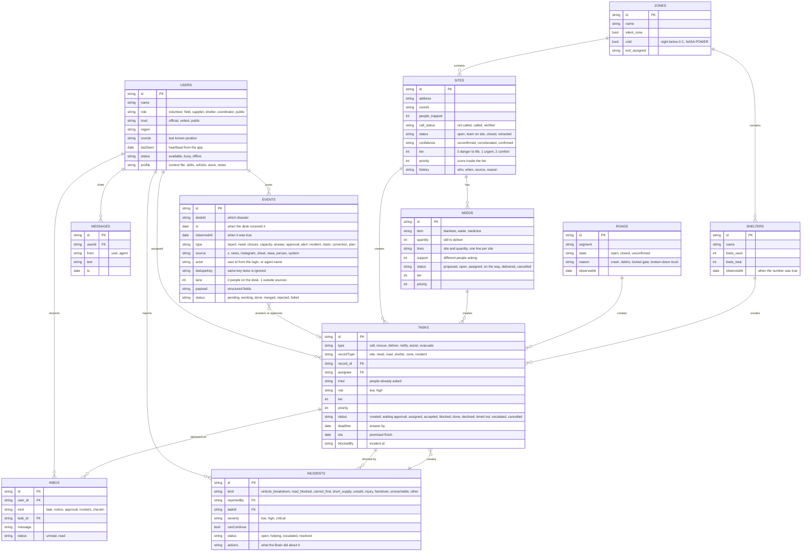

Every record keeps a `history` list: who changed it, when, from which source, and why. That is what makes the board and the handoff honest.

**What v2 added to the model, and why**

| Added | Why |
|---|---|
| `incidents` collection, `tasks.blocked`, `tasks.blockedBy` | A task can now fail after it was accepted (§6) |
| `users.coords`, `lastSeen`, `profile` | "Nearest free team" needs a position. The profile is each person's context file (voice memo 3) |
| `messages` collection | The agent loads "the last few messages", so they must be stored somewhere |
| `tier`, `priority`, `support` | The shared priority list and "enough people asked for it" (voice memo 3) |
| `trust`, `confidence` | Who may say what, and how sure the desk is (voice memo 2) |
| `observedAt` | A whiteboard photo that is two hours old was the Lahaina failure. Age must be the age of the fact, not of the upload |
| `deskId` on everything | Türkiye and Lahaina are two disasters in one database |
| `dedupeKey`, `lane`, `lockedAt`, `attempts` on events | No double processing, no stuck events, life-critical first (§10) |
| `needs.lines` | "30 blankets for sites 57 and 61" needs to say how many go to each |
| `tasks.tried`, `tasks.eta`, `tasks.recordType` | Never ask the same person twice. Know when a promise is late. Know which collection a task points to |
| Task type `approve` removed | An approval is the `waiting_approval` status plus an inbox item of kind `approval`. One way to model it, not two |

The exact TypeScript is in [[Team contracts#3. Data shapes|Team contracts §3]].

---

## 4. Lifecycles

### An event
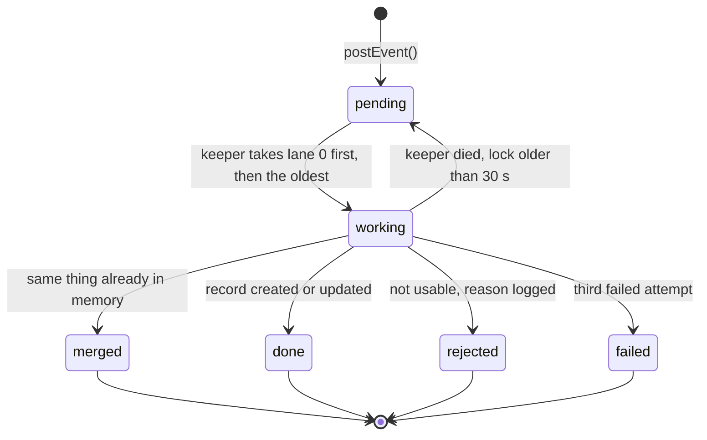

### A task
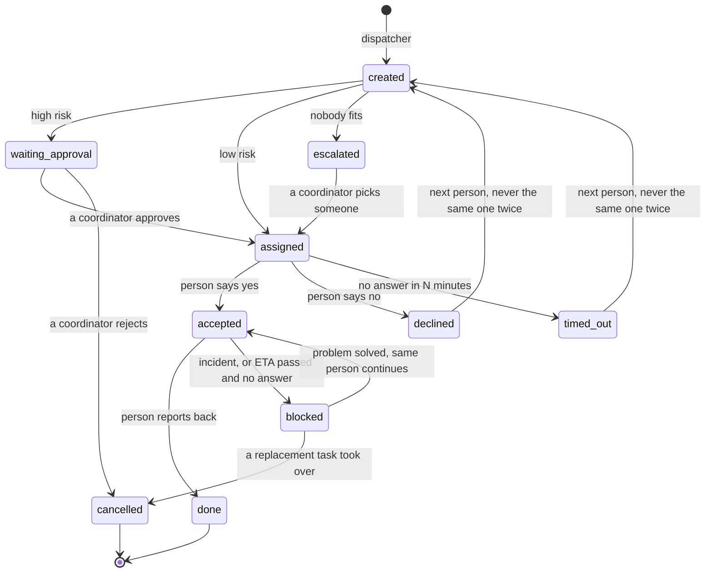

### A need (v2)
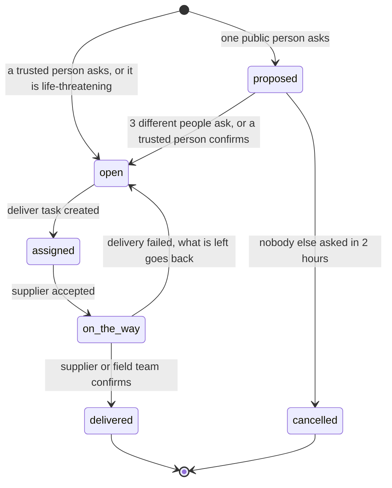

### An incident (v2)
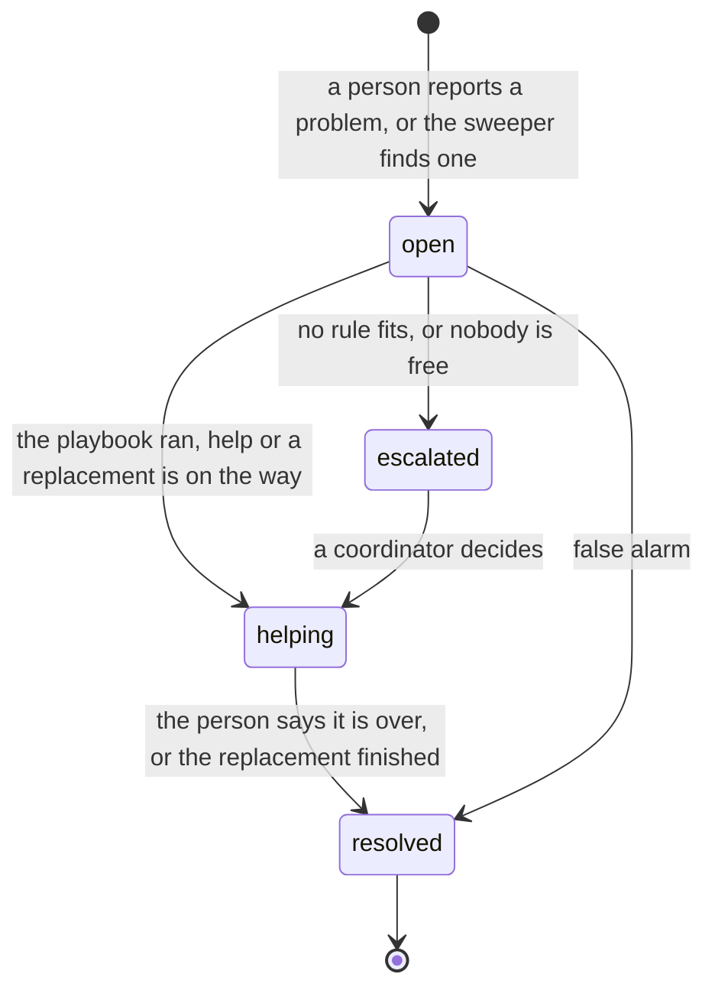

---

## 5. How the dispatcher decides

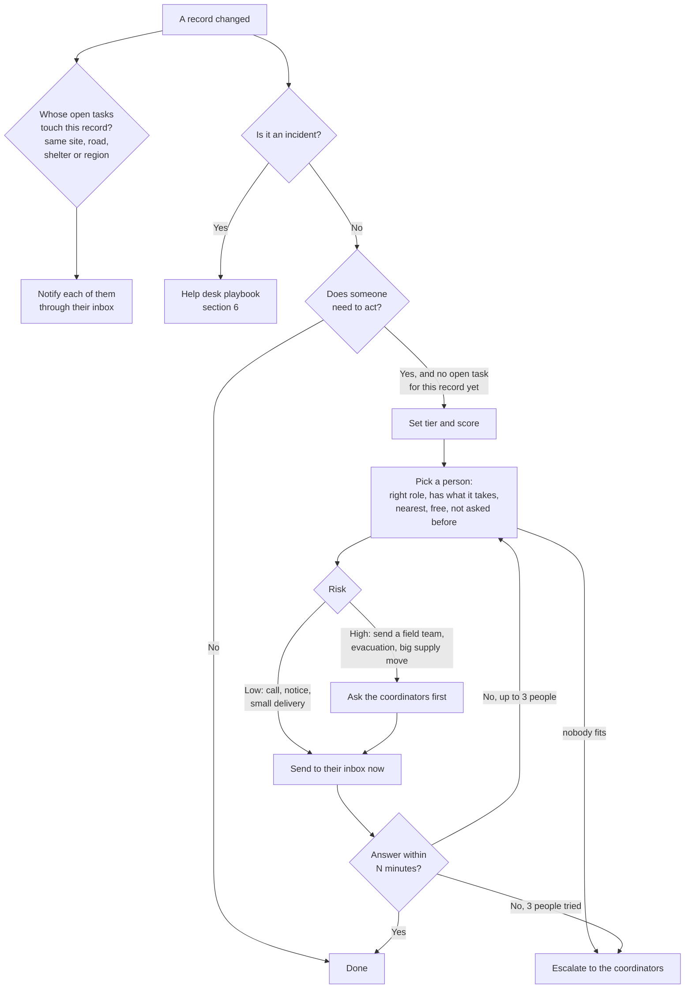

### Priority: tier first, then score (v2)

Version 1 named the order ("danger to life, then age, then silent zones") but gave no number, so it could not be coded or explained. This is the rule.

| Tier | Meaning | Examples |
|---|---|---|
| **0** | Danger to life | A trapped person, a life-threatening need, an injury incident |
| **1** | Urgent, no direct danger | A full shelter, a closed road, supplies for many people |
| **2** | Comfort | Hot meals, phone chargers |

Inside a tier, the higher score goes first:

```
score = 10 × different people or sources asking   (at most 50)
      +  1 × minutes waiting                      (at most 60)
      + 30   if the place is in a NASA silent zone
      + 20   if it is a warmth need (blankets, tents, heaters)
             and the NASA POWER night minimum there is below 0 °C
```

- **Tier always wins.** A comfort need with 50 supporters never passes a trapped person.
- **Copies do not count.** 400 retweets of one tweet are one voice. `support` counts different reporters.
- **Satellite data only ever raises** a score. Both NASA terms are positive.
- **A person makes the final call.** A coordinator can pin an item to the top or push it down. The reason is required and goes into the history. Rules propose, a human decides, and both are on the record. This is the answer to "who decides the priorities?" from the voice memos.
- **Two lists come out of one number.** The *shared priority list* on the board is every open task sorted by tier and score. A person's *own priority list* is the same sort over their own tasks, and their agent names the top one first.

### When does one person's wish become shared work? (v2)

From voice memo 3: one person asking for burgers is one node; if enough people ask, it goes on the shared list.

| Who says it | What happens |
|---|---|
| Field team, shelter, coordinator (`official`), or a vetted volunteer or supplier (`vetted`) | The need is `open` at once |
| A citizen or a social post (`public`), no danger to life | The need is `proposed`: visible on the board, creates no task. It opens when **3 different people** ask, or one trusted person confirms |
| Anyone, danger to life | Never waits. A volunteer gets a call task to verify it right away |

### Trust and confidence (v2)

| Trust level | Who | How they get it |
|---|---|---|
| `official` | Coordinators, field teams, shelter staff | Their organization's sign-in (SSOJet), or a coordinator grants it |
| `vetted` | Volunteers, suppliers | A coordinator approves their request |
| `public` | Citizens, and every social post | Default for anyone who signs in |

| Confidence of a fact | Rule |
|---|---|
| `confirmed` | Reported or checked by an `official` or `vetted` person: a field team on site, a volunteer's phone call, shelter staff about their own shelter |
| `corroborated` | 3 or more independent `public` sources |
| `unconfirmed` | Anything else |

- **Uncertain danger makes the plan more careful.** An unconfirmed road closure still closes the road for routing.
- **Uncertain wishes wait.** An unconfirmed comfort need stays `proposed`.
- **When two sources disagree** about the same field: the higher trust wins. Same trust: the newer `observedAt` wins. The losing value stays in the history. If two trusted sources disagree within 10 minutes (the sheet says 41/60, the photo says 58/60), the shelter gets a notice to confirm.
- A social post alone can never approve, close or cancel anything.

### Picking a person (v2)

A candidate must pass every line. It is a small constraint problem solved greedily.

1. Same desk, and a role that fits the task type.
2. Has what the task needs: stock and a vehicle for `deliver`, tools or a vehicle for `assist`.
3. Free: seen in the last 3 minutes, fewer than 3 open tasks.
4. Not in the task's `tried` list.

Among those who pass: nearest first (straight-line distance, or same region when a position is missing), then fewest open tasks. If nobody passes, the task is `escalated` to the coordinators with the reason.

### Approvals (v2)

A high-risk task goes to **every coordinator** on the desk. The first answer wins. If nobody answers in N minutes the item turns red on the board and is sent again. The desk never approves by itself.

### Sweeper: what runs on a timer (v2)

| Check, every 5 s | Action |
|---|---|
| Task `assigned`, no answer in N minutes (N = 2 in the demo) | `timed_out`, next person. After 3 people: escalate |
| Task `accepted`, ETA passed, or no word for M minutes | Send a check-in: "Still on your way?" After a second miss: open an incident of kind `unreachable` |
| Person not seen for 3 minutes | Counts as offline. Their unanswered tasks time out now |
| Shelter number older than 30 minutes | Ask that shelter to confirm |
| Road `unconfirmed` for 20 minutes | Ask the nearest field team to confirm |
| Event `working` for more than 30 s | Back to `pending`. Third time: `failed`, shown on the board |
| Approval waiting longer than N minutes | Turn red, send again |

**Order of the event queue:** lane 0 first (anything a person on the desk says or presses, and anything from the sweeper), then lane 1 (research agents and satellite). Oldest first inside a lane. A flood of tweets can no longer make a field team's report wait. This is only the order in which facts are *read*. Which *work* goes first is the tier and score above.

---

## 6. Help desk: when something goes wrong (v2)

Version 1 had a path for "no" and for "no answer". It had no path for **"I said yes, and then it went wrong"**: a supplier with 30 blankets gets a flat tire, and the need shows "on the way" forever while a field team waits in the cold. In a real response this is where the phone calls explode. The help desk is that missing path.

> [!important] The help desk is not a new agent and not a new writer
> It is one new event type (`incident`), one new collection (`incidents`), and one set of dispatcher rules (the playbook). The person tells **their own agent**, the same as everything else. Nothing else in the design changes.

### How a problem enters

| Way in | Detail |
|---|---|
| **Chat or voice** | "Flat tire, I'm stuck at km 14." The personal agent turns it into an `incident` event with the kind, the task, the position, and whether the person can still finish |
| **Problem button** | Every task card has a red **Problem** button with four choices: vehicle, road blocked, can't find it, other. Works without the LLM |
| **The sweeper** | The person cannot report (phone dead, no signal). The ETA passes, two check-ins get no answer, and the sweeper opens an `unreachable` incident by itself |

### What the Brain does, always in this order

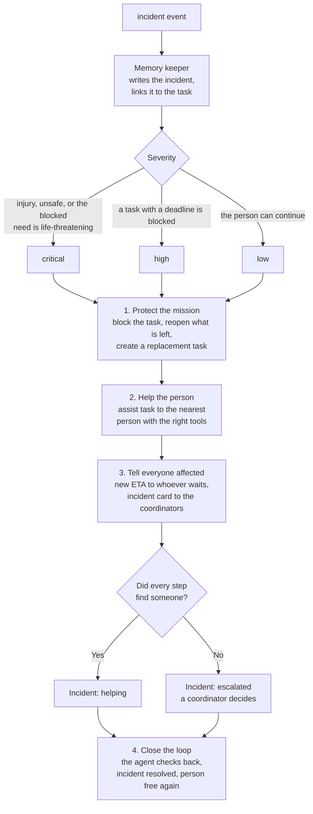

### The playbook

Plain code, one row per kind. The LLM only fills in the fields of the event. The rules decide.

| Kind | Example | What the Brain does by itself | Goes to a coordinator when |
|---|---|---|---|
| `vehicle_breakdown` | Flat tire, truck with 30 blankets | Task `blocked`. Need back to `open`. Replacement: **relay** (the nearest free vehicle picks the load up from the truck) or a **fresh delivery** from another supplier, whichever is closer to the site. `assist` task for the nearest person with tools. Waiting field teams get the new ETA | Nobody can replace it. Always told when the need is life-threatening |
| `road_blocked` | "I can't get through on Front St" | An unconfirmed `closure` on that road. Everyone whose task touches it gets a notice. The same task continues on another road, ETA updated | There is no other road |
| `cannot_find` | Wrong address, nobody at the site | Task paused. The site goes back to `not_called` with a note, and a volunteer verifies the address by phone | It fails a second time |
| `short_supply` | "I only have 12 of the 30" | The 12 go ahead. The other 18 go back to `open` and to the next supplier | Nobody has stock |
| `unsafe`, `injury` | Aftershock, gas smell, a team member is hurt | Task `blocked`. The site is flagged as a hazard. Everyone with a task at that site gets a warning. A medical or rescue task is proposed (high risk, needs approval) | Always, as critical |
| `unreachable` | ETA passed, no answer to two check-ins | Opened by the sweeper. Treated as a breakdown: the mission is protected first | Always told |
| `handover` | "My shift ends", "I can't go on" | The person's open tasks go to the next person, with their notes | — |
| `other` | "I can't log in", "I don't understand this task" | Nothing automatic | Always. This is the human help desk queue |

### Who answers the help desk

- **First line: the rules.** Most problems are one of a few kinds, and the fix is the same every time.
- **Second line: the coordinators.** They get an incident card for everything critical and for everything the rules could not solve. The card says what happened and what the desk already did, so they decide instead of collecting facts. No new role this weekend. A real deployment can add a `desk` role for a vetted volunteer.
- **Live web: Exa.** When no person on the desk can help (no mechanic, no tow truck), the supplier's agent searches the live web for the nearest tire service, tow service or pharmacy and puts the result on the incident card. This is a second real use of Exa, next to the news agent.

### Why it is cheap to build

| Layer | Change | Owner |
|---|---|---|
| Types | `incident` event, `Incident` record, task status `blocked` | Role 1 |
| Memory keeper | One handler: write or update the incident | Role 1 |
| Dispatcher | `lib/rules/incidents.ts`: the playbook table as code | Role 1 |
| Sweeper | The "ETA passed" check | Role 1 |
| Personal agent | One tool: `report_problem`. One optional Exa lookup | Role 2 |
| Screens | The Problem button, an Incidents column on the board | Role 3 |
| Demo | One scripted line: the truck breaks down | Role 4 |

It reuses the queue, the single writer, the assignment rule and the inboxes. Flow: [[#8.6 A truck breaks down (v2)]].

---

## 7. One turn of a personal agent

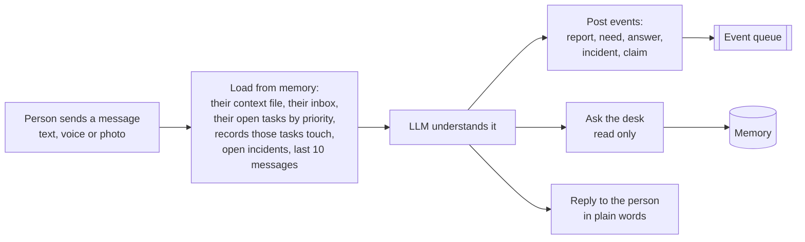

The personal agent **remembers nothing on its own**. Everything it knows comes from the collective memory, so nothing is ever known by one agent only.

### The context file (v2)

Voice memo 3: "every single person has their own context file". That file is `users.profile` plus the person's `messages`, both in MongoDB. It holds skills, languages, vehicle, stock for suppliers, and notes the agent should keep ("has a van", "speaks Arabic", "night shift"). The agent reads it every turn. The dispatcher reads it too when it picks a person, so the context file is useful to the whole desk, not only to one agent. This keeps decision 6: the agent still stores nothing itself.

### What a person can do in a turn

| The person | Tool the agent uses | Event |
|---|---|---|
| Answers a task: "called, voices heard", "on my way, 1 hour" | `answer_task` | `answer` |
| Says what they see or need | `post_report`, `post_need`, `post_closure`, `post_capacity` | `report`, `need`, `closure`, `capacity` |
| Says something went wrong (**v2**) | `report_problem` | `incident` |
| Says what they are already doing: "I'm taking water to the school" (**v2**) | `declare_work` | `claim` |
| Says the desk is wrong: "these are two buildings", "that report is false" (**v2**) | `correct_record` | `correction` |
| Asks a question: "which shelters have space?", "is Front St open?" (**v2**) | `ask_desk` | None, read only |

- **Ask the desk** is the crisis chatbot from voice memo 3. It is not a second bot: it is one read-only tool inside every personal agent, and a text box on the board. Every answer names its source and its age ("Shelter B 40 of 120, sheet, 6 minutes ago"). A person only gets answers about what their role may see (§9).
- **Declared work** is how "users tell the agent what they need to do" enters the shared list. The Brain records it as a task that person already accepted. If someone else is already doing it, the agent says so before the person sets off. Nobody picks work from a job board: work is pushed to people, and people can add their own.
- **Corrections** keep the promise in the main note that a person can steer the desk. `retract` and `edit` are simple. `split` and `merge` are a stretch goal.

---

## 8. The main flows

### 8.1 Nobody has called Ayşe
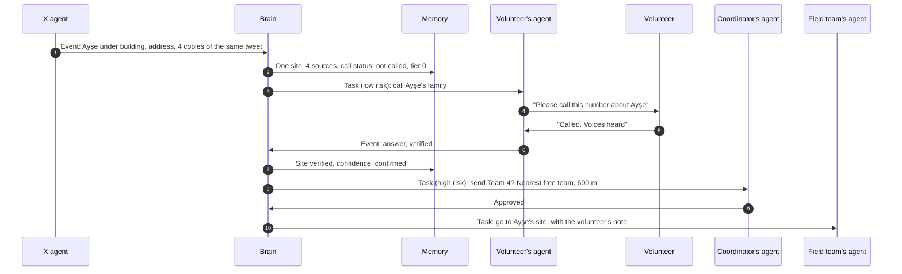

### 8.2 Blankets, without anyone calling anyone
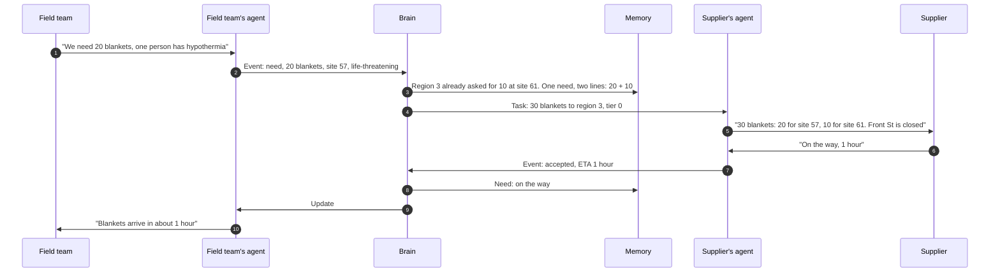

**Sum or not?** A second request from the **same site** for the same item is the same need said again: keep the larger number. A request from **another site** in the region is a new line, and the lines travel together in one delivery.

### 8.3 A road closes
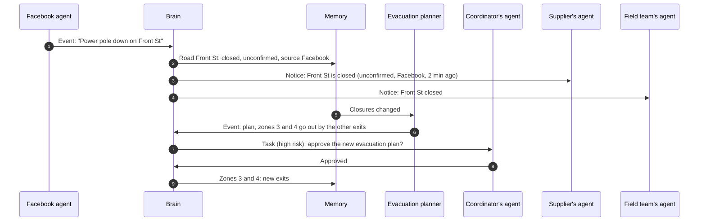

> [!warning] What the notice can promise
> "Use road Y" needs a road graph. We only load one for Lahaina. In the Türkiye scene the notice says which road is closed and why, and does **not** name another road.

### 8.4 A shelter fills up
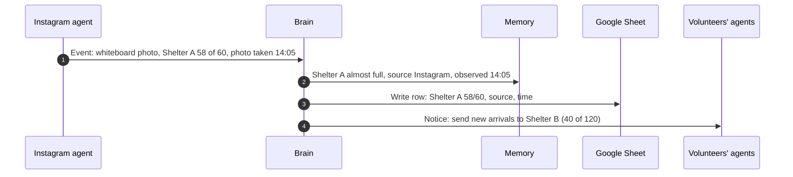

### 8.5 A silent zone
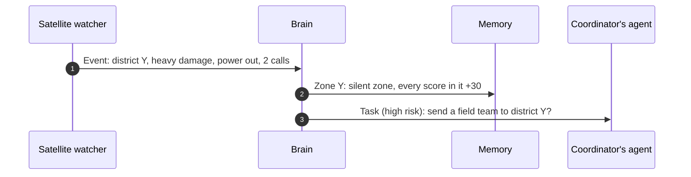

### 8.6 A truck breaks down (v2)
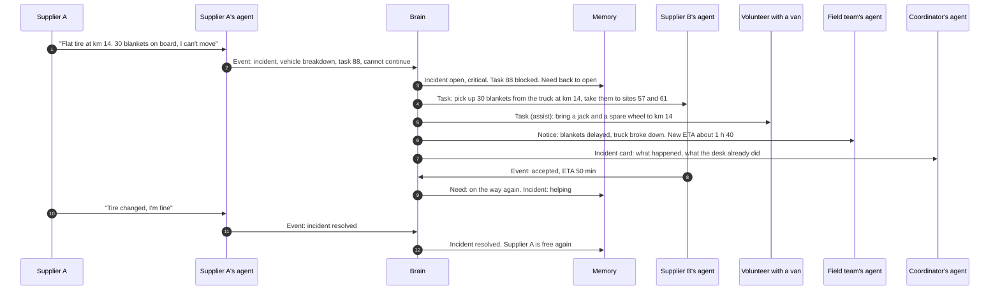

Nobody phoned anybody. The field team knew about the delay before they had to ask, and the coordinator only had to read.

### 8.7 Enough people ask for the same thing (v2)
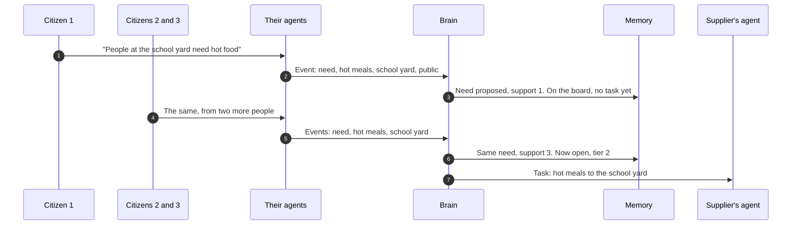

If a field team had said it once, the need would have opened at once.

---

## 9. Who can do what

| Role | Trust | Talks to | Sees on the board | Gets tasks | Can approve |
|---|---|---|---|---|---|
| **Citizen** (**v2**) | public | Own agent | Shelters with space, closed roads | No. Can report, ask, and offer help | No |
| **Volunteer** | vetted | Own agent | All sites and call status | Calls, small help | No |
| **Field team** | official | Own agent, phone, voice | Own tasks, sites and roads nearby | Rescue, on-site checks | No |
| **Supplier** | vetted | Own agent | All needs, roads | Deliveries, relays | No |
| **Shelter** | official | Own agent, or a photo of the whiteboard | Shelters | Confirm numbers | No |
| **Coordinator** | official | Own agent | Everything, incidents first | Approvals, escalations | Field team dispatch, evacuation plans, big supply moves, roles |

### Login and roles (v2)

Voice memo 3 opened with the question nobody answered: *how does someone log in as a volunteer, a shelter or a coordinator?*

- **Identity** comes from SSOJet (Google, Microsoft, or an organization's own sign-in).
- **Nobody picks their own role.** A new person is a citizen (`public`): they can report, ask and offer help, and they get no tasks.
- **A person asks for a role** ("I am a volunteer", "I run Shelter B"). A coordinator gets the request in the inbox and approves it. The grant is logged.
- **An organization comes in whole.** AFAD, a fire brigade or a county office connects its own sign-in once, and its members arrive as `official` field teams or coordinators. This is why single sign-on belongs in this product: in the first hour, an agency should join in minutes, not account by account.
- **The first coordinator** is set when the desk is created.

For the demo: seeded accounts, one per role. The request-and-approve flow is designed and is a stretch goal.

### Rules the API enforces (v2)

- The `actor` of an event comes from the login on the server. It is never read from the request body.
- An `approval` event is accepted only from a coordinator. An `answer` only from the person the task is assigned to.
- Workers and research agents send a shared key in a header.
- `?user=` on the API works only when `DEMO_MODE=1`.

Without these rules, anyone could approve a field team dispatch by posting one event.

---

## 10. How it runs

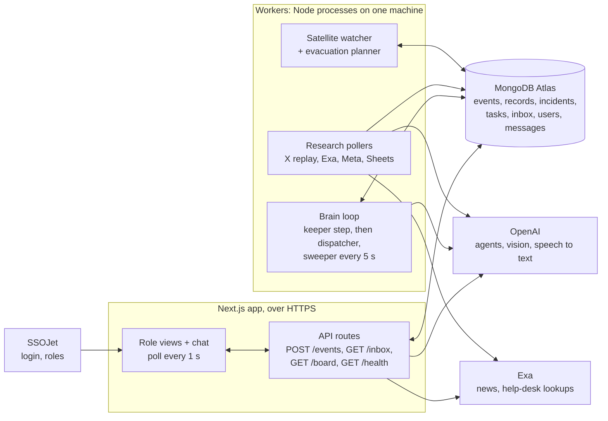

- **The queue is a MongoDB collection.** The memory keeper takes one event at a time with `findOneAndUpdate` on `pending`, sorted by lane and then age, which is atomic. Same for inboxes. The shape is Kafka-like (events = one topic, one inbox per person), so Kafka can replace it later without changing the design.
- **Real time = polling every second.** Enough for the demo. Atlas change streams can replace the polling later.
- **Models:** OpenAI for all LLM parts (track requirement). Exa feeds the news agent and the help-desk lookups (track requirement).

### One loop for the Brain (v2)

Version 1 ran the memory keeper and the dispatcher as two loops and left open how the dispatcher notices a change. Two loops can race: the dispatcher can see a half-written change, or create the same task twice. Version 2 keeps **two modules and one loop**:

```
forever:
    event   = take the next pending event (lane 0 first, then oldest)
    changes = memoryKeeper.apply(event)      // writes records, returns what changed
    dispatcher.react(changes)                // writes tasks and inbox
    every 5 s: sweeper.tick()
```

The files and the owners stay as they are. Only the entry point (`workers/brain.ts`) is new.

### Queue rules (v2)

| Problem | Rule |
|---|---|
| The keeper dies while an event is `working` | Each take stamps `lockedAt`. The sweeper puts events locked for more than 30 s back to `pending` |
| An event that always fails | `attempts` counts. The third failure sets `failed`, and the board shows it |
| The same tweet posted twice after a restart | `dedupeKey` (for example `x:<tweet id>`) with a unique index. The second insert is ignored |
| A flood of tweets delays a field report | `lane`: 0 for people on the desk and the sweeper, 1 for research agents and satellite |
| One LLM call per event is slow | Rules first: same `dedupeKey` or same text → a copy. Same kind within 100 m, or the same normalized address → the same record. The LLM is asked only when the rules cannot decide |
| The dispatcher creates the same task twice | Open tasks carry `open: true`. A unique index on `recordId + type` where `open` is true makes a second insert fail. A `blocked` task is not open, so its replacement can be created |

### The desk must not depend on the LLM (v2)

- Every task card has **Accept, Decline, Done and Problem** buttons that post events directly. Chat is the comfortable path. Buttons are the safe path.
- If OpenAI is slow or down, approvals, answers and incidents still work. Posts that could not be read stay on the board as raw text with a "not processed" mark.
- **Text from outside is data, never an instruction.** Research agents have no tools except "emit an event", and every payload is checked against its schema. A tweet that says "close all sites" becomes, at worst, one odd report.

### Where it runs (v2)

- **A phone browser only gives the microphone and the position to an HTTPS page.** `http://192.168.x.x:3000` will not record voice. Use a tunnel (`cloudflared` or `ngrok`) or deploy.
- **The loops need a real machine.** Serverless functions are short-lived, so the workers cannot live on Vercel.
- **Default for the demo:** one laptop runs the Next.js app and the workers, with a tunnel, and the phones open the tunnel URL from a QR code. **Option:** a Vultr instance (free credits, and it enters the Vultr prize). Decide by 22:00 and test voice on a real phone at CP2, not on Sunday morning.

### Health (v2)

`GET /api/health` returns the number of pending events, the age of the oldest one, the number of failed events, and the time of the last loop turn. The board shows it in one line at the bottom. When the demo freezes, this line says where.

### Privacy (v2)

- The board and the map show a masked phone number. The full number appears only in the task detail of the volunteer who has to call, and each view is logged.
- **Every phone number in the demo is made up.** The replay file replaces real numbers.
- Addresses are visible only after login. Nothing personal goes on a public page.

### Known limits we say out loud (v2)

- **No signal, no app.** A silent zone has no network, so people inside it cannot use the app. The desk reaches them through field teams. Offline send-later and SMS are not built.
- **One Brain loop.** Fine for hundreds of events. For a whole country the queue is split by region, which is where Kafka comes back.
- **Supplier stock is static** seed data. Real inventory is phase 2.

---

## 11. Resources we have and where each one goes (v2)

From the Hacker Packet. The full list with prizes and deadlines: [[Hackathon info]].

| Resource | What we get | Where it goes in the system | Status |
|---|---|---|---|
| **OpenAI** | Models, vision, speech to text | Every agent, whiteboard photos, voice messages | Core. Track requirement |
| **Exa** | $50 credits per hacker | News agent. Help-desk lookups (§6) | Core. Track requirement, so it must not be the first thing cut |
| **MongoDB Atlas** | Free tier, or $50 student credit | Queue, memory, incidents, tasks, inboxes | Core. MLH prize |
| **SSOJet** | Free plan, Next.js SDK | Login → role → what you see and what you may approve (§9) | Core. Partner track |
| **NASA ARIA damage map** | Likely building damage, Sentinel-1, about 30 m per pixel | Silent zones | Core for the NASA track. The service moved; the **new address works** and covers Malatya (checked 14 Nov, see [[Data sources]]) |
| **NASA night lights (GIBS)** | Black Marble gap-filled layer, about 500 m per pixel, no login | The "power out" half of a silent zone | Checked 14 Nov, works for 3 Jan and 8 Feb 2023 |
| **NASA POWER** | Daily temperature for any point, no key | The cold term in the priority score | Tested 14 Nov. Malatya, 9 Feb 2023: minimum −14.4 °C |
| **NASA EONET** | Live natural events, no key | "Live mode": open a desk from an event happening today | Stretch |
| **NASA API key** | One free key per person | Only if we use FIRMS for the Lahaina scene | Optional |
| **Vultr** | Free cloud credits | A machine for the workers and HTTPS (§10) | Optional. MLH prize |
| **GoDaddy Registry** | A free domain | The URL on the demo QR code | Optional, 10 minutes. MLH prize |
| **ElevenLabs** | Creator plan for a month | Reading tasks aloud to field teams | Only if voice becomes central. The track judges "voice is the product", so do not bolt it on |
| **Brev GPU, Gemini API** | Credits | Not needed: OpenAI is required by our track | Skip |
| **Mentors, help desk** | Halle Library, Discord help channel | SSOJet and Atlas questions | Use them early |

---

## 12. Decisions (settled)

| # | Question | Decision |
|---|---|---|
| 1 | Must it be "multiplayer AI"? | No. The pitch is coordination with less human relay |
| 2 | Does the agent assign tasks on its own? | Yes for low risk. High risk waits for a coordinator |
| 3 | Do people talk to each other directly? | Agents relay by default. A task can share a contact when needed, and that is logged |
| 4 | Is the dispatcher an LLM? | No, rules. The LLM only explains decisions to people |
| 5 | Brain: one part or two? | Two modules in code (memory keeper, dispatcher), **one loop**, one "Brain" in the pitch |
| 6 | Do personal agents keep memory? | No. They load from the collective memory every turn. The context file lives there too |
| 7 | Kafka? | No for the hackathon. MongoDB collections in a Kafka-like shape |
| 8 | How do people reach their agent? | Our web app, phone-friendly, text and voice. No WhatsApp or SMS this weekend |
| 9 | Which scene? | Türkiye first (real tweet data). Lahaina (Instagram, Facebook, evacuation) if time allows |
| 10 | What happens when a task goes wrong after it was accepted? | Help desk: an `incident` event, and the Brain re-plans by rules. Not a new agent, not a new writer (§6) |
| 11 | Who staffs the help desk? | Rules first. What rules cannot solve goes to the coordinators. No new role this weekend |
| 12 | How is priority decided? | Tier, then a score that anyone can read. A coordinator can override, with a logged reason (§5) |
| 13 | When does one person's wish become shared work? | Trusted reporter: at once. Public: when 3 different people ask. Danger to life never waits |
| 14 | Who may say what? | Three trust levels. Roles are granted, never self-chosen (§9) |
| 15 | A context file per person? | Yes: `users.profile` and `messages`, in the collective memory |
| 16 | Can people ask about the crisis? | Yes. "Ask the desk" is one read-only tool, not a second bot |
| 17 | A job board? | No. The board is for watching. Work is pushed, and people can declare work they are already doing |
| 18 | Who writes what? | One writer per collection (§2) |
| 19 | One disaster or many? | Every document carries `deskId` |
| 20 | Does the desk depend on the LLM? | No. Buttons post events directly |

---

## 13. Build plan (Sat 18:00 → Sun 12:00)

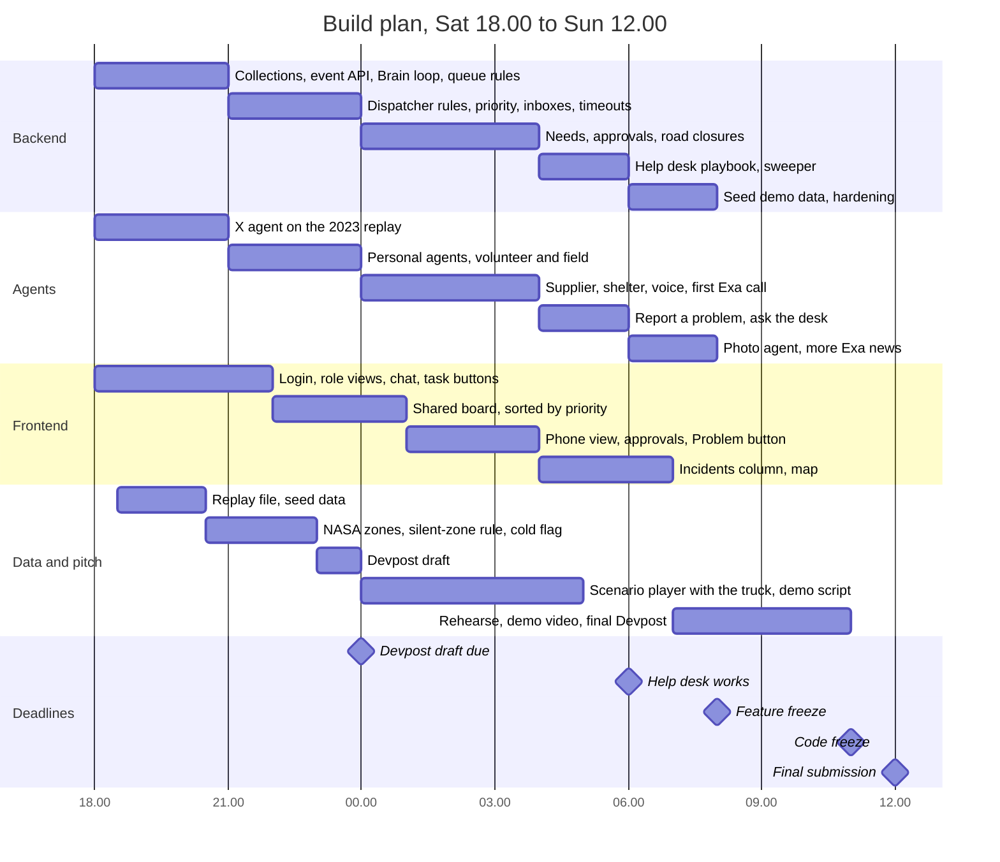

**Must work for the demo:** flows 8.1 and 8.2 end to end, the shared board, the coordinator approval, one real Exa call, one honest NASA layer, and login by role.

**First bonus:** flow 8.6, the truck. It is the strongest twenty seconds of the demo, because it shows the desk doing what no group chat does.

**If we are late, cut from the top:**
1. Instagram and Facebook agents, Google Sheets sync
2. Evacuation planner and the whole Lahaina scene
3. EONET live mode, role requests, corrections that split or merge
4. The "3 people ask" rule and declared work
5. Map polish
6. Ask the desk
7. The help desk Exa lookup (keep the playbook)

**Never cut:** the must-work list above.

---

## 14. Who builds what

| Role | Owns | Note |
|---|---|---|
| **Role 1: Backend and Brain** | MongoDB, event queue, memory keeper, dispatcher, priority, help desk playbook, sweeper, board and inbox API | [[Role 1 - Backend and Brain]] |
| **Role 2: Agents** | Research agents (X, Exa news), personal agents and their tools (incl. report a problem, ask the desk), `/api/chat`, voice and photo | [[Role 2 - Agents]] |
| **Role 3: Frontend** | Repo skeleton, SSOJet login, role screens, chat, task buttons, shared board with incidents, map | [[Role 3 - Frontend]] |
| **Role 4: Data, NASA and pitch** | Tweet replay, seed data, NASA silent zones and cold flag, scenario player, Devpost, video | [[Role 4 - Data, NASA and pitch]] |

Shared data shapes, API, folder ownership and checkpoints: [[Team contracts]]. Read it before writing code.
