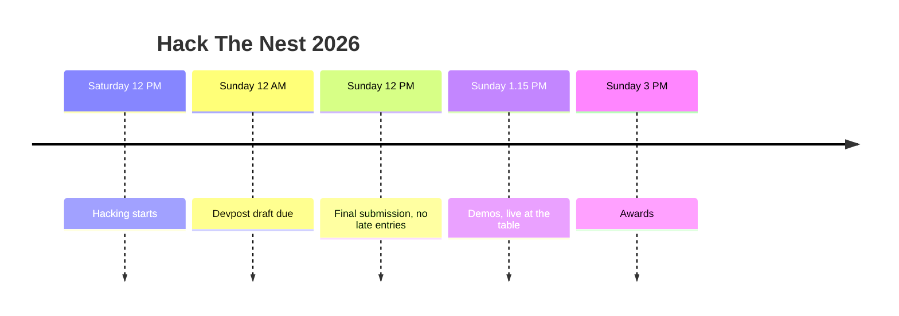

# Hackathon info: Hack The Nest 2026

Main note: [[Multiplayer Disaster Desk]]

Eastern Michigan University, 14–15 November 2026. Teams of 1 to 4. Source: the Hacker Packet PDF.

## Timeline

| What | When |
|---|---|
| Devpost draft | **Sunday 12:00 AM** (you can keep improving it afterwards) |
| Final submission | **Sunday 12:00 PM**, no late entries |
| Demos | Sunday 1:15 PM, science-fair style. About 2 minutes live at the table, then questions |

**Devpost needs:** name, short description, the problem it solves, a **public GitHub repo**, a **demo video under 3 minutes** (MLH requires it), every team member, the tracks you enter, and the AI tools you used.

> [!warning] Judges may ask about the code
> Everyone on the team should be able to explain any part of it.

## Track fit

| Track | Fit | Why |
|---|---|---|
| **Future of Intelligence** (OpenAI + Exa) | Very good | The track asks for "the thing that needs an agent to exist at all" and "a real user and a real problem". **Requirement: build on OpenAI models and Exa.** |
| **Beyond the Horizon** (NASA) | Good | Silent zone detection with the ARIA damage map and Black Marble. A judge who knows the science will check, so the data must be used correctly |
| **SSOJet** | Good | Role-based login (coordinator, field team, volunteer) fits the product naturally, which is exactly what the judges look for |
| **MongoDB Atlas** (MLH) | Good | The shared desk data lives here |
| **ElevenLabs** | Optional | Field teams report by voice. Only scores if voice is a real part of the product |

## Prizes (selected)
- **Overall:** 1st a PS5 each, 2nd a Switch 2 each, 3rd a 43" TV each
- **Beyond the Horizon:** a telescope each
- **SSOJet:** business licenses for the team
- **MongoDB:** an M5Stack IoT kit each
- **Future of Intelligence:** announced at kickoff

## Resources
- **GPU:** not needed (the model runs through the OpenAI API). If needed: Brev (Discord `#operation-qa-participants`, tag @Matt Cool) or Vultr credits.
- **Exa:** $50 in credits per hacker, code at kickoff and on Discord.
- **NASA API key:** free, one per teammate: api.nasa.gov.

## Key rules
- All code must be written during the 24 hours. Ideas and planning beforehand are fine.
- Only public, synthetic or our own data.
- Partner keys never go into GitHub or public channels.
