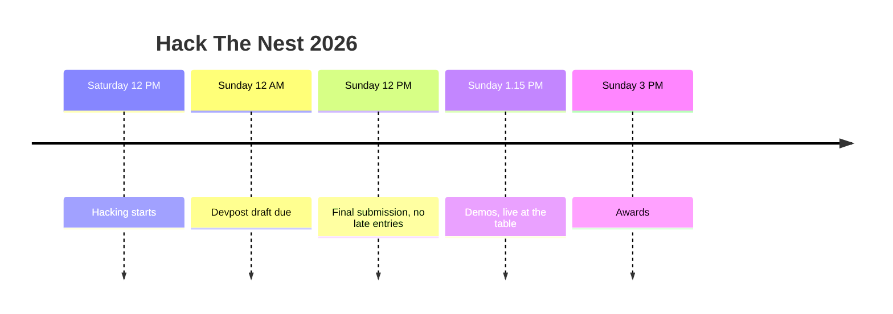

# Hackathon info: Hack The Nest 2026

Main note: [[Multiplayer Disaster Desk]]

Eastern Michigan University, 14–15 November 2026. Teams of 1 to 4. Source: the Hacker Packet PDF.

## Timeline

| What             | When                                                                                  |
| ---------------- | ------------------------------------------------------------------------------------- |
| Devpost draft    | **Sunday 12:00 AM** (you can keep improving it afterwards)                            |
| Final submission | **Sunday 12:00 PM**, no late entries                                                  |
| Demos            | Sunday 1:15 PM, science-fair style. About 2 minutes live at the table, then questions |

**Devpost needs:** name, short description, the problem it solves, a **public GitHub repo**, a **demo video under 3 minutes** (MLH requires it), every team member, the tracks you enter, and the AI tools you used.

> [!warning] Judges may ask about the code
> Everyone on the team should be able to explain any part of it.

## Track fit

| Track                                     | Fit       | Why                                                                                                                                                       |
| ----------------------------------------- | --------- | --------------------------------------------------------------------------------------------------------------------------------------------------------- |
| **Future of Intelligence** (OpenAI + Exa) | Very good | The track asks for "the thing that needs an agent to exist at all" and "a real user and a real problem". **Requirement: build on OpenAI models and Exa.** |
| **Beyond the Horizon** (NASA)             | Good      | Silent zone detection with the ARIA damage map and Black Marble. A judge who knows the science will check, so the data must be used correctly             |
| **SSOJet**                                | Good      | Role-based login (coordinator, field team, volunteer) fits the product naturally, which is exactly what the judges look for                               |
| **MongoDB Atlas** (MLH)                   | Good      | The shared desk data lives here                                                                                                                           |
| **ElevenLabs**                            | Optional  | Field teams report by voice. Only scores if voice is a real part of the product                                                                           |

## Prizes (selected)
- **Overall:** 1st a PS5 each, 2nd a Switch 2 each, 3rd a 43" TV each
- **Beyond the Horizon:** a telescope each
- **SSOJet:** business licenses for the team
- **MongoDB:** an M5Stack IoT kit each
- **Future of Intelligence:** announced at kickoff

## Resources

Everything the Hacker Packet gives us, and what we do with it. Where each one sits in the system: [[Final system design#11. Resources we have and where each one goes (v2)|Final system design §11]].

| Resource | What the packet gives | How to get it | We use it for |
|---|---|---|---|
| **OpenAI** | Models for the Future of Intelligence track | Team account. Docs: platform.openai.com/docs | Every agent, photos, voice. **Required by our track** |
| **Exa** | $50 in API credits per hacker | Code at kickoff and on Discord. Docs: docs.exa.ai | News agent, help-desk lookups. **Required by our track** |
| **MongoDB Atlas** | Free tier forever, or a $50 student credit | mlh.link/mongodb | The queue, the memory, the inboxes |
| **SSOJet** | Free plan, SDKs for Next.js and Node | ssojet.com | Login and roles |
| **NASA live APIs** | One free key per teammate, about 1,000 requests an hour | api.nasa.gov. EONET, POWER and GIBS need no key | Silent zones, cold flag, live events. Details: [[Data sources]] |
| **Vultr** | Free cloud credits | Sign up, mlh.link/vultr | Optional: a machine for the workers, with HTTPS |
| **GoDaddy Registry** | A free domain, with a claim code | MLH prizes page, mlh.link/GoDaddyRegistry | Optional: the URL on the demo QR code |
| **ElevenLabs** | Creator plan free for a month | Key at kickoff and on Discord | Not planned. Judged on "voice is the product, not a feature bolted on at 3 AM" |
| **Brev GPU** | Credits for about 50 teams, first come first served | Team captain posts in `#operation-qa-participants`, tags @Matt Cool | Not needed |
| **Gemini API** | MLH prize for using it | mlh.link/gemini | Not used. Our track requires OpenAI |
| **Mentors and help desk** | In Halle Library during hacking, plus the Discord help channel | Walk over, or post | SSOJet and Atlas setup questions. Ask early |
| **Workshops** | Devpost draft: Sat 9:00–9:30 PM, Student Center 310AB · Final submission: Sun 9:00–9:45 AM, Halle · Demo video: Sun 10:00–10:45 AM, Halle | Just go | Role 4 |

Not relevant to us: Base44, Breez and Solana (money), Quantum Rings and Xanadu (quantum), g.tec and PiEEG (brain signals), Seqera (bioinformatics), Tiger Data.

**After the weekend:** the DEV Writing Challenge pays $100 for a post about what we built (dev.to/mlh-hackathon). The SpaceXSI raffle needs Cursor as the main coding agent plus a Grok Bot; enter it only if that is true for us.

## What each track's judges check

| Track | Their bar, from the packet | What that means for us |
|---|---|---|
| **Future of Intelligence** | "A real user and a real problem." "A thin wrapper around one API will not place." "Show us the thing that needs an agent to exist at all." Polished like a real product | Lead with the people and the relay problem. Show **both** OpenAI and Exa working. The help desk flow is the best proof that this needs agents |
| **Beyond the Horizon** | NASA data **at the centre**, not decoration. Say which dataset, which dates, which place, with links. Know what one pixel means. Show how clouds and missing data were handled. Check the result against something known. Be honest about limits | See the checklist below |
| **SSOJet** | "How naturally sign-in fits your product, not how many providers you wired up." Not "a login page with nothing behind it" | The role decides what a person sees and what they may approve. An agency joins with its own sign-in. A role picker instead of SSOJet takes us out of this track |
| **MongoDB Atlas** | Any hack that stores its data in Atlas | Say how: queue, memory, incidents, inboxes |

### NASA checklist (Role 4 owns it)
- [ ] The project page carries this line: **"Supported by the Michigan Space Grant Consortium, NASA grant 80NSSC20M0124."**
- [ ] NASA is credited as the data source, each dataset is named, with links. No NASA logo. Nothing that sounds like NASA endorses us.
- [ ] On screen and in the write-up: dataset, date, place. "ARIA Damage Proxy Map, Sentinel-1, 10 Feb 2023, Malatya."
- [ ] Pixel size said out loud: damage map about 30 m, night lights about 500 m, temperature grid about 50 km.
- [ ] How we handled clouds and gaps: we use the gap-filled night-lights layer, and we say the damage map is weaker over vegetation and mountains.
- [ ] Compare the result with a published record or second dataset, as stated on page 9 of the organizer's guide. The previously proposed red-and-dark district is one team demo example. See [the requirements audit](../nasa-requirements-audit.md).
- [ ] Honest limits: the map shows likely damage, not single buildings. Satellite data only raises priority.

## Devpost checklist
- [ ] Name, short description, the problem it solves.
- [ ] **Public** GitHub repo (ask Darshal to make it public before 12:00).
- [ ] Demo video, **3 minutes or less**.
- [ ] Every teammate added.
- [ ] Tracks ticked: **Future of Intelligence** (main) · **SSOJet**, **Beyond the Horizon** (partner) · **MongoDB Atlas**, plus Vultr and GoDaddy if we used them (MLH).
- [ ] Which AI tools we used, honestly.
- [ ] The draft goes on Devpost **and in the event app** by midnight.

## At the demo table
- Find the table in the event app at 1:00 PM and stay at it. Judges come by **more than once**.
- About 2 minutes live, then questions. Partner tracks have their own judges.
- A judge may ask **anyone** to walk through **any** part of the code.

## Key rules
- All code must be written during the 24 hours. Ideas and planning beforehand are fine.
- Only public, synthetic or our own data.
- Partner keys never go into GitHub or public channels.
