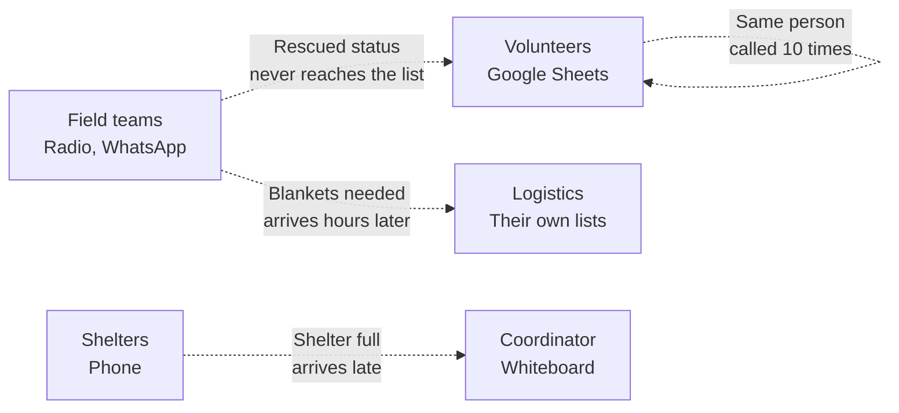
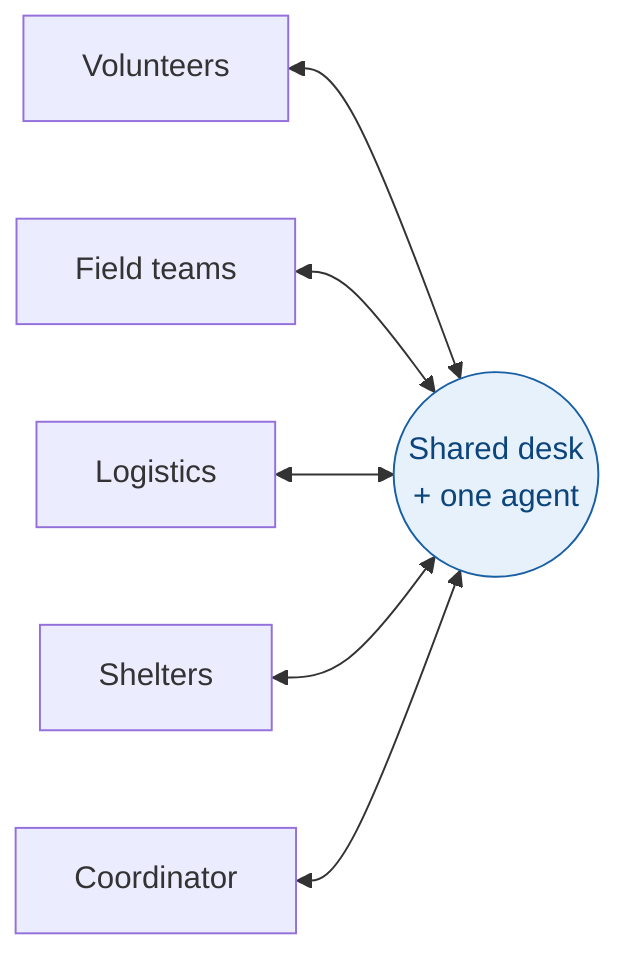
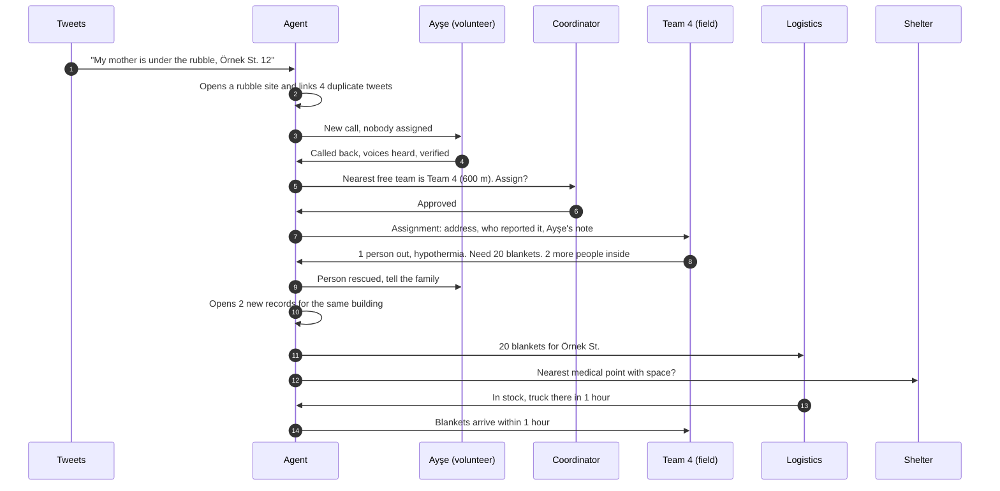
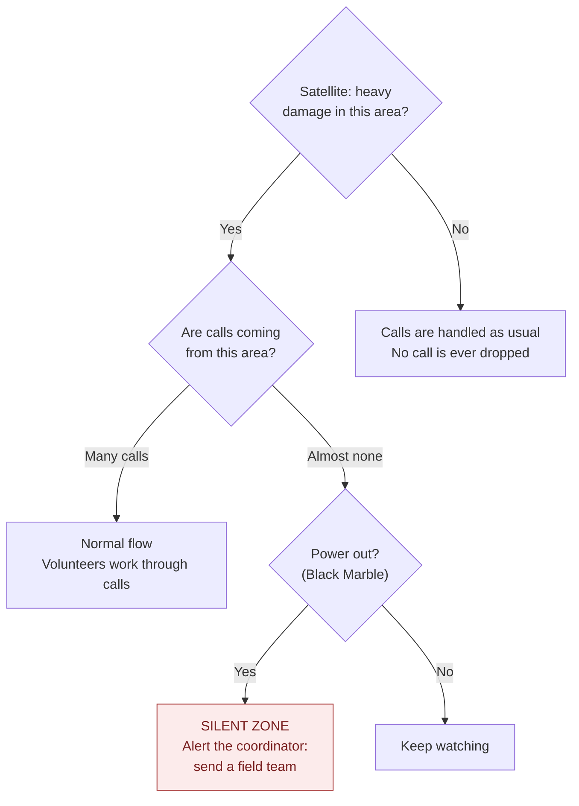
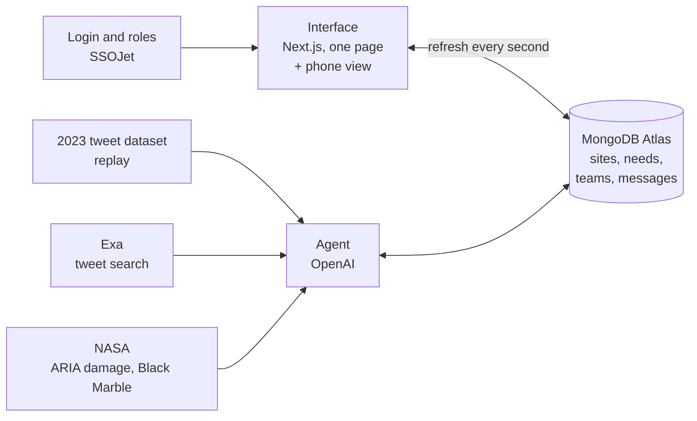

# Multiplayer Disaster Desk

> [!abstract] In one sentence
> A coordination app that brings the groups who work apart after an earthquake (volunteers, field teams, logistics, shelters and the coordinator) **onto one desk, with one shared agent**.

Jump to: [[System map.canvas|System map]] · [[Data sources]] · [[Hackathon info]]

---

## 1. Why this idea

### What multiplayer AI means
When Google Docs replaced Word, the pain it removed was emailing "report_v3_FINAL_final.docx" around. Today's AI version of that pain: **everyone asks their own ChatGPT and drops a screenshot of the answer into a group chat.** Context gets lost, and nobody knows who decided what.

**Multiplayer AI** means several people working **in the same agent session**. Everyone can see what the agent is doing, redirect it, and hand the work off to someone else.

> [!question] Is an idea really multiplayer AI? A two-question test
> 1. **If you remove the other people, does the product lose its point?** The answer should be yes.
> 2. **If you remove the AI, are you left with an ordinary shared app?** The answer should be yes.
>
> This idea passes both. Without people, nobody calls or rescues anyone. Without the AI, you are left with a Google Sheet full of duplicate rows, which is exactly what happened in 2023.

### What happened in 2023
After the 6 February 2023 earthquakes in Türkiye, thousands of people posted on Twitter: "My mother is under the rubble, the address is …". Volunteer developers built models that pulled addresses out of these tweets (afetharita). Hundreds of volunteers tried to track the calls in Google Sheets and Discord. Rescue teams, logistics and shelters each worked **in their own channel**.

---

## 2. The real problem: groups that do not talk to each other

Collecting the information was not the problem. The problem was that **information got lost every time it passed from one group to another.**

### Today


- A field team pulls someone out, but the volunteers' list still shows that person as "under the rubble".
- A team says "we need blankets here", and logistics hears about it hours later.
- A shelter is full, but new arrivals are still being sent there.
- The same tweet is shared hundreds of times, so ten volunteers call the same person. Other people never get a call.

### With the app


Everyone sees the same picture. Nobody passes information between groups by hand. The agent does it.

---

## 3. Who uses it

| Role | Device | What they do | What the agent gives them |
|---|---|---|---|
| **Coordinator** | Laptop, map view | Assigns teams to areas, approves priorities | "The nearest free team for this site is Team 4. Approve?" |
| **Call volunteers** | Laptop | Call people back from tweets and phone calls to verify them | Merges duplicates and shows calls nobody has picked up |
| **Field teams** (AFAD, army, fire brigade, AKUT) | Phone | Take assignments, report back by voice or short text | Sends each report to everyone who needs it |
| **Logistics** | Laptop | Manage stock and vehicles | Groups and ranks needs by area |
| **Shelter / medical point** | Phone | Report capacity and needs | Changes routing when a shelter fills up |

The desk holds four kinds of records: **rubble sites**, **supply needs**, **teams and their locations**, and **shelter capacity**.

---

## 4. Main flow: the life of one case

This is the heart of the product. One case passes through five groups, and none of them passes information to another by hand.



### Step by step
1. **03:10**: A tweet comes in. The agent opens a **rubble site** and links 4 duplicate tweets to it.
2. **03:15**: **Volunteer Ayşe** calls the person who posted it: "Voices heard, verified."
3. **03:16**: The agent asks the **coordinator**: "The nearest free team is Army Team 4, 600 m away. Assign them?" The coordinator approves.
4. **03:17**: The assignment lands on **Team 4**'s phone: the address, who reported it, and Ayşe's note.
5. **05:40**: Team 4 reports by voice. From that one report the agent does four things:
   - Marks the person as "rescued" on Ayşe's list.
   - Opens new records for the 2 people still in the building.
   - Sends a need for 20 blankets to **logistics**.
   - Suggests the nearest **shelter** or medical point with space.
6. **05:50**: **Logistics** replies: "Truck there in 1 hour." The agent passes this on to Team 4.
7. **In the background, NASA**: The agent warns the coordinator about a **silent zone** (see [[#6. NASA data and silent zones]]).
8. **08:00**: Shift change. The agent writes a summary for the incoming coordinator: "23 people rescued overnight, 6 sites still open, 2 supply deliveries late."

> [!tip] This is what multiplayer AI looks like
> Everyone talks to **the same agent**, and the agent is **everyone's shared memory**. The volunteer, the soldier, the logistics officer and the coordinator work on the same case without messaging each other.

### Three multiplayer moments
| Moment | What happens |
|---|---|
| **Watching** | Someone who just joined sees live what the agent is doing and who is working on what |
| **Steering and pushback** | A volunteer says "these two addresses are not the same", and the agent corrects itself. If two instructions conflict, the agent does not quietly merge them. It shows the trade-off and asks the person in charge |
| **Handoff** | When a shift ends, the next person does not get a document. They take over the agent session itself |

---

## 5. What the agent does and does not do

| Does | Does not |
|---|---|
| Merges duplicates, opens and closes records | Assign a team without the coordinator's approval |
| Sends each report to the groups that need it | Drop a call because of satellite data |
| Suggests teams, supplies and shelters | Replace AFAD or official systems |
| Ties every piece of information to a source, a person and a time | Present uncertain information as fact |
| Writes the shift handoff summary | Predict how damage will spread |

---

## 6. NASA data and silent zones

Tweets only come from people who have **a phone, battery, internet and followers**. Older people, areas without power and villages without signal stay silent. **A satellite sees everyone.**

NASA produced two datasets for the 2023 earthquakes (details in [[Data sources]]):
- **ARIA Damage Proxy Map:** likely building damage, derived from radar satellite images.
- **Black Marble night lights:** areas that lost power.



The strongest part of this is that it **covers the blind spot of tweet-based tools.** The volunteer tools of 2023 could only see the people who were able to speak up.

> [!warning] Rules for judges who know the science
> - Satellite data only **raises** priority. It never drops a call.
> - Every satellite fact shows its date and source: "Sentinel-1, 10 Feb 2023, NASA JPL ARIA".
> - The damage map is less reliable over vegetation and mountains. Say so on screen.
> - The map shows **likely damage**, not individual buildings.

---

## 7. What the app looks like

### Desk view (coordinator and volunteers)
```
┌─────────────────────────────────────────────────────────────────┐
│ Disaster desk · Malatya · night shift        AY  MK  ZD + agent │
├──────────────────────┬──────────────────────────────────────────┤
│ INCOMING             │ SHARED LIST                              │
│                      │                                          │
│ Tweet (translated):  │ Site 57 · Örnek St. 12       [2 sources] │
│ "My mother is under  │   1 person, voices heard · Ayşe calling  │
│ the rubble, St. 12"  │                                          │
│  → New site 57       │ Site 52 · Çınar St.   [unassigned 2 h]   │
│                      │   3 people · no phone number             │
│ Team 4 (voice): "1   │                                          │
│ person out..."       │ Need · 20 blankets · Logistics: 1 h      │
│  → Site 41 closed    │                                          │
│                      │ Shelter A 90% · Shelter B 40%            │
│ NASA: district Y     │                                          │
│  → Silent zone       │                                          │
├──────────────────────┴──────────────────────────────────────────┤
│ SHARED AGENT SESSION (everyone sees it)                         │
│ Mehmet: There are two buildings on St. 12, may not be the same  │
│ Agent:  You may be right, splitting the record. Zeynep, take it?│
│ Zeynep: On it                                                   │
│ ⇄ Ayşe leaves at 04:00. Summary: 14 closed, 3 urgent unassigned │
└─────────────────────────────────────────────────────────────────┘
```

### Field team view (phone)
```
┌───────────────────────────┐
│ Team 4 · Assignment       │
│ Örnek St. 12, No 4        │
│ 1 person, voices heard    │
│ Reported by Ayşe, 03:15   │
│                           │
│ [ On our way ] [ Arrived ]│
│                           │
│ ( Hold to report          │
│   by voice )              │
└───────────────────────────┘
```

---

## 8. What we show at the hackathon

| Where | What |
|---|---|
| **Pitch** | The full vision: five groups, one desk, one agent, silent zones |
| **Live demo** | Play the "life of one case" story from start to finish on four devices, one role per team member: volunteer, coordinator, field phone, logistics. The shelter role is covered in the pitch |
| **Data** | Tweets are real, from the 2023 dataset, replayed as if they were arriving live. NASA layers are real. Field and logistics reports are synthetic, and we say so |

> [!example] The strongest demo moment: side by side
> Split the screen. **Left, today:** every group in its own channel, four different and conflicting versions of the same case. **Right, the app:** one desk, one case, and every change has an owner.

The interface is in English and the tweets stay in Turkish. The agent shows each tweet with an English translation, which also makes a strong impression on the judges.

Track fit and deadlines: [[Hackathon info]].

---

## 9. Technical skeleton



- **Real time:** every screen refreshes once per second (polling). That is enough for the demo, so there is no need for websockets.
- **Agent tools:** open site, merge, close, suggest team, create need, suggest shelter, write handoff summary.
- **Every message** stores who wrote it and when. The agent needs this to tie each decision to a person.
- **Coordinator approval** is a separate step in the database. The agent cannot assign a team until the approval is there.
