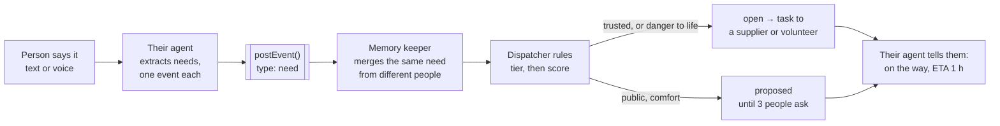

# Personal agents: what talking to your agent does

Read with: [[Final system design#7. One turn of a personal agent|Final system design §7]] · [[Team contracts]] · [[Frontend visual language]]

> [!abstract] For all four roles
> **Every person on the desk has their own agent.** Volunteer, field team, supplier, shelter, coordinator, citizen: one person, one agent, one chat. Talking to it does two different jobs. You **ask** it about the crisis (a read), and you **tell** it what you need (a write). Both go through the same chat box, text or voice. This note is what each team has to build so both jobs work.

---

## Background

The end-user skeleton is on `main`. Run `npm run dev` and open:

| Page | What it is |
|---|---|
| `/agent?user=zeynep` | **The end-user screen.** Left: the desk feed, every event from everyone. Right: this person's agent: their context file, their top task with Accept / Decline / Done / Problem, and the chat |
| `/board` | The shared board, one tab per record type (sites, needs, shelters, roads, incidents, tasks). A red badge on a tab counts the act-now items behind it |
| `/lab` | Every card in every state, for design work |

All three run on fake data in `fixtures/` until the real API is up. The chat falls back to a stub until `/api/chat` exists, and says so under the chat box.

The agent **remembers nothing on its own** (decision 6, unchanged). Every turn it loads the person's context with `getUserContext()`, and everything it learns goes out as an event through `postEvent()`. The context file (`users.profile`) shapes how it talks: the stub already shows this, Army Team 4's notes say "keep replies to one line" and its agent answers in one line, the supplier's agent quotes the stock on file.

---

## Job 1: ask the agent about the crisis (read)

A person asks in plain words and gets a summary of the whole desk's state, or of one part of it.

| Who asks | Example | What the agent reads |
|---|---|---|
| Coordinator | "what happened in the last hour?" "what's stuck?" | `getBoard()`: open incidents first, escalated tasks, tier 0 items with no owner |
| Volunteer | "which shelters have space?" | `searchMemory({ collection: "shelters" })` |
| Field team | "is İnönü Ave open?" "anything else at this building?" | roads and sites near their task |
| Supplier | "who still needs blankets?" | open needs by tier and priority |
| Citizen | "where can I sleep tonight?" | shelters with space, closed roads, nothing else |

Rules that do not bend:
- **Read only.** Asking never posts an event.
- **Every fact carries its source and age**, from `observedAt`: "Shelter B 24/60, sheet, 5 min ago". A number without an age is how Lahaina sent people to full shelters.
- **Role decides what you can see** ([[Final system design#9. Who can do what|§9]]). A citizen never gets site addresses or phone numbers.
- **The summary is built from records, not from the model's imagination.** If the desk has nothing, the agent says "the desk has nothing on that", it does not fill the gap.

## Job 2: tell the agent what you need (write)

People on the ground have needs of their own, and they say them out loud to whoever is closest. Today that is a WhatsApp group where the message scrolls away. Here, they say it to their agent, and the agent files it on the desk.

### What personal needs actually sound like

| Who | What they say | What the agent files |
|---|---|---|
| Citizen | "we are 6 people, a baby, no tent, it's freezing" | `need` tent, `need` blankets (warmth, cold-zone bonus applies), maybe `lifeThreatening` if the baby is hypothermic |
| Citizen | "my father's insulin is in the collapsed house" | `need` insulin, `lifeThreatening: true` → tier 0, a volunteer verifies by phone right away |
| Field team | "need 20 blankets, one person has hypothermia" | `need` 20 blankets **and** a `report` about the person. One sentence, two events |
| Field team | "we need a jackhammer at Çınar St." | `need` equipment, tied to the site |
| Field team | "my guys haven't eaten in 14 hours" | `need` food for the team. The helpers are people too |
| Supplier | "van's almost out of fuel" | `need` fuel. If it blocks a delivery it is a problem, so `incident` instead |
| Volunteer | "my phone is at 8%" | `need` power bank. Small, but a dead phone means unanswered calls |
| Shelter | "58 of 60, out of diapers, we need a doctor" | `capacity` 58/60, `need` diapers, `need` medical |

### What happens after the person speaks

**Who sets the priority: the rules, not the LLM.** This is the part to get right in the pitch, because judges will ask. The agent's job is narrow: hear the need, split it into clean events, set `lifeThreatening` honestly, and leave fields empty when unsure. Priority comes from the plain-code score in [[Final system design#Priority: tier first, then score (v2)|§5]]: tier first (danger to life always wins), then 10 × different people asking, minutes waiting, +30 silent zone, +20 warmth in a cold zone. Same inputs, same order, every time, and anyone can read why. The model never decides who gets help first.

### The person's own list

Each agent keeps the person's own list in front of them: their open tasks **and the needs they filed**, sorted by the same tier and score. The agent names the top one first, and when a need changes state it tells them without being asked:

- "Your tent request: 1 of 3 people asked so far. It goes on the shared list at 3."
- "Your blankets: on the way, Kızılay depot 2, about 1 hour."
- "The insulin request is with a volunteer now. They will call you."

That list is computed from the shared memory every turn. The agent stores none of it.

---

## What each team needs to do

**Role 1, Backend and Brain**
- [ ] `Need` has no field for who asked. Add `requestedBy: string[]` (user ids, one per different person). Without it no agent can say "your request", and `support` cannot be checked.
- [ ] `getUserContext()` returns the needs this person filed, with status, tier, priority and support. Today it only returns records their tasks touch.
- [ ] A feed endpoint, `GET /api/events?since=<ts>`, for the left side of `/agent`. The contract only has `POST`.
- [ ] Decide: is a helper's own need (food for a field team, fuel for a supplier) tier 1 by default? It keeps tier-0 work moving.

**Role 2, Agents**
- [ ] `ask_desk` has a summary mode: "what happened in the last hour" → `getBoard()` filtered by role, every number with source and age.
- [ ] One sentence can hold several needs. Emit one event per need ("blankets and a doctor" is two).
- [ ] On every turn, check the person's filed needs for status changes and say them first, before the next task.
- [ ] Citizens get an agent too, with the citizen prompt from §9: they can report, ask and offer help, they get no tasks.

**Role 3, Frontend (Dan)**
- [x] `/agent` and `/board` skeleton on fake data.
- [ ] A "your needs" list on `/agent` under the top task, once `requestedBy` exists.
- [ ] Hold-to-talk button on the chat, tested on a phone over HTTPS.
- [ ] Swap fixtures for `/api/board`, `/api/inbox`, `/api/chat` and the feed as each one lands.

**Role 4, Data and pitch**
- [ ] One demo beat with a personal need: a citizen says "6 of us, a baby, no tent", it shows up `proposed`, two more people ask, it opens and a supplier gets the task.
- [ ] Seed users with real-looking context files (skills, vehicle, stock, notes). The agent's voice comes from them.
