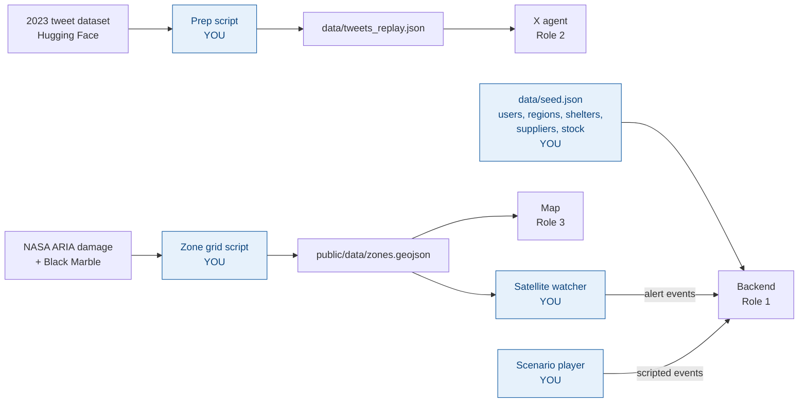

# Role 4: Data, NASA and pitch

**Owner:** _write your name here_

**Delivery status · 14 Nov 2026, 20:56 EST.** Replay/seed, NASA inputs and the scenario player are prepared for team integration. See [version notes](../../role-4-changelog.md), [handoff](../../role-4-handoff.md), [NASA evidence](../../nasa-evidence.md) and [the demo script](../../demo.md). The current NASA cache supports cold alerts and retains unknown silent-zone evidence.

Read first: [[Team contracts]] · Design: [[Final system design]] · Data background: [[Data sources]] · What changed in version 2: [[Design review 2026-11-14]]

> [!abstract] Your mission
> Make the demo **real and repeatable**: the tweet replay file, the seed data, the NASA silent-zone layer, and a scripted scenario that plays the field, supplier and shelter side. Then own the **story**: Devpost, pitch, demo video, rehearsal.

---

## Your slice of the system

## You own
`data/` · `scripts/` · `public/data/` · `workers/satellite-watcher.ts` · `workers/scenario-player.ts` · `docs/` (pitch, Devpost text)

## What you need
- **Python** for the offline prep scripts: `datasets` (Hugging Face), `pandas`, `geopy` (Nominatim, max 1 request per second), and for the NASA layer either `rasterio` (if the ARIA files are GeoTIFF) or plain HTTP to the ARIA map service.
- **NASA API key** (api.nasa.gov, free). The three layers we use need no key: copy-paste requests are in [[Data sources#Checked on 14 Nov|Data sources, "Checked on 14 Nov"]].
- Links: [[Data sources]].
- **Devpost** account, everyone added to the project.

---

## Tasks, in order

### 1. Replay file + seed (18:30 → 20:30): Role 2 and Role 1 wait on this
- [ ] Download `ctoraman/deprem-tweet-dataset`. Keep only calls for help.
- [ ] Pick **one city** (e.g. Malatya or Hatay) and ~50–80 tweets with an address. Keep a few duplicates on purpose: the merge is part of the demo.
- [ ] **Replace every phone number with a made-up one**, and keep a masked form (last two digits) for the board. The volunteer has to see a number to "call", so it must not be a real one. Drop full names if they are not needed.
- [ ] Geocode addresses offline (Nominatim, 1 per second) → `coords`. Hand-fix the ones that fail.
- [x] Write `data/tweets_replay.json`: `{ id, text, ts_offset_seconds, coords?, region }`. Five synthetic messages were delivered in `6361419` on 14 Nov at 19:44 EST. Actual worker retry acceptance is pending.
- [ ] Write `data/seed.json`: demo users (one per role, matching SSOJet accounts), regions, 3 shelters, **2 suppliers with blanket stock** (the second one is the rescue in the truck scene). Every user gets `deskId: "malatya-2023"`, a `trust` level, `coords`, and a `profile` (`vehicle`, `skills`, `stock`). Add **one volunteer with a van and the `mechanic` skill**, and **two coordinators**.

**Done when:** Role 2's X agent can read the file, Role 1 can seed the database.

### 2. NASA silent zones (20:30 → 23:00)
- [x] **Use the current ARIA service.** Cached and verified the Sentinel-1 product for 10 Feb 2023 at about 30 m. Transparent pixels leave valid unflagged coverage unresolved. Normalized damage stays unknown. Completed 14 Nov, 20:04 EST.
- [ ] Grid the chosen city into zones (~500 m cells or neighborhoods). Per zone: mean damage (ARIA), dark or not after the quake (Black Marble), count of tweets.
- [x] Cached and compared Black Marble for 3 Jan and 8 Feb 2023. Saturated rendering leaves both selected cells' darkness unknown. Completed 14 Nov, 20:04 EST.
- [x] **Cold flag.** Recorded POWER values for 6–10 Feb and read −14.38 °C for 9 Feb. Both cells reuse the regional observation. Completed 14 Nov, 19:55 EST. Brain priority acceptance is pending.
- [x] Generated `public/data/zones.geojson` with matching seed IDs, two 500 m polygons, required properties, nullable unknown evidence, dates, sources and native scales. Completed 14 Nov, 20:04 EST.
- [x] Added and tested `workers/satellite-watcher.ts`, deterministic rules, stable event keys and HTTP retries. The cache yields two cold alerts and zero silent-zone alerts. Live API acceptance is pending. Completed 14 Nov, 20:04 EST.
- [ ] **One check against something known.** The guide accepts a published record or second dataset. The team's original example was a reported damaged district with a red overlay and dark night lights. The current cache leaves that night-light check unresolved. See [the requirements audit](../../nasa-requirements-audit.md).
- [ ] Fallback if the NASA data fights you: hand-draw 2–3 zones from the NASA images, and say so in the pitch.

### 3. Devpost draft (23:00 → 00:00): due at midnight
- [ ] Name, one-line pitch, problem, how it works, tracks entered (Future of Intelligence, Beyond the Horizon, SSOJet, MongoDB Atlas), AI tools used, every teammate added.
- [ ] The draft also goes **in the event app**. Help session: Sat 9:00–9:30 PM, Student Center 310AB.
- [ ] The NASA credit line is on the page: "Supported by the Michigan Space Grant Consortium, NASA grant 80NSSC20M0124." Full list: [[Hackathon info#NASA checklist (Role 4 owns it)|NASA checklist]].

### 4. Scenario player (00:00 → 04:00): CP3
- [x] `workers/scenario-player.ts` supports five manual cues and optional delays, with `x-agent-key`, stable event keys and actual record IDs. The field fallback uses the delivered `field-alpha` identity. Completed 14 Nov, 20:56 EST. [Runbook](../../scenario-player.md)
- [x] **The truck scene.** The player posts `vehicle_breakdown` for the accepted primary delivery and resolves the same incident by its actual ID. Seventeen scenario tests pass. Live CP4 acceptance remains pending. Completed 14 Nov, 20:56 EST.
- [ ] Decide with the team: **is Ayşe the trapped person or the volunteer?** The design and the whiteboard say trapped; the story in the main note says volunteer. Pick one before you write the demo script.
- [x] A [two-minute demo script](../../demo.md) with proposed team-role/device assignments, manual fallback cues and a rehearsal checklist. Drafted 14 Nov, 20:56 EST. The team still needs to confirm operators and rehearse.

### 5. Pitch, video, rehearsal (07:00 → 11:00)
- [ ] Pitch: Türkiye 2023 story → the gap (groups do not talk) → the desk → live demo → **the truck breaks down and the desk re-plans** → NASA silent zones and the −14 °C night → what's next (Lahaina, evacuation, real platforms).
- [ ] **Demo video under 3 minutes** (MLH requires it). Record it at 08:00 when everything works, not at 11:30.
- [ ] Rehearse the 2-minute table demo at least 3 times with all four people.
- [ ] Final Devpost: video link, public repo link (**ask Darshal to make the repo public before 12:00**), screenshots.

---

## Rules you enforce
- **No real personal data on screen:** masked phones, no full names unless needed.
- **Every NASA number shows its source, its date and its pixel size.** Satellite data only raises priority.
- Everything synthetic is labeled synthetic in the pitch.

## Your part in the demo
You open and close the pitch, explain the silent zones, and run the scenario player.

## Track
**Beyond the Horizon (NASA):** you own it. A judge who knows the science will check: say what ARIA and Black Marble measure, how old the data is, how big one pixel is, and where it is weak (vegetation, mountains). The guide's own words: "NASA data is at the center of the project, not decoration on top of it." Our answer: the satellite finds the people who cannot post, and the temperature decides how urgent a blanket is.
