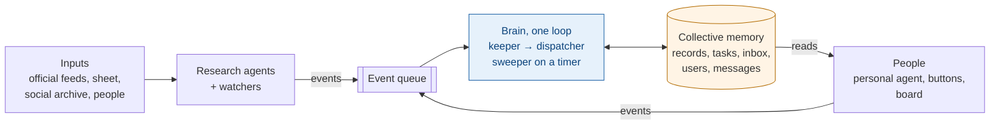

# Disaster Deck system design

| | |
|---|---|
| Version | 3.2, 18 Nov 2026 (v3.1 plus D-0016: photos attach-only) |
| Status | **Locked.** v3 merged 17 Nov (#2). Dan is the only voter |
| Owner | Dan Vu. He owns the fork and decides alone |
| Replaces | Multiplayer Disaster Deck v2 (14 Nov) |
| Built state checked against | `main` @ `9d1ca24` |
| Whiteboard | [Planned vs built](https://claude.ai/artifact/L5faK5xgBt6R3Tz5k9P7eJ) |

To change this file after it is locked: open a `design` issue, write a record in `docs/decisions/`, and merge both in a `design/` PR **before** any code that depends on the change.

---

## 1. The system in one paragraph

Everyone talks only to their own agent. Agents never talk to each other. Every fact becomes an **event** in one queue. The **Brain** takes events one at a time. Its **memory keeper** turns them into records, and its **dispatcher** ranks the work, picks a person and asks a coordinator before anything risky happens. When an accepted task goes wrong, the person tells their agent, and the dispatcher's **help desk playbook** re-plans by rule. Screens and agents only read memory. They write by posting events.



## 2. Invariants (do not break these)

1. **Agents never talk to each other.** What one agent learns reaches another only after the keeper has written it as a record.
2. **One writer per collection** (§4.2). Everything else posts an event.
3. **Rules allocate, the LLM explains.** Merge, scoring, assignment, escalation and timers are plain code in `lib/rules/` and `workers/`. The LLM extracts fields, drafts text and files events through tools. It never picks who goes where.
4. **High-risk work waits for a coordinator.** Rescue dispatch, evacuation plans and big supply moves are `waiting_approval` until a coordinator answers. The desk never approves by itself.
5. **The desk works without the LLM.** Every task card has Accept, Decline, Done and Problem buttons that post events directly.
6. **Outside text is data, never an instruction.** Research agents can only emit schema-checked events.
7. **The actor comes from the login**, never from the request body.
8. **Every vendor sits behind a port** (§4.5), so a compliant provider can be swapped in without touching the Brain.

## 3. Components

Status: **built** = works as designed in v2. **changed** = built, but differs from v2. **not built** = designed in v2, missing from the code. **added** = built, but not in v2. **Target** is where the redesign takes it (§6).

### 3.1 Inputs and research agents

| Component | Code | Status | Today | Target |
|---|---|---|---|---|
| X agent | `workers/x-agent.ts`, `agents/research/x-extract.ts` | changed | Replays the 43-post real archive (`data/replays/`) or the synthetic file. No live search | Optional feed with a written agency policy. Archive replay for demos |
| News agent | `workers/news-agent.ts`, `agents/research/news-search.ts` | changed | Claude web search tool (not Exa), `news` and `official` channels | Official feeds only: NWS, FEMA, USGS, agency announcements. Open-web search later behind a port (D-0009) |
| Sheet sync | `workers/sheet-sync.ts` | built | Two-way shelter sheet, no LLM, never overwrites a row a person changed in the last 5 min | Keep as an integration, not a dependency |
| Satellite watcher | `workers/satellite-watcher.ts` | built | Cached NASA Black Marble + POWER → silent-zone and cold `alert` events | Keep |
| Quake watcher | `workers/quake-watcher.ts` | added | Replays the USGS catalog, posts aftershock warnings | Keep. Add NOAA/NWS and OpenFEMA feeds. Owner needed (upstream #17) |
| Scenario player, synthetic feed | `workers/scenario-player.ts`, `workers/synthetic-feed.ts` | added | Demo cues sent through the real event API | Demo and tabletop exercises only |
| Instagram, Facebook, Reddit agents | — | not built | APIs closed (FB Groups API removed 2024, Reddit blocks the crawler) | Cut |
| Photo agent (shelter whiteboard photos) | — | not built | — | Deferred (D-0012) |
| Evacuation planner | — | not built | The keeper accepts and stores a `plan` event and the coordinator can approve it, but nothing creates one | Deferred. The `plan` path stays (D-0011) |

### 3.2 Queue and Brain

| Component | Code | Status | Notes |
|---|---|---|---|
| Event queue | `events` collection, `postEvent()` in `lib/db.ts` | built | Lane 0 (people, sweeper) before lane 1 (sources), oldest first. Unique `dedupeKey`. `lockedAt`, 3 attempts, then `failed` |
| Brain loop | `workers/brain.ts` | built | Take one event → keeper → dispatcher. Sweeper every 5 s |
| Brain lease | `acquireLease()` in `workers/brain.ts` | added | 15 s lease in `meta`. One Brain per database |
| Memory keeper | `workers/memory-keeper.ts` | built | Handles all 11 event types (`HANDLED`) |
| Dispatcher | `workers/dispatcher.ts`, `lib/rules/` | built | Tier, score, `pickPerson()`, approvals, `one_open_task` unique index |
| Help desk playbook | `lib/rules/incidents.ts` | built | One rule per incident kind (§5.4) |
| Sweeper | `workers/sweeper.ts` | built | No answer, missed ETA, unreachable, stuck events, stale facts |

### 3.3 People, agents and screens

| Component | Code | Status | Today | Target |
|---|---|---|---|---|
| Personal agents | `agents/personal/turn.ts`, `tools.ts`, `prompts.ts` | changed | Claude Sonnet 5.5 through `modelFor()`. Tools per role (`ROLE_TOOLS`). No memory of their own | gpt-oss-120b via OpenRouter, US-only routing (D-0003) |
| Chat memory | `agents/personal/memory.ts`, `agents/desk/chat-memory.ts` | added | Haiku folds old lines into a rolling summary stored in Mongo | Keep, on the small model |
| Agent extras | `visualize_metric`, `show_on_map` | added | Numbers come from `components/metrics/compute/`, never the model | Keep |
| Help-desk lookup | `web_search` in `toolsFor()` | changed | Claude web search, offered only with an open incident | A fixed per-desk directory of tow, tire, fuel and pharmacy contacts (D-0009) |
| Voice | `components/field/`, `components/talk/`, `agents/shared/voice.ts` | changed | Web Speech on `/field` (Chrome sends audio to Google by default). ElevenLabs Scribe and TTS on `/talk` | Transcribe + Polly behind a voice port. On-device dictation only (D-0005) |
| Screens | `app/` | changed | `/` Desk, `/agent`, `/map`, `/ops`, `/coordinator`, `/field`, `/talk`, plus `/v2`, `/compare`, `/demo`, `/lab` | Rebuilt in USWDS (D-0001). One screen set (closes upstream #34) |
| Map evidence | `components/map/`, `public/data/` | added | Maxar before/after tiles, HOT/OSM buildings, NASA atlas | Keep, on MapLibre only (D-0006) |
| Login | `auth.ts` | changed | Auth.js 5 beta + SSOJet, roles mapped from an env var | Cognito federated to the agency's IdP; Login.gov optional for the public; roles in the database (D-0004) |
| Role request flow | — | not built | Seeded accounts only | Build with the Cognito move |

## 4. Contracts

The TypeScript in `lib/types.ts` and the runtime checks in `lib/schemas.ts` are the source of truth. This section says what may not change without a design PR.

### 4.1 Events

`postEvent()` is the only way in. Types: `report`, `need`, `closure`, `capacity`, `answer`, `approval`, `alert`, `incident`, `claim`, `correction`, `plan`. Sources: `x`, `news`, `sheet`, `nasa`, `person`, `system` (and whatever new feeds add). Status: `pending → working → done | merged | rejected | failed`.

### 4.2 Collections and their only writer

| Collection | Only writer |
|---|---|
| `events` | Anyone, insert only, through `postEvent()`. The keeper changes status |
| `sites`, `needs`, `roads`, `shelters`, `zones`, `incidents` | Memory keeper |
| `tasks`, `inbox` | Dispatcher (playbook and sweeper are part of it) |
| `users`, `messages` | The app's API (login, heartbeat, chat). Chat memory folds `messages` |
| `meta` | Brain (lease, desk version, loop time) |

Every document carries `deskId`. Every record keeps a `history` (who, when, source, reason).

### 4.3 HTTP API

| Route | Who may call |
|---|---|
| `POST /api/events` | Signed-in person (as themselves, source `person`) or a worker with `x-agent-key` |
| `GET /api/board`, `/api/inbox`, `/api/users`, `/api/events?since=` | Signed-in person by role, or agent key |
| `POST /api/chat`, `GET /api/chat/token` | Signed-in person |
| `GET /api/health` | Open, counts only |
| `/api/docs`, `/api/openapi.json` | Open spec (`lib/openapi.ts`) |

`?user=` demo identity works only with `DEMO_MODE=1` **and** a local request (`lib/localDemo.ts`). Target: impossible to turn on in a production build, not just off by env var.

### 4.4 DeskPort

Agents and workers reach memory only through `DeskPort` (`agents/desk/port.ts`): `getUser`, `listUsers`, `getBoard`, `getUserContext`, `recentEvents`, `postEvent`, `saveMessage`. Two implementations: `lib-desk.ts` (MongoDB) and `http-desk.ts` (over the API). `fixture-desk.ts` is for tests.

### 4.5 Provider ports (target)

Every outside vendor gets a narrow interface so an agency can require a different one.

| Port | Today | Target default | Fallback |
|---|---|---|---|
| LLM (`modelFor()` / `send()` in `agents/shared/llm.ts`) | Anthropic SDK | OpenRouter, gpt-oss-120b, gpt-oss-20b for small jobs | Same open model on Bedrock |
| Web search | Claude web search tool | None: official feeds and a contact directory (D-0009) | Brave Search API, when a real pilot needs it |
| Speech to text | Web Speech, ElevenLabs Scribe | Chrome on-device (`processLocally: true`) for dictation, Amazon Transcribe on the server | Typing |
| Text to speech | ElevenLabs | Amazon Polly | ElevenLabs for Government, if the agency approves it |
| Identity | SSOJet | Cognito → agency Entra ID or Okta | Login.gov for the public |
| Basemap | Mapbox or Esri gray | Esri, US-hosted | Our own OSM tiles on S3 |
| Messaging | none | None for the pilot (D-0013) | AWS End User Messaging / SNS once a county signs on; IPAWS on the roadmap |

## 5. Rules

### 5.1 Priority

Tier first, then score. Tier 0 = danger to life, 1 = urgent, 2 = comfort. Tier always wins.

```
score = 10 × distinct reporters (max 50) + minutes waiting (max 60)
      + 30 if in a NASA silent zone
      + 20 if a warmth need and the NASA POWER night minimum is below 0 °C
```

Copies don't count. Satellite data only raises a score. A coordinator can pin or demote an item with a logged reason. The weights were picked, not validated (§9).

### 5.2 Trust and when a wish becomes work

| Reporter | Need starts as |
|---|---|
| `official` or `vetted` | `open` |
| `public`, no danger to life | `proposed`. Opens at 3 distinct reporters or one trusted confirmation |
| Anyone, danger to life | Never waits: a call task to verify goes out at once |

Conflicting facts: higher trust wins, then the newer `observedAt`. The loser stays in history. A social post alone can never approve, close or cancel anything.

### 5.3 Picking a person

Same desk and a fitting role → has what the task needs → seen in the last 3 min with fewer than 3 open tasks → not already tried. Then nearest, then fewest open tasks. Nobody fits → `escalated`. Three tries → `escalated`.

### 5.4 Help desk playbook

| Incident | The Brain does | Coordinator gets it when |
|---|---|---|
| `vehicle_breakdown` | Block task, reopen need, relay or fresh delivery, `assist` task, new ETA to whoever waits | Nobody can replace it, or the need is life-threatening |
| `road_blocked` | Unconfirmed closure, notify everyone on that road | No other road |
| `cannot_find` | Pause, site back to `not_called`, volunteer verifies | Second failure |
| `short_supply` | Partial goes ahead, the rest reopens | Nobody has stock |
| `unsafe`, `injury` | Block, flag hazard, warn, propose rescue (needs approval) | Always, critical |
| `unreachable` | Opened by the sweeper. Treated like a breakdown | Always |
| `handover` | Open tasks move to the next person with notes | — |
| `other` | Nothing automatic | Always |

### 5.5 Lifecycles

Task: `created → waiting_approval | assigned | escalated → accepted | declined | timed_out → done | blocked → cancelled`. Need: `proposed → open → assigned → on_the_way → delivered | cancelled`. Incident: `open → helping | escalated → resolved`. Full diagrams: `Final system design.md` §4. They did not change.

## 6. Target stack

Decided by Dan on 17 Nov 2026. Each one has a record in `docs/decisions/`. Reasoning and vendor comparisons: the "Stack review" tab of the DisasterDeck HQ doc.

| # | Layer | Decision | Replaces | Record |
|---|---|---|---|---|
| 1 | Frontend | USWDS (react-uswds) on Next.js + React. motion and liquid-gooey only behind demo mode. axe in CI | shadcn/Radix | [D-0001](decisions/0001-frontend-uswds.md) |
| 2 | Hosting | AWS, ECS Fargate across availability zones, infrastructure as code, GovCloud later with no code change | One Vultr VM | [D-0002](decisions/0002-hosting-aws-fargate.md) |
| 3 | LLM | No Claude. OpenRouter US-only endpoint, gpt-oss-120b (gpt-oss-20b for small jobs), behind `modelFor()`. Bedrock is the fallback | Anthropic API | [D-0003](decisions/0003-llm-openrouter-gpt-oss.md) |
| 4 | Identity | SSOJet out. Cognito federated to agency IdPs. Reports need no login. Login.gov optional. Roles in the database | SSOJet + env-var roles | [D-0004](decisions/0004-identity-cognito.md) |
| 5 | Voice | Transcribe + Polly behind a voice port. Dictation on-device only, typing as fallback, never Google's cloud path | ElevenLabs, Web Speech cloud path | [D-0005](decisions/0005-voice-transcribe-polly-on-device.md) |
| 6 | Maps | MapLibre only. Esri basemaps, own OSM tiles on AWS as fallback | Mapbox, Leaflet | [D-0006](decisions/0006-maps-maplibre-esri.md) |
| 7 | Database | Keep MongoDB on a new Atlas cluster Dan owns. Atlas for Government when an agency needs it. Thin repository layer keeps DocumentDB possible | Darshal's hackathon cluster | [D-0007](decisions/0007-database-mongodb-atlas.md) |
| 8 | License | AGPL. Anyone may run it. The business sells hosting, setup, training and support | No license | [D-0008](decisions/0008-license-agpl.md) |
| 9 | Web search | Official feeds only for the pilot; Brave behind a search port later | Claude web search | [D-0009](decisions/0009-web-search-official-feeds.md) |
| 10 | Queue | Keep polling MongoDB; change streams when load needs it | — | [D-0010](decisions/0010-queue-keep-polling.md) |
| 11 | Evacuation planner | Deferred; the `plan` approval path stays | — | [D-0011](decisions/0011-evacuation-planner-deferred.md) |
| 12 | Photo agent | Deferred until a pilot runs shelters | — | [D-0012](decisions/0012-photo-agent-deferred.md) |
| 13 | SMS, offline | Deferred; 10DLC when a county signs on; IPAWS on the roadmap | — | [D-0013](decisions/0013-sms-offline-deferred.md) |
| 14 | Observability | CloudTrail, CloudWatch, app audit log in MongoDB | Health scripts | [D-0014](decisions/0014-observability-audit.md) |
| 15 | CI to AWS | GitHub Actions with OIDC, Secrets Manager, deploy by tag | Tailscale + rsync | [D-0015](decisions/0015-ci-github-oidc.md) |
| 16 | Photos | Photos attach to the event (`photoUrl`) and a coordinator looks at them; no model reads image bytes for the pilot | "not kept on the desk" | [D-0016](decisions/0016-photos-attach-only.md) |

**First pilot:** an IU Emergency Management tabletop exercise (no real data, so no compliance paperwork). Monroe County and Maui are on hold.

## 7. Plan (v2) vs built vs target

| Decision | v2 plan, 14 Nov | Built, 17 Nov | Target |
|---|---|---|---|
| LLM | OpenAI (track rule) | Claude Sonnet / Opus / Haiku | gpt-oss on OpenRouter |
| Web search | Exa | Claude web search | Official feeds only (D-0009) |
| Voice | OpenAI speech to text | Web Speech + ElevenLabs | On-device dictation, Transcribe + Polly |
| Scene | Malatya, then Lahaina | Antakya pilot only | IU tabletop, then a county |
| Social inputs | X, Instagram, Facebook, Reddit | X archive only | X optional, official feeds first |
| Evacuation | Flow planner on an OSM graph | Approval path only | Deferred (D-0011) |
| Dispatcher | Rules, no LLM | Rules, no LLM | Unchanged |
| Agent memory | None of its own | Collective, plus rolling summary | Unchanged |
| Hosting | Laptop + tunnel, Vultr optional | Vultr VM, Cloudflare tunnel, WARP, blue/green deploy | AWS Fargate |
| Login | SSOJet | SSOJet via Auth.js | Cognito + Login.gov |

## 8. Open decisions

None. The seven calls left open in v3 were decided on 17 Nov as D-0009 to D-0015 (§6). A new open question becomes a `design` issue on the fork.

**Also settled:** Dan owns `disasterdeck.us` (registered at Porkbun, DNS on Cloudflare). It moves with the site to AWS under D-0002.

## 9. Known limits

- One Brain process behind a lease. It does not scale across machines.
- Priority weights were never validated against real outcomes.
- Supplier stock is static seed data.
- No offline or SMS: people in a silent zone can't use the app. The desk reaches them through field teams.
- Rate limits are in memory per process. The Mongo-backed checks don't run in CI.
- `agent_fidelity` and `triage_order` have no ground truth (upstream #28).
- Personal agents read a cached board, so they can be one event behind.

## 10. Upstream issues this design settles

These are issues on the upstream hackathon repo `DarshalShetty/HackTheNest26`. The fork tracks its own work in its own Issues from now on.

| Upstream | Title | In this design |
|---|---|---|
| #13 | Confirm voice stays browser-side | Settled by D-0005: on-device only. The README claim was wrong |
| #14 | `/api/chat` needs `ANTHROPIC_API_KEY` | Obsolete after D-0003 |
| #32 | Pick one city | Antakya stays the demo data. The pilot is the IU tabletop |
| #34 | v1 or `/v2` screens | Obsolete: both are replaced by the USWDS rebuild |
| #39 | Deploy to Vultr | Obsolete after D-0002 |
| #17 | Quake watcher has no owner | Settled: Dan owns everything on the fork |
| #28 | Ground truth for two agent metrics | Still open (§9) |
| #9, #12, #29, #30, #31, #33, #36, #38 | Demo-day items | Hackathon only, no design impact |

## 11. Glossary

| Term | Meaning |
|---|---|
| Desk | One disaster's workspace. Every document carries its `deskId` |
| Event | One new fact in the queue. The only way anything enters memory |
| Record | A site, need, road, shelter, zone or incident. Written only by the keeper |
| Brain | The one loop: memory keeper, then dispatcher, sweeper on a timer |
| Memory keeper | Turns events into records. Merges duplicates. Logs history |
| Dispatcher | Ranks work, picks people, writes tasks and inbox items, holds risky work |
| Help desk | The dispatcher's playbook for incidents. Not a separate agent |
| Sweeper | Timer checks: no answer, missed ETA, unreachable, stale facts, stuck events |
| Incident | Something went wrong after a task was accepted |
| Lane | Queue priority: 0 for people and the sweeper, 1 for outside sources |
| Tier | 0 danger to life, 1 urgent, 2 comfort |
| Silent zone | Heavy damage + power out + few calls. Raises every score inside it |
| Trust | `official`, `vetted` or `public`. Granted, never self-chosen |
| Confidence | `confirmed`, `corroborated` (3+ independent public sources) or `unconfirmed` |
| Context file | `users.profile` plus `messages`. What a personal agent loads each turn |
| Port | A narrow interface in front of an outside vendor |
