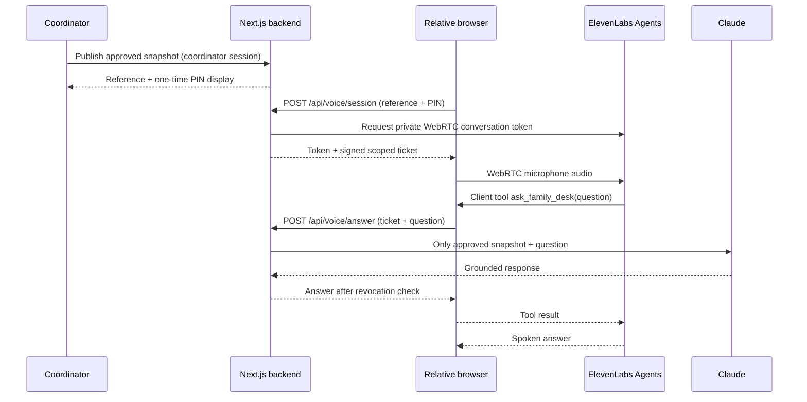

# Family voice demo

Relatives can speak to a browser-based ElevenLabs voice assistant that reads a coordinator-approved update through Claude. This implementation does **not** receive calls to a normal telephone number. No Twilio account, purchased number, tunnel or desktop application is required for the browser demo.

## Run on your workstation

1. Use Node 22+ and `npm ci`. Copy `.env.example` to `.env.local` if it does not exist. Do not overwrite a teammate's existing settings.
2. Set `ANTHROPIC_API_KEY`, `ELEVENLABS_API_KEY` and a randomly generated `FAMILY_VOICE_SECRET` of at least 32 characters in `.env.local`. These are server-only secrets. Obtain your own keys or receive the team's keys privately; Git does not contain them.
3. Run `npm run voice:setup`. This creates a private ElevenLabs agent and its client tool, and writes their IDs into ignored `.env.local`. Rerunning updates the same agent. It disables provider audio recording, sets transcript retention to one day, limits concurrency to two and daily conversations to 30. Creation/configuration requires Agents permission on the API key. Speech and model usage consume provider credits.
4. Run `npm run demo -- --port 3675`. Open [coordinator updates](http://127.0.0.1:3675/coordinator/family?user=coordinator-duty).
5. Select a case, enter a **fictional** shareable update and its observation timestamp, approve the sharing checkbox and publish. Record the reference and eight-digit PIN, which appears only once. Demo records without MongoDB exist only in server memory and disappear on restart. Existing fixture site labels may still be legacy Malatya placeholders; they are not real Antakya person records.
6. Open [family voice](http://127.0.0.1:3675/family), enter that reference and PIN, click **Sesli ara** and allow microphone access. Ask in Turkish or English. Use headphones to avoid feedback. End the call to release the microphone. Calls last at most ten minutes. Browser microphones require localhost or HTTPS; plain HTTP on another machine's IP is insufficient.

With `MONGODB_URI`, updates persist in the separate `family_voice` collection of `MONGODB_DB`. Existing operational records are read-only to this feature. A signed-in coordinator is required outside the loopback demo; query-string users do not bypass authentication over the network. Existing site desk IDs must match the coordinator's desk. Set `DEMO_MODE=0` for real operation and `PUBLIC_APP_URL` to the exact HTTPS origin behind a proxy. The local demo identity is not production authentication.

## What information is shared

An operational site does not identify a person or establish a caller's relationship to them. The coordinator must verify identity, permission and the intended recipient outside this feature before issuing access. There is no public name search, broad board access or automatic disclosure of reports, phone numbers, addresses, health information, internal notes or other families' records. The coordinator writes an explicitly approved, time-stamped snapshot; operational changes do not silently alter that snapshot. Revoke the old grant and publish a new one when the facts change.

The assistant says when the information was observed, acknowledges unknown/stale information and labels synthetic demo records. It cannot contact a human, promise rescue, dispatch a team or write to Brain records. Grant expiry is 24 hours; each signed answer session expires after ten minutes. Revocation is checked again on every answer, including after the model returns. Previously disclosed information cannot be withdrawn from a caller's memory or an ongoing provider conversation.

## Request flow



ElevenLabs handles speech recognition, voice playback and conversational turn-taking. Its own routing model chooses the client tool; **Claude on our backend generates the scoped case answer** through the existing spend meter. This is not a direct Claude-only speech pipeline. Access tickets stay in memory, not URLs or localStorage. The backend stores a salted PIN hash, never a retrievable plaintext PIN. A capability holder can access only the published snapshot; the PIN is not proof of legal kinship. API keys remain server-side. Our app does not save audio or transcripts; ElevenLabs processes speech/tool outputs and retains conversation text under the configured one-day policy. Anthropic receives the question and approved snapshot under its API data policy. Do not demo with real private victim information.

## Verification

Verified on 15 November 2026 at 03:34 EST after integrating team main through `f12bd23`: eight voice access tests, seven historical replay tests, TypeScript, full ESLint, design-token checks and production build pass. Synthetic live tests obtained a private ElevenLabs token, returned scoped Claude answers (including a hostile question) and blocked an existing ticket after revocation. Headless Edge connected with a synthetic microphone and exercised publishing, PIN entry, actual WebRTC, the Claude client tool, provider agent responses, mute and explicit end without page errors. Human speaking/listening acceptance and shared Atlas persistence were not performed.

The updated lockfile also passed a fresh `npm ci --ignore-scripts --no-audit --no-fund` in an isolated cache directory (376 packages); it does not require the original workstation's pre-existing node_modules.

```sh
npm run check:voice      # no provider calls, no MongoDB writes
npx tsc --noEmit
npx eslint
npm run build
# Optional, with the local demo server running; consumes two small Claude requests:
npm run voice:smoke
```

The live smoke test refuses MongoDB storage, creates one synthetic update in memory, obtains a private ElevenLabs token, asks a normal and a hostile question, then revokes access and checks that the existing ticket fails. It prints only synthetic answers, never PINs, session tokens or credentials. It does not prove microphone/audio quality or a completed phone call. Manual acceptance: publish → enter reference/PIN → speak → hear a grounded answer → mute/unmute → end, then revoke and verify no new case answer can be obtained. Also test permission denial and browser navigation during connection.

## Connecting a real telephone later

Incoming PSTN calls require a provider such as Twilio with an active inbound number, or an existing SIP trunk, plus a public HTTPS service. The current **client tool needs the browser** and will not run during a standalone phone call. Replace it with a signed server webhook or private custom LLM endpoint, bind the verified caller to a scoped grant server-side, and implement telephone PIN entry/identity checks before connecting the number. Do not put a full board or victim directory in an agent prompt. Telephone charges, number provisioning and caller verification have not been configured or tested here.

For public deployment, use a shared rate-limit store rather than the current single-process limiter, add abuse monitoring and a reviewed recipient-verification process, validate actual Atlas permissions and provider retention settings, and perform a real two-way audio acceptance call. The existing spend meter applies to Claude; ElevenLabs account limits are separate. Voice/model mistakes remain possible, so this demo cannot be used as an emergency-status authority.

Primary integration references: [ElevenLabs JavaScript SDK](https://elevenlabs.io/docs/eleven-agents/libraries/java-script), [Agents API](https://elevenlabs.io/docs/api-reference/agents/create), [Twilio integration](https://elevenlabs.io/docs/eleven-agents/phone-numbers/twilio-integration).
