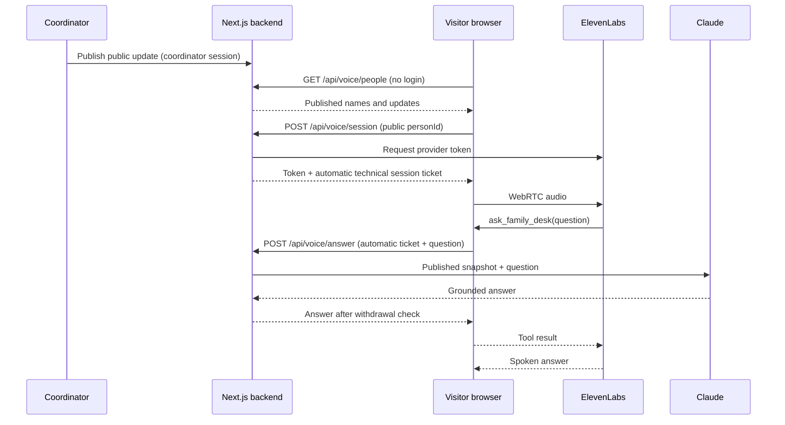

# Family voice demo

For a fresh teammate workstation, use the [shared-demo setup checklist](family-voice-team-setup.md).

Anyone can search published family updates by name, read them immediately and start an ElevenLabs conversation backed by Claude. **No account, reference code, PIN or relationship verification is required to read or call.** Coordinators still sign in to publish or withdraw updates. This browser demo does not receive calls to a normal telephone number.

The family interface, timestamps, service messages, voice greeting and responses use English. The voice and Claude configurations explicitly keep responses in English even if a caller requests another language. Run `npm run voice:setup` after pulling this version to update an existing provider agent; restart the app and start a new call to use the new settings.

## Run locally

1. Use Node 22.18+ or 24 and `npm ci`. Preserve your existing private `.env.local` settings.
2. Set `ANTHROPIC_API_KEY`, `ELEVENLABS_API_KEY` and a random `FAMILY_VOICE_SECRET` of at least 32 characters. Secrets are intentionally absent from Git.
3. Run `npm run voice:setup`. This creates/updates the private ElevenLabs provider agent and browser tool, saving IDs in ignored `.env.local`. The key needs Agents permission. Provider audio recording is disabled, transcript retention is one day, concurrency is two and the daily call limit is thirty. Calls consume provider credits.
4. Run `npm run demo -- --port 3675`. At [coordinator updates](http://127.0.0.1:3675/coordinator/family?user=coordinator-duty), select a case, enter a fictional display name/update and its observation timestamp, then publish. The update is now public.
5. Open [family voice](http://127.0.0.1:3675/family), search the name, read the update and select it. Click **Start voice call**, allow the microphone and speak in English. You can also type during a call. No access code is issued or requested. Mute/end controls are available; calls last at most ten minutes.

Browser microphones require localhost or HTTPS. Without `MONGODB_URI`, demo publications use temporary memory and disappear on restart. Legacy fixture site labels are synthetic, not verified Antakya person records.

With MongoDB, updates persist in `family_voice` in `MONGODB_DB`. Real coordinator authentication is required to publish outside the loopback demo; query-string users cannot bypass network authentication. Sites must belong to that coordinator's desk. Set `DEMO_MODE=0` for real operation and `PUBLIC_APP_URL` to the exact external HTTPS origin behind a proxy.

## Add more examples

Use [coordinator updates](http://127.0.0.1:3675/coordinator/family?user=coordinator-duty): select an existing case, enter the searchable display name and the exact facts to share, set when those facts were observed, then press **Publish approved update**. Refresh `/family` and search the name. Use **Withdraw publication** to remove an outdated example.

Seven fictional examples with English summaries are included in `data/family-voice-examples.json`: Ayşe (callback inquiry), Emma Wilson (shelter registration), Daniel Brooks (unverified missing-person inquiry), Olivia Bennett (pending transport), Noah Carter (family check-in), Sophia Reed (old observation) and James Parker (pending equipment request). With the local demo running, load them using:

```sh
npm run voice:examples
# Another local port:
npm run voice:examples -- --url http://127.0.0.1:3672
```

The loader uses temporary memory only, skips already active matching names, and makes no paid model/audio calls. Run it again after a server restart. To add reusable examples, append entries to the JSON using the existing format (`alias`, `siteIndex`, `observedMinutesAgo`, `summary`); keep the `FICTIONAL DEMO:` label. Observation times are calculated when loading. For a configured MongoDB backend, add records through the coordinator screen instead.

Try asking in English: "Where was Emma Wilson last registered?", "Has Olivia's transport been confirmed?", "How recent is Sophia Reed's information?", or "Do you have any verified information about Daniel Brooks?" The entire family interface, voice greeting and answers are in English. The assistant continues in English even if a question or source update is in another language.

## Public information flow

The anonymous directory exposes active published names, summaries, source/publication/expiry timestamps and demo labels. It excludes operational notes, source phone numbers, provider credentials and legacy PIN hashes. Everyone can read published updates; coordinators control publication. Previously published updates also become public in this version. No database migration is needed: old PIN fields are ignored and excluded from responses.

Publications expire after 24 hours and can be withdrawn. Operational changes do not silently alter a published snapshot: withdraw and republish when facts change. Unknown, stale and synthetic information stays explicit. The agent cannot dispatch teams, write Brain records, invent a person's condition or promise rescue. Name search lists possible records instead of guessing between identical names.



A public record ID identifies the selected person; it is not a credential. The browser manages provider tokens and ten-minute technical tickets automatically. Users never enter an authorization code. These sessions bind answers to the selected record and control provider use; they do not verify identity or kinship. Withdrawal is checked before and after every Claude request. Already disclosed information cannot be removed from an ongoing conversation's memory.

ElevenLabs handles speech recognition, playback and turn-taking. Its routing model calls the browser tool; Claude generates the case answer through the existing spend meter. Keys stay server-side and tickets remain in memory, not URLs/localStorage. Our app saves no audio/transcripts. ElevenLabs processes speech/tool results with one-day transcript retention; Anthropic receives the question and published snapshot under its API data policy.

## Verification

Public-flow verification, 15 November 2026 at 03:51 EST: nine automated voice tests, TypeScript, full ESLint and an isolated production build passed. Headless Edge verified anonymous name search, an unknown name, selecting a public record, actual WebRTC with a synthetic microphone, a real Claude tool answer, mute and end without any reference/PIN entry or page errors. The new session request contains only the selected public record ID.

```sh
npm run check:voice
npx tsc --noEmit
npx eslint
npm run build
# Optional live-provider test with the memory demo running:
npm run voice:smoke
```

Automated checks cover anonymous directory access, PIN-free session creation, public field projection, withdrawal, expiry, technical ticket integrity, body size, same-origin handling and API registration. The live smoke test refuses MongoDB storage, publishes synthetic data, discovers it anonymously, starts without caller credentials, asks two Claude questions and checks withdrawal. It never prints provider keys or session tokens.

The original voice version passed live-provider and headless Edge tests with a synthetic microphone, actual WebRTC, the Claude tool, mute and end. Human speech/listening quality and shared Atlas persistence require separate acceptance. Manual public-flow acceptance: signed-out `/family` → search → select → call without codes → hear the timestamped answer → end. Check unknown names, identical names, empty results and withdrawn updates.

## Telephone calls later

Incoming PSTN calls require a provider number (such as Twilio) or SIP trunk and a public HTTPS service. The browser client tool cannot run in a standalone telephone call. Replace it with a signed server tool/custom LLM integration, support spoken public-name selection, then connect the number. Caller PINs are not part of this public flow. No number was purchased or connected.

For multiple server instances, replace the in-process limiter with a shared store and validate Atlas permissions/provider limits. Claude's spend meter and ElevenLabs account limits are separate.
