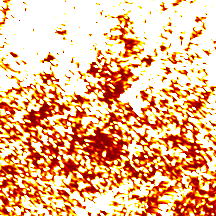

# Malatya NASA evidence · v1

The map contains two synthetic 500 m demo cells inside longitude 38.29–38.35 and latitude 38.33–38.39. The retrospective scene is 11 February 2023 at 09:00 Türkiye time. Source products were retrieved on 14 November 2026. Their processing versions reflect the present archive. The exact 2023 publication times are unavailable.

| Input | Observation dates and native scale | Decision supported by this cache |
|---|---|---|
| ARIA, Sentinel-1 radar coherence change | 10 February 2023, about 30 m | Colored surface-change overlay. Valid unflagged coverage is unresolved. Normalized `damage` stays unknown. |
| Black Marble, Suomi NPP VIIRS gap-filled BRDF-corrected radiance rendering | 3 January and 8 February 2023, about 500 m | Both city cells reach the white end of the display scale. `dark` stays unknown. |
| POWER, MERRA-2 `T2M_MIN` | 6–10 February 2023, 0.5° × 0.625° regional meteorology | 9 February minimum **−14.38 °C**, `cold: true`. Both cells share this regional observation. |

ARIA describes yellow-to-red pixels as increasing radar coherence change and warns about vegetation and mountains. Its four-band rendered image has transparent background pixels. Their validity cannot be resolved from this export. `flaggedOverlayFraction` measures colored pixels over the whole demo cell and is retained separately from normalized damage. [ARIA service metadata](https://gis.earthdata.nasa.gov/portal/rest/services/DISASTERS_202302_EARTHQUAKE_TURKIYE/2302_opera_dpm/ImageServer)

The GIBS layer identifies gap-filled BRDF-corrected Suomi NPP radiance with a 500 m tile matrix. Its linked colormap maps values **at or above 38.2 nW/(cm² sr)** to white. A white pixel therefore gives a clipped displayed value. Both selected cells are fully white in the after image. Rendered alpha coverage also omits the original product's cloud, snow and retrieval-age quality flags. This comparison leaves a power outage unresolved. [GIBS capabilities](https://gibs.earthdata.nasa.gov/wmts/epsg4326/best/1.0.0/WMTSCapabilities.xml), [linked colormap](https://gibs.earthdata.nasa.gov/colormaps/v1.3/VIIRS_DayNightBand_At_Sensor_Radiance.xml), [NASA product specification](https://ladsweb.modaps.eosdis.nasa.gov/filespec/VIIRS/2/VNP46A2_v2.0.fs)

POWER returns −3.49, −9.56, −10.79, −14.38 and −11.04 °C for 6–10 February. These daily values use local solar time (LST). The worker uses an end-of-product-date UTC label for `observedAt` and preserves the original date and LST in the map evidence. The value describes regional weather. [Recorded POWER query](https://power.larc.nasa.gov/api/temporal/daily/point?parameters=T2M_MIN&community=RE&longitude=38.31&latitude=38.35&start=20230206&end=20230210&format=JSON), [POWER spatial-resolution guidance](https://power.larc.nasa.gov/docs/services/)

| ARIA · 10 February | Lights · 3 January | Lights · 8 February |
|---|---|---|
|  |  |  |

## Zone output and call provenance

| Zone ID | Source posts | Distinct synthetic original calls | Colored overlay area | `damage` / `dark` / `silentZone` |
|---|---|---|---|---|
| `malatya-turuncu` | 4 | 1 | 76.875% | unknown / unknown / unknown |
| `malatya-mor` | 1 | 1 | 40.9375% | unknown / unknown / unknown |

The call window is replay seconds `[0,20)`. `data/nasa/analysis-config.json` maps four Ayşe reposts to one original call. These are sample counts from the synthetic replay. They provide no estimate of total reports from Malatya.

The candidate rule requires damage ≥0.20, darkness with a displayed-brightness ratio ≤0.60, and at most one distinct call. Brightness comparisons additionally require ≥80% rendered coverage, baseline brightness ≥10/255 and ≤20% saturation. These thresholds are demo choices. The cached evidence produces **two cold alerts and zero silent-zone alerts**.

`/data/zones.geojson` includes IDs, polygons, source URLs, dates, native scales, thresholds, counts, cold flags and quality details. Unknown evidence is JSON `null`. Role 3 should display it as unknown. The shared database `Zone` interface requires numeric/boolean fields, so the evidence GeoJSON should be consumed as a separate nullable map format. The watcher posts only the existing `AlertPayload` fields through the event API.

## Independent check

DHA documented the collapse of Yeni Cami on 6 February 2023 at 10:47 Türkiye time. The public OSM landmark is at longitude 38.3181102, latitude 38.3495353. The surrounding 500 m cell has 98.2143% colored overlay area, consistent with surface change in a location with reported damage. The night-light rendering there is also saturated. The comparison supports a coarse location check and leaves nighttime power conditions unresolved. Numerical results and the landmark reference are saved in `data/nasa/validation.json`. [DHA field report](https://www.dha.com.tr/gundem/malatyada-depremde-yeni-cami-de-yikildi-2201455), [OpenStreetMap landmark](https://www.openstreetmap.org/way/296572992)

## Reproduce and run

Use Python 3.10+ with `scripts/requirements-nasa.txt` and Node.js 22.18+ or 24. From the repository root, run the preparation script against the committed cache.

```sh
python scripts/prepare-nasa.py
python scripts/nasa-evidence.test.py
node workers/satellite-watcher.ts --dry-run
node --test scripts/satellite-watcher.test.mjs
```

Use `--download` to fetch missing inputs or `--refresh` to replace the cache deliberately. The manifest retains source URLs, SHA-256 hashes and original download file timestamps across offline rebuilds. The cache's `.gitattributes` preserves downloaded bytes across Git checkouts on Windows and Linux.

Once Role 1's event API is running with `AGENT_KEY` in `.env.local`, run one observation batch. Set `BASE_URL` when the API is hosted elsewhere.

```sh
node --env-file=.env.local workers/satellite-watcher.ts
```

Each event has a key derived from desk, zone, alert kind, observation and dataset version. The sender retries network failures, HTTP 429 and server errors up to three times with the same key. A repeated invocation relies on the event API's unique key to return the existing ID. The local HTTP test exercises this contract with a simulated stored event followed by a lost success response. Live MongoDB deduplication, priority changes and coordinator approval remain integration checks for Role 1.

Credit the ARIA team, Copernicus and ESA, NASA GIBS / Black Marble, NASA POWER / MERRA-2, and OpenStreetMap contributors. The event packet also requests the following credit line.

Supported by the Michigan Space Grant Consortium, NASA grant 80NSSC20M0124.
